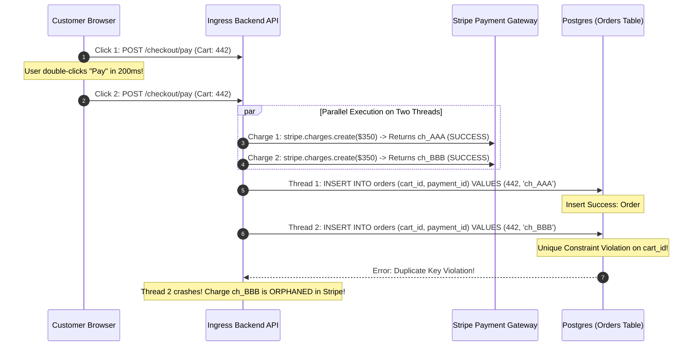

## Fast Revision (10-Second Recall)
- **The Core Paradox:** The customer's credit card statement shows two identical charges of $100 ($200 total), but the database and user portal display exactly one order #1002.
- **Top 2 Root Causes:**
  1. *Client Double-Submit with Distinct Payment Intents:* The user double-clicked "Pay" in 150ms. The first click created PaymentIntent A; the second click created PaymentIntent B. The backend order creation had a unique constraint on `order_id`, so Order #1002 was created linked to Intent A, while Intent B was charged anonymously in Stripe with no order linked to it!
  2. *Retried Checkout Without Gateway Idempotency:* The backend retried an unacknowledged payment without passing the `Idempotency-Key` header to Stripe.
- **Immediate Remediation:** Run an automated audit script that reconciles Stripe charges against database orders, finds unlinked orphaned charges, and issues an immediate automated refund to the customer.
- **Prevention:** Generate the `idempotency_key` client-side upon checkout initialization and disable the submit button immediately upon click.

## The 30-Second Spoken Script
> "When a customer is charged twice but only one order is created, the root cause is almost always an **idempotency gap during payment authorization coupled with a unique constraint on order creation**.
>
> Typically, an anxious user double-clicks the 'Pay' button or experiences a mobile network timeout and retries. Because the checkout button was not disabled immediately, or because the frontend generated a new checkout session on each click, two independent Payment Intents were dispatched to Stripe. Both payments succeeded at the bank.
>
> However, on our backend, our order creation logic enforced an atomic database constraint on the cart or checkout session. The first payment successfully persisted Order #1002, while the second payment's order creation threw a duplicate key violation and was rolled back, leaving the second charge orphaned in Stripe without an associated order.
>
> To resolve the active incident:
> 1. We query Stripe API for charges in the last 24 hours that lack an associated internal `order_id` metadata tag, cross-reference them against user bank disputes, and issue an immediate API refund.
> 2. To prevent recurrence, we generate an immutable `idempotency_key` on the client when the checkout form first renders, disable the submit button on click, and mandate `idempotencyKey` on all payment gateway calls."

## Scenario / Problem Context
An online fashion boutique ran a Cyber Monday promotion. A customer purchased a designer jacket for $350.

The customer clicked "Pay Now." The mobile browser spinner froze for 3 seconds. The customer clicked "Pay Now" a second time. The screen refreshed and displayed:
`"Order Confirmed! Order #99120"`

Twenty minutes later, the customer received two SMS alerts from Chase Bank:
- `Chase Alert: $350.00 charged at FashionBoutique`
- `Chase Alert: $350.00 charged at FashionBoutique`

The customer logged into their order history: only **one order** existed.
The warehouse only shipped **one jacket**.
The customer was charged **$700 total**.

The CFO demands an emergency incident response:
1. How did this happen?
2. How many other customers were double-charged?
3. How do we refund every affected customer automatically?
4. How do we eliminate this permanently in code?

## Architectural Workflow / Sequence


## Deep-Dive Analysis & Root Causes

### 1. The Disconnect Between Gateway State and Database State
In the sequence diagram above:
- Stripe knows about two charges: `ch_AAA` ($350) and `ch_BBB` ($350).
- The internal database only knows about Order #99120 linked to `ch_AAA`.
- `ch_BBB` is an **orphan charge**: money was captured from the customer's bank, but no order, receipt, or warehouse fulfillment record exists in the database.

### 2. Client-Side Double Submissions (Rage Clicks)
If the frontend button does not immediately disable on mousedown:
```typescript
// VULNERABLE: Allows multiple submissions before async promise returns!
<button onClick={() => processPayment()}>Pay Now</button>
```
Two clicks within 200ms dispatch two parallel HTTP requests across two separate TCP sockets. Both requests hit separate Node.js or Go worker pods simultaneously.

### 3. Missing Gateway Idempotency Keys
Stripe, Adyen, and PayPal provide an `Idempotency-Key` HTTP header:
- If you pass the same key (`Idempotency-Key: cart_442`), the gateway recognizes the duplicate.
- It returns the original transaction (`ch_AAA`) without charging the credit card a second time!
- If the developer omits this header, the gateway treats every incoming call as a brand new financial authorization.

## Practical Debugging Commands & Code

### Step 1: Automated Reconciliation and Refund Script for Orphaned Charges
Run this script to find and refund every customer double-charged in the last 24 hours:

```typescript
// scripts/reconcileDoubleCharges.ts
import Stripe from 'stripe';
import { Pool } from 'pg';

const stripe = new Stripe(process.env.STRIPE_SECRET_KEY!, { apiVersion: '2023-10-16' });
const db = new Pool({ connectionString: process.env.DATABASE_URL });

async function refundOrphanedCharges() {
  const client = await db.connect();
  console.log('Auditing Stripe charges against database orders in the last 24 hours...');

  try {
    // 1. Fetch recent charges from Stripe
    const oneDayAgo = Math.floor(Date.now() / 1000) - (24 * 3600);
    const charges = await stripe.charges.list({ created: { gte: oneDayAgo }, limit: 100 });

    for (const charge of charges.data) {
      if (!charge.paid || charge.refunded) continue;

      // 2. Check if charge ID is linked to an existing database order
      const res = await client.query('SELECT id, status FROM orders WHERE payment_id = $1', [charge.id]);

      if (res.rows.length === 0) {
        // ORPHAN DETECTED: Money was charged, but no order exists!
        console.warn(`ORPHAN CHARGE FOUND: ${charge.id} for $${charge.amount / 100} (${charge.billing_details.email})`);

        // 3. Automatically issue full refund
        const refund = await stripe.refunds.create({
          charge: charge.id,
          reason: 'duplicate',
          metadata: {
            automated_remediation: 'true',
            reason: 'Double charge orphan reconciliation',
          },
        });

        console.log(`Successfully refunded orphan charge ${charge.id}: Refund ID ${refund.id}`);
      }
    }
  } finally {
    client.release();
  }
}

refundOrphanedCharges();
```

### Step 2: Full-Stack Solution: Client Button Debounce & Gateway Idempotency
Frontend debounces and creates a client-side idempotency token:

```typescript
// frontend/src/components/CheckoutButton.tsx
import React, { useState } from 'react';

export function CheckoutButton({ cartId, onCheckout }: { cartId: string; onCheckout: (key: string) => Promise<void> }) {
  const [isSubmitting, setIsSubmitting] = useState(false);

  const handleClick = async () => {
    // 1. Instantly disable button on click
    if (isSubmitting) return;
    setIsSubmitting(true);

    try {
      // 2. Deterministic idempotency key tied to this cart version
      const idempotencyKey = `idem_${cartId}_${Date.now()}`;
      await onCheckout(idempotencyKey);
    } finally {
      // Keep disabled until navigation
    }
  };

  return (
    <button onClick={handleClick} disabled={isSubmitting}>
      {isSubmitting ? 'Authorizing Payment...' : 'Pay Now'}
    </button>
  );
}
```

Backend mandates gateway idempotency key:
```typescript
// src/services/paymentService.ts
export async function authorizePayment(cartId: string, amountCents: number, idempotencyKey: string) {
  // Pass idempotency key directly to Stripe API!
  // If called 5 times simultaneously, Stripe charges the card ONCE and returns identical charge ID!
  return stripe.charges.create(
    {
      amount: amountCents,
      currency: 'usd',
      source: 'tok_visa',
      metadata: { cartId },
    },
    {
      idempotencyKey: `charge_${cartId}`, // Deterministic per cart!
    }
  );
}
```

## Prevention & Senior Best Practices
1. **Always Pass Idempotency Keys to Payment Processors:** Use deterministic keys (`charge_${cartId}`) on all Stripe/PayPal API calls so duplicate requests return the cached original charge.
2. **Disable Submit Buttons Synchronously on Mousedown:** Set `disabled={true}` on the first click before starting asynchronous promises to prevent rage-click double submits.
3. **Run Hourly Orphan Charge Reconciliation:** Deploy an hourly background worker that queries recent Stripe charges, checks for corresponding database orders, and automatically refunds any unlinked orphan charges.
4. **Use Two-Step Authorize-and-Capture:** Authorize the payment first, insert the order record into the database, and then capture the funds. If the order insert fails, cancel the authorization before funds settle.
5. **Attach Business Metadata to Payment Gateway Calls:** Always pass `{ order_id, user_id, cart_id }` into Stripe metadata so orphan charges can be traced in the Stripe dashboard during support investigations.

