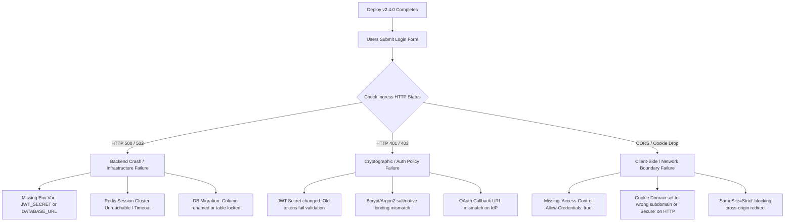

## Fast Revision (10-Second Recall)
- **Top Root Causes**: Mismatched or rotated `JWT_SECRET` / session encryption keys without dual-key grace periods, missing/misconfigured environment variables in new pods, strict CORS/Cookie flags (`SameSite`, `Secure`, `Domain`), database schema lock or column rename, and broken Redis session store connectivity.
- **Triage Checklist**: Check deployment diff (`git diff HEAD~1`), inspect edge proxy/CDN status codes (401 vs 403 vs 500), examine auth service container logs for missing secrets, verify Redis session cluster health, and validate browser cookie/CORS headers.
- **Immediate Mitigation**: If root cause is not identified within 5–10 minutes and user impact is severe, initiate an immediate rollback to the previous stable release artifact or container tag while investigating offline.

---

## The 30-Second Spoken Script
> "When all users fail to log in immediately after a deployment, I treat it as a SEV-1 incident. My immediate triage separates frontend/edge issues from backend failures. 
>
> First, I inspect edge status codes: HTTP 500 indicates a backend crash—typically an unhandled exception from a missing environment variable like `JWT_SECRET`, an unreachable Redis session store, or an unmigrated database column. HTTP 401/403 suggests cryptographic invalidation—such as a rotated signing key without a transition window, or an altered password hashing library. HTTP 0 / Network Error on the client indicates a CORS misconfiguration or broken cookie flags (`Secure` on non-HTTPS, or incorrect `SameSite`/`Domain` settings).
>
> I check container stdout logs and review the release commit diff. If the root cause cannot be pinpointed within 5 minutes, I trigger an immediate canary/deployment rollback. To prevent this, auth systems must enforce dual-key rotation, automated synthetic login smoke tests in CI/CD, and strict config-validation schemas on startup."

---

## Scenario / Problem Context
At 14:00 UTC, a scheduled release (v2.4.0) is deployed to production via Kubernetes rolling update. Within 60 seconds of completion:
- Customer service Slack channels erupt with complaints that users are kicked out and cannot log back in.
- Frontend displays generic toast: `"Login failed. Please try again."`
- Monitoring graphs show a cliff-dive in successful API authentications (down 99.4%) and an immediate spike in HTTP 401 and 500 status codes.

```
Metric                             v2.3.9 (Baseline)    v2.4.0 (Post-Deploy)
-----------------------------------------------------------------------------
Login Success Rate (200 OK)        98.8%                0.6%
Auth Error Rate (401/403/500)      1.2%                 99.4%
Active User Sessions (Redis)       42,100               1,200 (plummeting)
Ingress HTTP 500 Error Rate        0.02%                34.8%
```

---

## Architectural Workflow / Sequence



---

## Deep-Dive Analysis & Root Causes

### 1. Inadvertent JWT Secret or Signing Key Rotation
If `JWT_SECRET` is generated dynamically on container startup (e.g., `crypto.randomBytes(32).toString('hex')`) instead of being loaded from a persistent secrets manager (HashiCorp Vault, AWS Secrets Manager), every new pod restart or rolling deployment invalidates all previously signed JWTs. Furthermore, rolling updates cause pods on the new revision to reject tokens generated by pods on the older revision.

### 2. Missing Environment Variables in Kubernetes / ECS Config
When developers add a new configuration parameter (e.g., `SESSION_ENCRYPTION_KEY` or `OAUTH_CLIENT_SECRET`) to local `.env`, but omit it from production Kubernetes `ConfigMap` or secret manifests, the application either throws an unhandled `TypeError: Cannot read properties of undefined` during the login lifecycle or fails to initialize external auth clients.

### 3. Database Schema Migration and ORM Discrepancies
- **Renamed Columns**: If a migration renamed `password_digest` to `password_hash`, but old code or cached ORM metadata attempts to query the old column, PostgreSQL throws `column "password_digest" does not exist` (`42703`), causing login endpoints to return HTTP 500.
- **Exclusive Table Locks**: A long-running migration (e.g., adding an unindexed foreign key or scanning a large table) holds an `ACCESS EXCLUSIVE` lock on `users`, queuing all incoming login `SELECT` queries until gateway timeouts (504) fire.

### 4. CORS and Cookie Policy Misconfigurations
If the backend changes its CORS middleware without preserving credentials:
```typescript
// BROKEN: Omitting credentials prevents Set-Cookie headers from being saved
app.use(cors({ origin: "https://app.domain.com" })); 

// FIXED: Required for cross-origin session cookies
app.use(cors({ origin: "https://app.domain.com", credentials: true }));
```
Similarly, setting `Cookie: Secure=true` on staging environments running without TLS, or setting `Domain=api.example.com` instead of `.example.com`, causes the browser to reject the cookie silently.

---

## Practical Debugging Commands & Code

### 1. Incident Triage Runbook (First 5 Minutes)

```bash
# Step 1: Check pod status and recent restart loops
kubectl get pods -n production -l app=auth-service

# Step 2: Tail logs of the new deployment pods for unhandled errors
kubectl logs -n production -l app=auth-service --tail=200 -f | grep -E "ERROR|FATAL|Exception|unhandledRejection"

# Step 3: Check ingress controller response codes
kubectl logs -n ingress-nginx -l app.kubernetes.io/name=ingress-nginx --tail=500 \
  | grep "/api/v1/auth/login" \
  | awk '{print $9}' | sort | uniq -c

# Step 4: Compare environment variables between running pod and staging
kubectl exec -it $(kubectl get pods -n production -l app=auth-service -o jsonpath='{.items[0].metadata.name}') \
  -- env | grep -E "JWT|AUTH|SESSION|COOKIE|REDIS"
```

### 2. Validating Secret Consistency Across Replicas

```bash
# Verify that all running replicas share the exact same JWT Secret hash
for pod in $(kubectl get pods -n production -l app=auth-service -o jsonpath='{.items[*].metadata.name}'); do
  echo -n "$pod secret hash: "
  kubectl exec $pod -- sh -c 'echo -n "$JWT_SECRET" | sha256sum'
done
```

### 3. Verifying Redis Session Connectivity and Memory Pressure

```bash
# Connect to Redis session pod and check ping, memory, and key eviction
redis-cli -h redis-session.internal -p 6379 ping
redis-cli -h redis-session.internal -p 6379 info memory | grep -E "used_memory_human|maxmemory_human"
redis-cli -h redis-session.internal -p 6379 slowlog get 10
```

### 4. Implementation: Dual-Key Rotation Pattern for Zero-Downtime JWT Updates
To prevent deployments or scheduled secret rotations from breaking existing logins, implement dual-key verification:

```typescript
import jwt from "jsonwebtoken";

interface KeyPairConfig {
  currentSecret: string;
  previousSecrets: string[];
}

const keys: KeyPairConfig = {
  currentSecret: process.env.JWT_SECRET_CURRENT!,
  previousSecrets: process.env.JWT_SECRET_PREVIOUS 
    ? process.env.JWT_SECRET_PREVIOUS.split(",") 
    : [],
};

// Sign tokens ALWAYS with the current primary secret
export function signAuthToken(payload: object): string {
  return jwt.sign(payload, keys.currentSecret, { expiresIn: "2h" });
}

// Verify tokens by checking current secret first, then falling back to previous secrets
export function verifyAuthToken(token: string): any {
  try {
    return jwt.verify(token, keys.currentSecret);
  } catch (err: any) {
    if (err.name === "TokenExpiredError") {
      throw err; // Do not retry expired tokens
    }
    
    // Attempt fallback verification with previous keys
    for (const oldSecret of keys.previousSecrets) {
      try {
        return jwt.verify(token, oldSecret);
      } catch {
        // Continue checking fallback keys
      }
    }
    throw new Error("Invalid token signature across all active key sets");
  }
}
```

### 5. Automated Environment Validation on Application Startup
Prevent pods from starting if essential auth configs are absent:

```typescript
import { z } from "zod";

const EnvSchema = z.object({
  NODE_ENV: z.enum(["development", "staging", "production"]),
  PORT: z.string().default("3000"),
  DATABASE_URL: z.string().url(),
  REDIS_URL: z.string().url(),
  JWT_SECRET_CURRENT: z.string().min(32, "JWT secret must be at least 32 characters"),
  COOKIE_DOMAIN: z.string().min(1),
  CORS_ORIGIN: z.string().url(),
});

export function validateEnvironment() {
  const result = EnvSchema.safeParse(process.env);
  if (!result.success) {
    console.error("FATAL: Environment validation failed before boot:");
    console.error(JSON.stringify(result.error.format(), null, 2));
    process.exit(1); // Crash immediately before taking traffic
  }
  return result.data;
}
```

---

## Prevention & Senior Best Practices

| Failure Mode | Naive Approach | Production Architecture Standard |
| :--- | :--- | :--- |
| **Secret Rotation** | Hard-rotate `JWT_SECRET` in prod env | Dual-key verification with phased retirement window |
| **Missing Configs** | Runtime crash upon first login request | Fail-fast schema validation (`Zod` / `Joi`) on server boot |
| **Deploy Verification** | Manual browser test after rollout | Automated synthetic E2E login smoke test in deployment pipeline |
| **Cookie Issues** | Hardcoded cookie domain attributes | Environment-scoped cookie parameters with automated CORS checks |
| **Deployment Strategy**| Big-bang all-pod replacement | Canary rollout (5% traffic) with automated rollback on 4xx/5xx spike |

1. **Synthetic Canary Probes**: Run an automated probe every 60 seconds that executes a complete login flow (`POST /api/login` -> receive cookie -> `GET /api/me`). If the canary fails post-deployment, block promotion and auto-rollback.
2. **Zero-Downtime Rollback Procedure**: Ensure container deployment rollbacks can be completed with a single command (`kubectl rollout undo deployment/auth-service`) in under 60 seconds.
3. **Stateless vs Stateful Sessions**: If using stateful sessions in Redis, ensure session stores run in high-availability clusters with persistence (AOF enabled) so that pod restarts or failovers do not purge active sessions.

