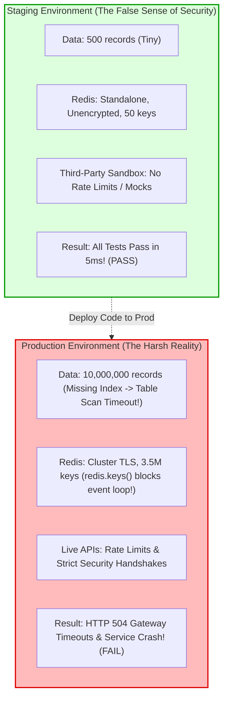

## Fast Revision (10-Second Recall)
- **The Staging Illusion:** Staging environments provide a false sense of security because they have 1/1,000th of production data volume, lack distributed multi-AZ network latencies, use relaxed single-node configurations, and mock third-party security controls.
- **Top 5 Discrepancies:**
  1. *Missing / Misnamed Secrets:* Production environment variables differ (`REDIS_CLUSTER_URL` in prod vs `REDIS_HOST` in staging).
  2. *Data Scale & Query Timeouts:* Staging has 500 rows (unindexed query runs in 3ms); production has 20,000,000 rows (query times out after 30 seconds).
  3. *TLS & Network Topology:* Staging connects over plain HTTP/unencrypted Redis; production enforces mTLS, strict SSL ciphers, and cross-VPC peering.
  4. *Third-Party Sandbox Differences:* Stripe/PayPal sandbox mode accepts any test card number; production enforces 3D-Secure MFA and fraud scoring.
  5. *OS & Runtime Kernel Limits:* Staging has `ulimit -n 65535`; production container runs with restricted distroless Linux cgroups.

## The 30-Second Spoken Script
> "When code works flawlessly in staging but crashes in production, our investigation focuses on **Environmental Drift and Data Volumetrics**.
>
> We systematically audit four primary divergence vectors:
> First, **Configuration and Secrets Drift**: We compare environment variables between staging and production using automated diff tools, verifying that secret names, database connection strings, and feature flags match. A classic bug is staging using standalone Redis without authentication, while production uses an authenticated multi-node Redis Cluster with TLS.
> Second, **Data Volume and Indexing Reality**: In staging, tables have hundreds of records, allowing full sequential scans to finish in 5 milliseconds. In production with 10 million rows, an unindexed query hits the statement timeout, returning HTTP 504 to users.
> Third, **Third-Party API Behavior**: Sandbox environments (like Stripe, Salesforce, or Twilio) do not enforce production rate limits, fraud screening, or webhook signature verification.
> Fourth, **Network Topology and Permissions**: Staging services often share a single subnet with relaxed IAM permissions. Production enforces cross-AZ security groups, strict egress proxies, and least-privilege IAM roles."

## Scenario / Problem Context
An HR management platform tested a new salary review module for 3 weeks in staging. QA engineers ran 400 manual tests and automated Playwright integration suites:
- All tests passed with 100% green status.
- Staging logs showed zero errors.
- Sign-off was approved for production deployment.

Twenty minutes after deploying to production:
1. When managers clicked "Review Department Salaries," the page hung for 60 seconds before failing with `HTTP 504 Gateway Timeout`.
2. The production Redis cluster crashed because the new code called `redis.keys('salary:*')`. Staging had 50 keys (took 1ms); production had 3,500,000 keys, blocking Redis single-threaded execution for 40 seconds!
3. The production PostgreSQL master CPU spiked to 100% due to an unindexed join on `departments.id`.

The VP of Engineering demands to know: *"Why did staging not catch these issues?"* and mandates a framework to eliminate staging-vs-production discrepancies permanently.

## Architectural Workflow / Sequence


## Deep-Dive Analysis & Root Causes

### 1. The `KEYS *` Command in Redis
In staging with 50 keys:
`await redis.keys('salary:*');` runs in 0.5ms.
In production with 3,500,000 keys:
`KEYS` scans the entire internal keyspace. Because Redis is single-threaded, it blocks **all other commands across the entire company** for 30 to 45 seconds!
- **Rule:** Never use `KEYS *` in production; always use `SCAN` or Redis Sets.

### 2. Missing Secret Linting and Configuration Validation
A service boots in production. It looks for `DATABASE_URL`.
- Staging had `DATABASE_URL = postgres://staging-db:5432`.
- Production was configured by DevOps with separate variables: `DB_HOST`, `DB_PORT`, `DB_USER`, `DB_PASS`.
- The production container crashes because `DATABASE_URL` is undefined.

### 3. Database Execution Plan Inversion
A query with an index works in staging. But in production:
- If table statistics are outdated, the PostgreSQL query planner might decide that a sequential scan is "cheaper" than an index scan on a table with millions of rows.
- Or an unindexed foreign key lock locks the entire table during `UPDATE`.

## Practical Debugging Commands & Code

### Step 1: Environment Variable Diff Checker (Excluding Secrets)
Compare production and staging configuration schemas automatically in CI:

```bash
# Compare keys of production vs staging Kubernetes ConfigMaps
diff <(kubectl get configmap api-config -n staging -o json | jq -r '.data | keys[]' | sort) \
     <(kubectl get configmap api-config -n production -o json | jq -r '.data | keys[]' | sort)

# Output highlights missing or misnamed environment variables instantly!
```

### Step 2: Strict Startup Environment Validation with `@t3-oss/env-core` or Zod
Crash the application at boot time with a clear error message if any production secret is missing:

```typescript
// src/config/env.ts
import { z } from 'zod';

const envSchema = z.object({
  NODE_ENV: z.enum(['development', 'staging', 'production']),
  DATABASE_URL: z.string().url(),
  REDIS_URL: z.string().url(),
  // Strict TLS required in production!
  REDIS_TLS_ENABLED: z.string().transform((v) => v === 'true').default('false'),
  JWT_SECRET: z.string().min(32, 'JWT secret must be at least 32 characters!'),
  STRIPE_SECRET_KEY: z.string().startsWith('sk_'),
});

export const env = (() => {
  const result = envSchema.safeParse(process.env);
  if (!result.success) {
    console.error('FATAL: Invalid environment configuration in container:');
    console.error(JSON.stringify(result.error.format(), null, 2));
    process.exit(1); // Fail immediately at container startup!
  }
  return result.data;
})();
```

### Step 3: Fast PostgreSQL Query Plan Comparison (EXPLAIN ANALYZE)
Inspect why a query is slow in production compared to staging:

```sql
-- Run on production replica to inspect execution plan without impacting master
EXPLAIN (ANALYZE, BUFFERS) 
SELECT e.id, e.name, s.amount 
FROM employees e 
JOIN salaries s ON s.employee_id = e.id 
WHERE e.department_id = 'dept_442';

-- Check:
-- 1. Does it say "Seq Scan on salaries" (Missing Index!)?
-- 2. Are buffer blocks read from disk (Buffers: read=45020) rather than RAM (hit)?
```

## Prevention & Senior Best Practices
1. **Enforce Environment Variable Schema Validation:** Validate all configuration keys at boot time using Zod or Joi, failing immediately if a variable is missing or malformed.
2. **Never Run `KEYS *` on Redis:** Ban `redis.keys()` in static analysis linting; mandate `SCAN` with cursor iteration.
3. **Seed Staging with Anonymized Production Data Volumes:** Populate staging with at least 1,000,000 anonymized records to ensure query planners exercise real indexes rather than sequential scans.
4. **Shift from Static Staging to Production Canaries:** Recognize that staging will never 100% replicate production. Deploy code using **Canary Deployments (2% traffic)** to test against real production data and network topology safely.
5. **Mirror Security Group and IAM Rules in Staging:** Ensure staging enforces the exact same TLS encryption, IAM role boundaries, and network subnets as production.

