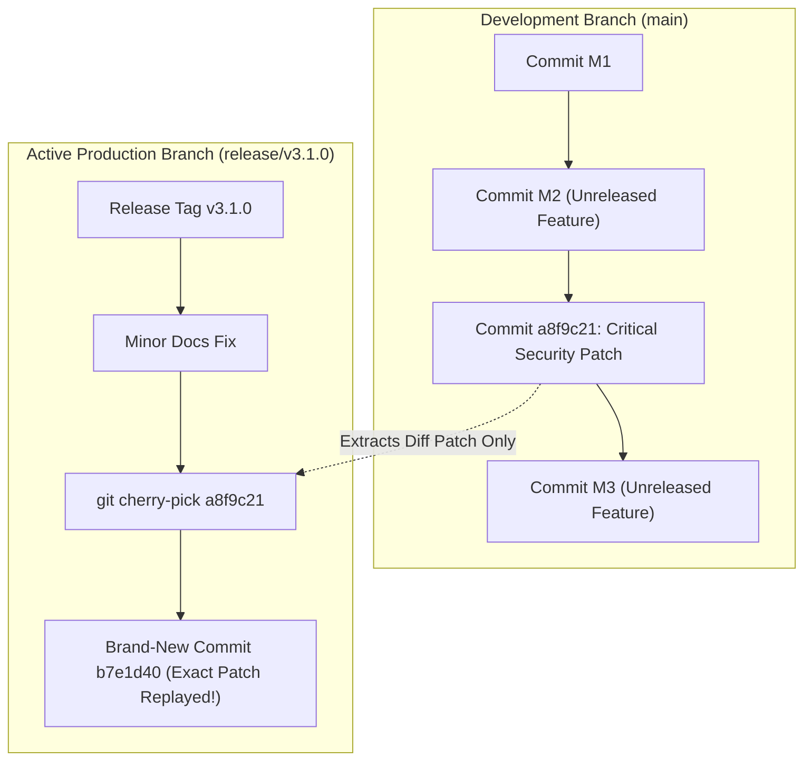

## Fast Revision (10-Second Recall)
`git cherry-pick <commit-sha>` extracts the exact patch introduced by a specific commit from one branch and applies it as a brand-new commit on your current checked-out branch. Use it for applying emergency production hotfixes to older release branches or rescuing an isolated feature from an unmerged experimental branch.

## The 30-Second Spoken Script
> "`git cherry-pick` is precision surgery for Git commit history. Instead of merging or rebasing an entire branch—which brings along all prior commits and unreleased features—cherry-picking allows you to select a single, specific commit from Branch A and replay its exact diff onto Branch B as a new commit with a new SHA. The most common enterprise use case is emergency hotfixing: when a critical payment bug is fixed on the main development branch, but production is running an older `v2.4.0` release branch containing 50 unreleased features, you cannot simply merge `main` into `release/v2.4.0`. Instead, you cherry-pick only the single hotfix commit SHA into the release branch, build, and deploy immediately. While powerful, cherry-picking creates duplicate commits with different SHAs, so it should be reserved for targeted hotfixes and branch rescues, not routine code integration."

## Scenario / Problem Context
Production is running release branch `release/v3.1.0`. A high-severity data corruption vulnerability was discovered. A developer fixed the bug on `main` in commit `a8f9c21`. However, `main` also contains 120 commits of unreleased, untested V3.2 features that cannot go to production. The release manager must extract only the critical security fix from `main` and transplant it cleanly onto `release/v3.1.0` without bringing any V3.2 code along.

## Architectural Workflow / Sequence


## Deep-Dive Analysis & Root Causes

### 1. How Cherry-Pick Works Internally
When you run `git cherry-pick <SHA>`:
1. Git calculates the diff between `<SHA>` and its immediate parent commit `<SHA>^`:
   $$\Delta = \text{Diff}(\text{Parent}, \text{Commit})$$
2. Git attempts to apply this diff patch directly onto your currently checked-out `HEAD`.
3. If the patch applies cleanly, Git creates a new commit containing the same author, commit message, and diff, but with a **new commit timestamp and new parent commit**, resulting in a unique SHA hash.

### 2. Common Cherry-Pick Options
- `git cherry-pick -x <SHA>`: Appends `(cherry picked from commit a8f9c21...)` to the commit message. **Always use `-x` for auditing and provenance!**
- `git cherry-pick -n <SHA>` (`--no-commit`): Applies the diff to your working directory and staging area without creating a commit, allowing you to combine or inspect changes first.
- `git cherry-pick A..B`: Cherry-picks a linear range of commits (from commit after A up to and including B).

### 3. The Duplicate Commit Problem
Cherry-picking duplicates code under two different commit SHAs:
- `Commit a8f9c21` on `main`.
- `Commit b7e1d40` on `release/v3.1.0`.
When `release/v3.1.0` is eventually merged back into `main` during a release synchronization, Git's 3-way merge algorithm is smart enough to recognize that the changes are identical, but visual commit graphs and git log searches will show duplicated commit messages.

## Practical Debugging Commands & Code

#### Production Hotfix Cherry-Pick CLI Playbook
```bash
# 1. Checkout the target release branch needing the hotfix
git checkout release/v3.1.0
git pull origin release/v3.1.0

# 2. Cherry-pick the security commit from main with provenance tracking (-x)
git cherry-pick -x a8f9c21

# 3. If conflicts occur:
# Git pauses execution and prompts to resolve conflicts
git status # View conflicted files
# Edit files to resolve conflicts, then stage them:
git add src/security/validator.ts
# Continue the cherry-pick:
git cherry-pick --continue

# (If the conflict is too messy and you need to abort safely):
git cherry-pick --abort

# 4. Run automated test suite to ensure the hotfix works on older branch
npm test

# 5. Push updated release branch to remote
git push origin release/v3.1.0
```

#### Cherry-Picking a Range of Commits
```bash
# Cherry-pick three consecutive commits: commit1, commit2, commit3
# Note: A..B excludes A; A^..B includes A
git cherry-pick a1b2c3d^..e4f5a6b
```

## Prevention & Senior Best Practices

### 1. Architectural Guardrails
- **Always Include `-x` Flag**: Mandate `git cherry-pick -x` in team runbooks. Without the `-x` annotation, tracing which hotfix commit corresponds to which original bug fix becomes impossible during SOC 2 audits.
- **Commit Granularity (Atomic Commits)**: A commit can only be cleanly cherry-picked if it is atomic (contains only the bug fix). If a developer bundles a bug fix with 4 unrelated formatting changes and a library upgrade, cherry-picking will produce massive, unnecessary merge conflicts.

### 2. Operational Hardening
- **Never Cherry-Pick Instead of Proper Branching**: Do not use cherry-picking as a standard daily integration mechanism between feature branches. Use proper rebasing or merging to preserve DAG branch hierarchy.
- **Automated Cherry-Pick Bots**: Tools like Mergify or Kubernetes `k8s-ci-robot` can automatically cherry-pick commits labeled `needs-cherry-pick/v1.2` into designated release branches upon PR merge.

