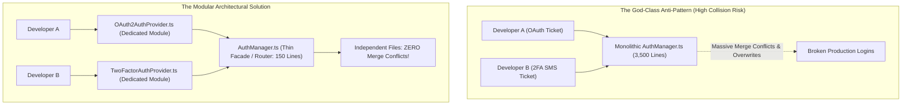

## Fast Revision (10-Second Recall)
When two developers must modify the same file concurrently, decouple their work architecturally by refactoring large files into modular components (Single Responsibility Principle), establish communication on shared interface contracts, pull and rebase against main daily, and pair-program on final merge resolutions.

## The 30-Second Spoken Script
> "When two engineers work on the same file concurrently, the problem is usually architectural rather than technical. If two developers building completely different features—say, user notifications and billing payments—are both constantly modifying `UserService.ts` or `routes.ts`, it is a flashing warning sign of a 'God-Class' or tight coupling violating the Single Responsibility Principle. In the immediate term, both developers should coordinate early: communicate on Slack, establish who merges first, and the second developer should pull and rebase against `main` daily so conflicts are resolved incrementally in small 5-line chunks rather than a 500-line explosion at the end of the sprint. For the long term, the senior engineering solution is structural refactoring: split the oversized file into domain-specific modules, middleware handlers, or partial classes using dependency injection, ensuring that future feature work naturally touches separate, isolated files."

## Scenario / Problem Context
Two developers were assigned separate sprint tickets: Developer A was adding OAuth2 social login, while Developer B was implementing two-factor SMS authentication. Both spent 5 days heavily editing the same 3,500-line monolithic `AuthManager.ts` file. When Developer A merged their branch to `main`, Developer B's branch had 400 conflicting lines across 15 methods. A rushed, uncoordinated merge by Developer B accidentally overwrote Developer A's OAuth token logic, breaking production logins.

## Architectural Workflow / Sequence


## Deep-Dive Analysis & Root Causes

### 1. Code Architecture as Conflict Prevention
Merge conflicts are an indicator of code organization:
- **High Conflict Files**: God-classes, centralized routing tables, monolithic dependency injection containers, and giant configuration arrays.
- **Low Conflict Architecture**: Micro-modules, plug-in provider patterns, domain-driven directory structures.
- By breaking `AuthManager.ts` into a strategy pattern (`OAuthStrategy`, `TwoFactorStrategy`, `PasswordStrategy`), multiple engineers can work on authentication simultaneously with zero line overlap.

### 2. Operational Collaboration Protocols
When refactoring is not immediately possible during an active sprint:
1. **Declare Collision Early**: Daily standup should identify when two engineers will touch the same core file.
2. **Frequency of Synchronization**: The second developer must run:
   ```bash
   git fetch origin && git rebase origin/main
   ```
   every morning. Resolving 2 conflicting lines every morning takes 30 seconds; waiting 2 weeks means resolving 200 conflicting lines under deadline stress.
3. **The First-to-Merge Rule**: The developer who finishes first merges to `main`. The second developer is responsible for rebasing their branch on `main` and verifying tests pass.

### 3. Pair-Merge on Complex Resolutions
Never resolve an ambiguous conflict in isolation:
- If Developer B does not fully understand Developer A's new OAuth implementation, guessing which lines to keep risks silently deleting bug fixes.
- **Senior Rule**: Hop on a 10-minute huddle and pair-resolve the conflict together.

## Practical Debugging Commands & Code

#### Refactoring God-Class into Modular Strategy Pattern (TypeScript)
```typescript
// BEFORE: Monolithic AuthManager.ts where all developers collide
// export class AuthManager { loginWithPassword() {...} loginWithOAuth() {...} verifyMFA() {...} }

// AFTER: Extensible Strategy Pattern - Developers work in separate files!

// 1. Common Interface (contracts/AuthProvider.ts)
export interface AuthProvider {
  name: string;
  authenticate(credentials: any): Promise<{ userId: string; token: string }>;
}

// 2. Developer A's File: providers/OAuthProvider.ts
export class OAuthProvider implements AuthProvider {
  name = 'oauth';
  async authenticate(payload: { code: string; provider: string }) {
    // OAuth logic exclusively isolated here
    return { userId: 'usr_88', token: 'jwt_oauth_xyz' };
  }
}

// 3. Developer B's File: providers/TwoFactorProvider.ts
export class TwoFactorProvider implements AuthProvider {
  name = 'mfa';
  async authenticate(payload: { otpCode: string; sessionToken: string }) {
    // 2FA logic exclusively isolated here
    return { userId: 'usr_88', token: 'jwt_mfa_approved' };
  }
}

// 4. Thin Registry (AuthManager.ts) - Rarely modified!
export class AuthManager {
  private providers = new Map<string, AuthProvider>();

  registerProvider(provider: AuthProvider) {
    this.providers.set(provider.name, provider);
  }

  async authenticate(method: string, payload: any) {
    const provider = this.providers.get(method);
    if (!provider) throw new Error(`Unsupported auth method: ${method}`);
    return provider.authenticate(payload);
  }
}
```

#### Daily Rebase Habit for Developer B
```bash
# Fetch latest main without switching branches
git fetch origin main

# Rebase local branch onto latest main
git rebase origin/main

# If conflicts occur: resolve immediately while context is fresh, then continue
git add src/
git rebase --continue
```

## Prevention & Senior Best Practices

### 1. Architectural Guardrails
- **Enforce File Size Linters**: Configure ESLint rules (`max-lines: ["error", 500]`) or SonarQube quality gates that prevent files from growing into monolithic God-classes.
- **Decompose Centralized Route Manifests**: Instead of a single 2,000-line `routes.ts`, use distributed route discovery (NestJS controllers, Express modular routers per domain).

### 2. Operational Hardening
- **Code Ownership (CODEOWNERS)**: Use GitHub `CODEOWNERS` file to require code owner reviews on core shared files before merge.
- **Branch Naming & Visibility**: Publish work-in-progress draft pull requests early so teammates can see who is currently modifying which files.

