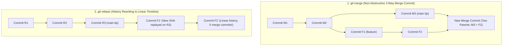

## Fast Revision (10-Second Recall)
`git merge` creates a new merge commit combining two branch histories non-destructively, preserving chronological commit context at the cost of messy 'railroad' DAG graphs. `git rebase` rewrites commit history by replaying local feature commits on top of the target branch tip, producing a clean linear history. The Golden Rule of Rebase: Never rebase shared public branches.

## The 30-Second Spoken Script
> "The choice between `git merge` and `git rebase` comes down to whether you prioritize historical fidelity or linear cleanliness. `git merge` is non-destructive: it takes two parent branches and joins them with an explicit 3-way merge commit. It never alters existing SHA hashes, preserving the exact chronological sequence of when commits were authored. However, frequent merges create a tangled, unreadable 'train-track' graph with hundreds of noise commits like 'Merge branch main into feature'. Conversely, `git rebase` rewinds your local branch to the common ancestor, fast-forwards your branch to the latest tip of main, and replays each of your commits sequentially as brand-new commits with new SHAs. This results in a clean, linear history where `git bisect` and `git log` are effortless to navigate. Our senior team policy is: rebase local private feature branches to stay updated with `main`, but use Squash-and-Merge or explicit PR merge commits when integrating into shared production branches."

## Scenario / Problem Context
An engineering team of 25 developers committed to a single shared repository. Developers frequently ran `git pull` (which defaulted to `git merge`), creating hundreds of redundant merge commits daily: "Merge branch 'main' of github.com...", "Merge branch 'feature-12' into main". During a production outage, the on-call engineer attempted to use `git bisect` to find the breaking commit, but the tangled non-linear DAG made bisecting fail unpredictably. The team must define a standard branch integration strategy.

## Architectural Workflow / Sequence


## Deep-Dive Analysis & Root Causes

### 1. Architectural Comparison Matrix
| Dimension | `git merge` | `git rebase` |
|---|---|---|
| **History Mutability** | Non-destructive (existing SHAs never change) | Destructive / Rewriting (creates brand-new SHAs) |
| **Commit Graph** | Non-linear (divergent branches, 2 parent commits) | Perfectly linear (single straight line DAG) |
| **Conflict Resolution** | Resolves all conflicts once in the merge commit | Must resolve conflicts sequentially commit-by-commit |
| **Safe on Shared Branches** | 100% Safe | **Extremely Dangerous** (breaks teammates' clones) |
| **Tooling Ergonomics** | Makes `git bisect` and `git revert` complex | Simplifies `git bisect`, `git cherry-pick`, and auditing |

### 2. The Golden Rule of Rebasing
> **Never rebase a branch that has been pushed to a remote repository and is being used by other developers.**
- If Developer A rebases `feature-shared` and force-pushes (`git push --force`), Git replaces the commits with new SHAs.
- When Developer B runs `git pull`, Git sees two divergent histories with identical diffs but different SHAs, creating duplicated commits and endless merge conflicts.
- **Rule**: Rebase *only* your private local feature branch before creating a pull request.

### 3. Interactive Rebasing for Commit Hygiene (`git rebase -i`)
Before opening a Pull Request, use interactive rebase to polish local commit history:
- `squash` (s): Combines typo and work-in-progress commits ("wip", "fix lint", "test") into a single clean atomic commit.
- `reword` (r): Rewrites ambiguous commit messages to conform to Conventional Commits standards (`feat: add stripe checkout`).
- `drop` (d): Discards temporary debug logs or experiments.

### 4. Pull Integration: `git pull --rebase`
By default, running `git pull` when remote changes exist creates a local merge commit.
- Setting `git config --global pull.rebase true` instructs Git to fetch remote changes and replay local unpushed commits on top, eliminating all useless "Merge branch 'main'" local commits.

## Practical Debugging Commands & Code

#### Interactive Rebase Workflow to Clean Feature Branch
```bash
# 1. Fetch latest changes from remote main
git fetch origin main

# 2. Rebase local feature branch interactively on top of origin/main
git rebase -i origin/main

# Git opens your editor showing commit list:
# pick a1b2c3d feat: add shopping cart schema
# squash d4e5f6a fix typo in migration
# squash 7a8b9c0 fix linter warnings
# reword 1f2e3d4 add cart checkout endpoint

# 3. If conflicts arise during rebase:
# Git pauses at the conflicting commit:
git status # Identify conflicting files
# Edit files to resolve conflicts, then stage them:
git add src/cart.ts
# Continue rebase (NEVER use git commit here!):
git rebase --continue

# (If everything goes wrong, safely abort back to original state):
git rebase --abort

# 4. Push polished clean history to remote branch (lease prevents overwriting teammates)
git push origin feature-cart --force-with-lease
```

#### Configuring Git Defaults for Linear Hygiene
```bash
# Set pull to automatically rebase instead of creating merge commits
git config --global pull.rebase true

# Configure rerere (Reuse Recorded Resolution) to auto-resolve repeated merge conflicts
git config --global rerere.enabled true
```

## Prevention & Senior Best Practices

### 1. Architectural Guardrails
- **Enforce `--force-with-lease`**: Ban raw `git push --force` in team policies and CI. `git push --force-with-lease` checks if remote refs were updated by a teammate before overwriting, preventing accidental loss of someone else's work.
- **GitHub / GitLab PR Integration Options**:
  - For small features: Use **Squash and Merge** (compresses entire PR into 1 atomic commit on main).
  - For large epics: Use **Rebase and Merge** or **Merge Commit** with linear branch enforcement.

### 2. Operational Hardening
- **Branch Protection on Main**: Disable direct pushes to `main` and require pull requests to be up-to-date with the base branch before merging.
- **Conventional Commits Linter**: Integrate `commitlint` into pre-commit hooks to enforce structured commit messages (`feat:`, `fix:`, `refactor:`, `chore:`).

