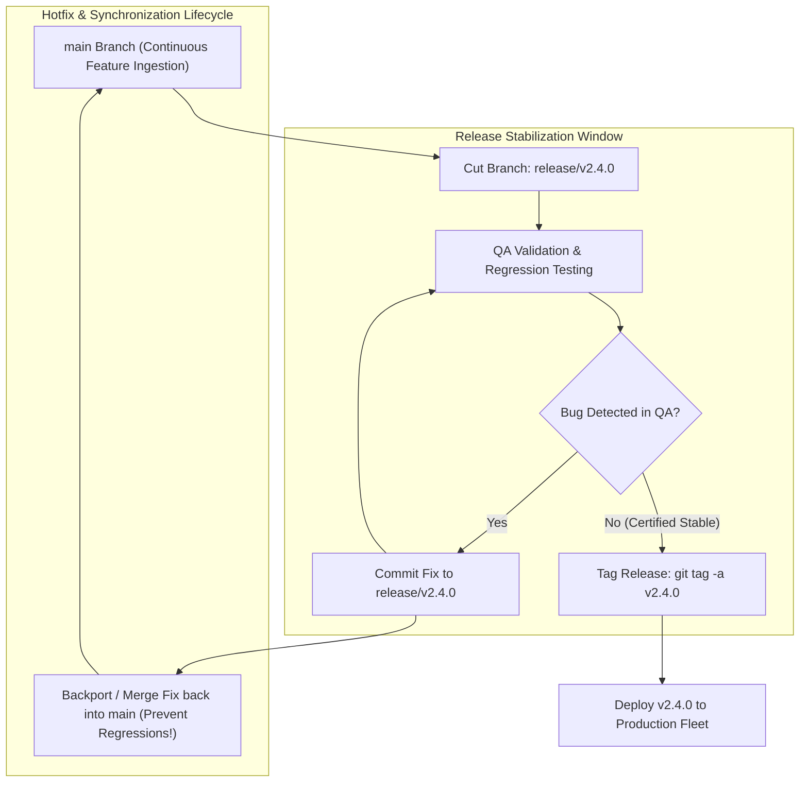

## Fast Revision (10-Second Recall)
Manage production software releases using structured Release Branching: branch `release/vX.Y.Z` from `main` or `develop` for stabilization and QA freezing, tag releases with Semantic Versioning (SemVer), deploy immutable container images, and backport critical production hotfixes to both the active release branch and main.

## The 30-Second Spoken Script
> "Branching models must align with your deployment cadence. For continuous SaaS deployment where code goes to production multiple times a day, modern GitHub Flow—merging short-lived feature branches directly into `main` with automated canary deployments—is the gold standard. However, for enterprise software, mobile apps, or regulated platforms with scheduled release cycles, the Release Branching strategy is essential. We cut a dedicated release branch, such as `release/2.4.0`, from `main`. This branch enters a stabilization freeze where only bug fixes and documentation updates are allowed, while the rest of the engineering team continues developing new features on `main` without interruption. Once QA certifies the release, we apply an immutable SemVer git tag like `v2.4.0` and deploy to production. If an emergency bug is found in production, we branch a `hotfix/2.4.1` directly from the `v2.4.0` tag, fix it, deploy, and critically: cherry-pick or merge the hotfix back into `main` to prevent regression in future releases."

## Scenario / Problem Context
A healthcare SaaS company scheduled monthly releases. Developers worked directly on `develop` and merged into `master` on release day. When a critical bug was found during final staging validation, the team delayed the entire release for two weeks, freezing all 40 developers from merging new features. Furthermore, when an emergency security hotfix was pushed directly to production, the developer forgot to merge it back into `develop`, causing the vulnerability to reappear in the next scheduled release.

## Architectural Workflow / Sequence


## Deep-Dive Analysis & Root Causes

### 1. Comparison of Major Git Branching Models
| Model | Core Concept | Release Frequency | Best Used For |
|---|---|---|---|
| **GitHub Flow** | Single `main` branch + short feature branches | Multiple times daily (CD) | Modern web SaaS, microservices, cloud-native |
| **Release Branching** | `main` + isolated `release/vX.Y` branches | Weekly to Monthly | Mobile apps (App Store review), enterprise on-prem |
| **Classic Gitflow** | Dual long-lived branches (`master` + `develop`) | Infrequent (Quarterly) | Legacy software with complex milestone cycles |

### 2. Semantic Versioning (SemVer 2.0.0)
Tagging must follow strict SemVer standards: `vMAJOR.MINOR.PATCH`
- **MAJOR (v3.0.0)**: Incompatible, breaking API changes.
- **MINOR (v2.4.0)**: Backward-compatible new functionality.
- **PATCH (v2.4.1)**: Backward-compatible bug fixes and security hotfixes.

### 3. The Forgotten Backport Trap
The most dangerous failure in release branch management:
- A hotfix is developed on `release/v2.4.0` or `hotfix/v2.4.1`.
- It is deployed to production and confirmed working.
- The engineer forgets to merge or cherry-pick the commit back into `main`.
- Three weeks later, `v2.5.0` is released, and the bug **reappears in production** because `v2.5.0` was branched from `main` which lacked the fix.
- **Solution**: Automated CI bots that open backport PRs automatically upon hotfix merge.

## Practical Debugging Commands & Code

#### Release Branch Lifecycle CLI Playbook
```bash
# 1. Cut new release branch from latest main
git checkout main
git pull origin main
git checkout -b release/v2.4.0
git push origin release/v2.4.0

# 2. Bump version in package.json and commit
npm version minor --no-git-tag-version
git commit -am "chore(release): bump version to 2.4.0"
git push origin release/v2.4.0

# 3. Apply bug fix during release stabilization
git commit -am "fix(auth): resolve session timeout bug found in QA"
git push origin release/v2.4.0

# 4. Once QA certifies: Create annotated, cryptographically signed tag
git tag -a v2.4.0 -m "Release v2.4.0: Certified for production deployment"
git push origin v2.4.0

# 5. CRUCIAL: Backport bug fixes back into main!
git checkout main
git pull origin main
git merge --no-ff release/v2.4.0 -m "chore: merge release/v2.4.0 back into main"
git push origin main
```

#### Emergency Production Hotfix Workflow
```bash
# 1. Branch hotfix directly from the affected production release tag
git checkout -b hotfix/v2.4.1 v2.4.0

# 2. Fix bug and commit
git commit -am "fix(security): patch CVE-2026-9912 SQL injection vulnerability"

# 3. Tag and deploy hotfix
git tag -a v2.4.1 -m "Hotfix v2.4.1: Emergency security patch"
git push origin v2.4.1

# 4. Immediately cherry-pick hotfix into main
git checkout main
git pull origin main
git cherry-pick v2.4.1
git push origin main
```

## Prevention & Senior Best Practices

### 1. Architectural Guardrails
- **Immutable Container Image Tags**: Never deploy Docker images tagged `:latest` or mutable branch names. Always build and tag container images with the exact Git commit SHA or SemVer tag (`company/billing:v2.4.0` or `company/billing:sha-7f8a9b2`).
- **Automated Backport Bots**: Install GitHub Backport Actions or Mergify to automatically generate and merge backport PRs to `main` when a hotfix is merged.

### 2. Operational Hardening
- **Protected Release Tags**: Configure repository settings so that Git tags matching `v*` cannot be deleted or force-pushed, guaranteeing an immutable audit trail for compliance.
- **Automated Changelog Generation**: Use tools like `standard-version` or `release-it` to parse Conventional Commits and automatically generate `CHANGELOG.md` upon tagging.

