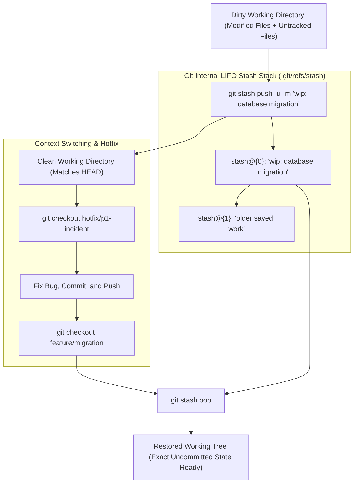

## Fast Revision (10-Second Recall)
`git stash` temporarily shelves uncommitted changes (both staged and unstaged) in a local stack, restoring your working directory to a clean `HEAD` state without creating unnecessary commits. Always name stashes with `git stash push -m "message"`, include untracked files with `-u`, and restore work using `git stash pop` or `git stash apply`.

## The 30-Second Spoken Script
> "`git stash` is the developer's scratchpad for context switching. Imagine you are midway through a complex refactor with 12 uncommitted modified files and 3 new untracked components, when a critical production bug requires your immediate attention on a hotfix branch. You don't want to discard your work, and creating a messy 'wip - do not merge' commit pollutes Git history. Running `git stash push -u -m 'refactor: cart checkout migration'` sweeps your entire working directory clean in one command, saving modified and untracked files into an internal LIFO stack. You can then safely switch branches, debug the hotfix, deploy it, and switch back to your feature branch. Running `git stash pop` re-applies your exact in-progress diff and clears the stash entry, allowing you to resume coding precisely where you left off."

## Scenario / Problem Context
A software engineer was midway through modifying database schema files and config manifests. The changes broke local TypeScript compilation. Suddenly, an urgent P1 incident occurred, requiring the engineer to pull the latest `main` branch and test an infrastructure fix immediately. Attempting `git checkout main` failed with: `error: Your local changes to the following files would be overwritten by checkout`. The engineer needs to clear the working tree instantly without losing several hours of uncommitted work.

## Architectural Workflow / Sequence


## Deep-Dive Analysis & Root Causes

### 1. How Git Stash Works Under the Hood
Git stash is not a temporary text file; it creates real Git commit objects in `.git/refs/stash`:
- A stash entry is represented by **two (or three) commits**:
  1. Commit 1: Contains all **staged changes** (the index).
  2. Commit 2: Contains all **unstaged modifications** in your working directory (child of Commit 1 and current `HEAD`).
  3. Commit 3 (Optional with `-u`): Contains all **untracked files**.
Because stashes are genuine Git commit trees, they are completely safe from accidental deletion and can even be recovered if dropped.

### 2. `git stash pop` vs `git stash apply`
- **`git stash apply`**: Re-applies the stashed changes to your working tree, but **keeps the stash on the stack**.
  - *Best used for*: Applying the same changes to multiple branches (e.g. temporary local test configurations).
- **`git stash pop`**: Re-applies the stashed changes and **immediately deletes the stash from the stack** if there are no conflicts.
  - *Best used for*: Standard daily context-switching.

### 3. Untracked and Ignored Files
By default, plain `git stash` only saves tracked files:
- New files that have never been staged (`git add`) are **completely ignored** and left dirty in your working tree!
- **Always use `-u` (or `--include-untracked`)**:
  ```bash
  git stash push -u -m "meaningful message"
  ```
- Use `-a` (`--all`) to also include files ignored by `.gitignore`.

### 4. Recovering a Dropped Stash
If an engineer accidentally runs `git stash drop` or `git stash clear`:
- Git deletes the ref pointer, but the commit object remains in the object database for up to 30 days until garbage collection (`git gc`).
- The stash can be recovered using `git fsck --lost-found`.

## Practical Debugging Commands & Code

#### Production Git Stash CLI Playbook
```bash
# 1. Stash all changes (staged, unstaged, and untracked) with a descriptive message
git stash push -u -m "feat(billing): in-progress stripe webhook handler"

# 2. View all stashed work in the stack
git stash list
# Output:
# stash@{0}: On feature-billing: feat(billing): in-progress stripe webhook handler
# stash@{1}: On main: temporary local config override

# 3. Inspect the diff of a specific stash before applying it
git stash show -p stash@{0}

# 4. Switch branches and do urgent work
git checkout main
git pull origin main
# ... fix bug ...

# 5. Return to feature branch and pop the latest stash
git checkout feature-billing
git stash pop

# 6. Apply an older specific stash while keeping staged index intact
git stash apply --index stash@{1}

# 7. Discard a specific stash entry
git stash drop stash@{1}
```

#### Recovering a Dropped or Cleared Stash
```bash
# Find dangling commits created by git stash
git fsck --lost-found | grep commit

# Inspect the dangling commit to verify it contains your stashed code
git show <dangling-commit-sha>

# Re-apply the recovered commit directly to your working tree
git merge <dangling-commit-sha>
# or convert it back into a stash:
git update-ref refs/stash <dangling-commit-sha> -m "Recovered Stash"
```

## Prevention & Senior Best Practices

### 1. Architectural Guardrails
- **Always Label Your Stashes**: Never run bare `git stash`. A stack containing `stash@{0}: WIP on main`, `stash@{1}: WIP on main`, and `stash@{2}: WIP on main` makes identifying saved work impossible. Always use `git stash push -m "descriptive label"`.
- **Branch Directly from a Stash**: If a stashed change has lingered for weeks and now conflicts with the current branch, create a brand-new branch directly from the stash:
  ```bash
  git stash branch feature-rescued-work stash@{0}
  ```
  This creates a new branch based on the commit where the stash was created and pops the stash with zero conflicts!

### 2. Operational Hardening
- **Don't Use Stash as Long-Term Storage**: Git stash is designed for temporary hours-long context switches. If work must be preserved for more than a couple of days, commit it to a feature branch (`git checkout -b wip/my-feature && git commit -am "wip"`) and push to the remote.
- **Clear Stash Stack Regularly**: Run `git stash list` periodically and drop obsolete entries to keep the stack under 3 items.

