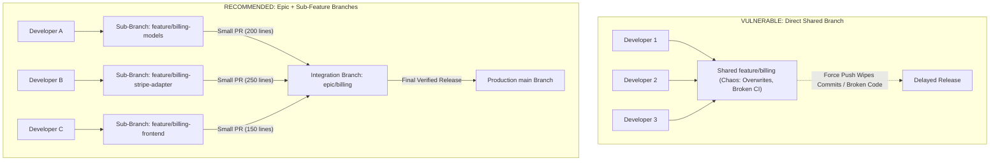

## Fast Revision (10-Second Recall)
Avoid having multiple developers commit directly to a single shared feature branch to prevent stepping on each other's toes and force-push clobbering. Instead, create an Epic parent branch with individual sub-feature branches (`feature/epic-subtask`), integrate via short-lived Stacked PRs, or practice Trunk-Based Development using feature flags directly on `main`.

## The 30-Second Spoken Script
> "When multiple developers must collaborate on a large, multi-week feature—like a complete redesign of the checkout funnel—having everyone push directly to a shared `feature/checkout` branch is a recipe for chaos: developers accidentally overwrite each other's unpushed commits, rebasing becomes impossible without breaking colleagues, and code review at the end is an unreviewable 5,000-line monster. We recommend two modern architectural approaches: First, the Epic Branch with Sub-Feature Branches model. We create an integration branch `epic/checkout`. Each developer creates their own focused sub-branch (like `feature/checkout-ui` and `feature/checkout-api`), opening small, reviewable pull requests that merge directly into the `epic` branch. Second, and even better, Trunk-Based Development with Feature Flags: both developers commit small, incremental PRs directly into `main` every single day, keeping the new code dormant behind an environment flag. This completely eliminates merge conflicts, ensures continuous integration, and allows the feature to be toggled on instantly in production."

## Scenario / Problem Context
Three developers were assigned to build an enterprise multi-currency billing engine over a 4-week sprint. All three pushed daily to a shared branch `feature/billing`. On week 3, Developer A ran `git push --force` after rebasing, wiping out 4 days of Developer B's work. Furthermore, when Developer C tried to run integration tests, the branch was constantly broken because Developer A and B pushed half-finished code. The team missed their sprint deadline due to Git friction.

## Architectural Workflow / Sequence


## Deep-Dive Analysis & Root Causes

### 1. The Pitfalls of Shared Feature Branches
- **Ban on Rebasing**: If 3 developers share a branch, nobody can rebase or squash commits. You are forced into messy merge commits.
- **Accidental Force-Push Destruction**: A single accidental `git push --force` wipes out teammates' commits from the remote origin.
- **Broken Window Theory**: Because it is "just a feature branch", developers push untested, non-compiling code, breaking local dev environments for teammates.

### 2. Strategy 1: The Epic Branch with Stacked PRs
- Create a parent branch: `epic/checkout-redesign` branched from `main`.
- Developer A branches from epic: `feature/checkout-backend` $\rightarrow$ merges into `epic`.
- Developer B branches from epic: `feature/checkout-frontend` $\rightarrow$ merges into `epic`.
- **Benefits**:
  - Each developer owns their branch and can rebase locally.
  - Pull requests are small, focused, and reviewable in 15 minutes.
  - The `epic` branch runs CI to verify integration.
  - Once the epic is complete, merge `epic` into `main` via a single squashed PR.

### 3. Strategy 2: Trunk-Based Development with Feature Flags
The ultimate industry best practice:
- Don't use epic branches at all!
- Wrap new code in a feature flag:
  ```typescript
  if (featureFlags.isEnabled('NEW_BILLING_ENGINE', user)) {
    return newBillingEngine.process(order);
  }
  return legacyBillingEngine.process(order);
  ```
- All three developers merge small PRs directly into `main` 2-3 times daily.
- Code is deployed to production continuously in dark/dormant mode.
- Eliminates merge debt completely.

## Practical Debugging Commands & Code

#### Setting Up Epic and Sub-Feature Branching Workflow
```bash
# 1. Lead creates the integration epic branch from main and pushes to remote
git checkout main
git pull origin main
git checkout -b epic/billing-v2
git push origin epic/billing-v2

# 2. Developer A creates sub-task branch based on the epic
git fetch origin
git checkout -b feature/billing-models origin/epic/billing-v2

# Developer A does work, commits cleanly ...
git commit -m "feat(billing): add multi-currency schemas"

# 3. Developer A opens Pull Request TARGETING epic/billing-v2 (NOT main!)
git push origin feature/billing-models
# In GitHub/GitLab UI: Set Base Branch = epic/billing-v2

# 4. Developer B keeps their sub-branch up to date with the evolving epic
git checkout feature/billing-adapter
git fetch origin epic/billing-v2
git rebase origin/epic/billing-v2
```

#### Protecting Shared Epic Branch on Remote
```bash
# Never push with raw --force on shared branches!
# Always use --force-with-lease to avoid overwriting teammates
git push origin feature/my-subtask --force-with-lease
```

## Prevention & Senior Best Practices

### 1. Architectural Guardrails
- **Automate CI on Epic Branches**: Ensure GitHub Actions / GitLab CI runs the exact same test and linter suites on `epic/*` branches as on `main`.
- **Enforce Max PR Size**: Use PR size labels (e.g. `size/S`, `size/M`, `size/XL`). Block PRs larger than 500 lines of code to encourage breaking features into manageable sub-tasks.

### 2. Operational Hardening
- **Feature Flag Governance**: Every feature flag must have an assigned owner and an expiration ticket created to remove the flag and dead code paths within 30 days of 100% rollout.
- **Continuous Integration Habit**: Mandate that developers synchronize their local work with the remote epic branch at least once every 24 hours.

