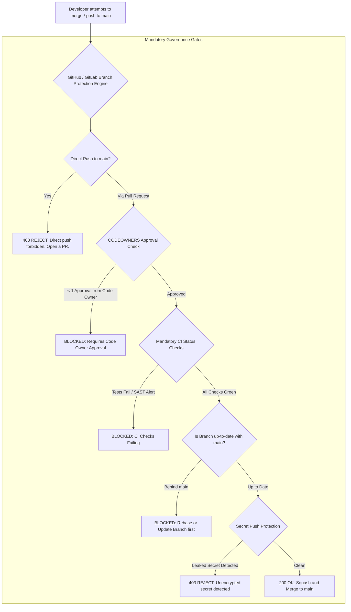

## Fast Revision (10-Second Recall)
Protect production stability by enforcing Branch Protection Rules on `main`: block direct pushes, require pull requests with minimum peer approvals (via CODEOWNERS), mandate passing CI status checks (tests, linters, SAST), require linear history with signed commits (GPG), and enable automated secret scanning with push protection.

## The 30-Second Spoken Script
> "The `main` branch represents deployable production software, so leaving it unprotected is an unacceptable operational risk. A single developer accidentally running `git push origin main --force` or committing broken code directly can take down production and block an entire company. We enforce a multi-layered Branch Protection and Governance policy on GitHub or GitLab. First, direct pushes to `main` are strictly prohibited for all developers, including administrators; all changes must arrive via a Pull Request. Second, PRs require at least one approving review from designated domain experts configured via a `CODEOWNERS` file. Third, all automated CI checks—unit tests, integration suites, ESLint, and security vulnerability scans—must pass before the merge button is enabled. Fourth, we enforce linear history (Squash and Merge or Rebase) and require that the PR branch be strictly up to date with `main` to prevent semantic merge bugs. Finally, we enable Secret Scanning with Push Protection to reject any commit containing API keys or passwords before it leaves the developer's machine."

## Scenario / Problem Context
A developer working late at night intended to push a quick debugging commit to their local feature branch, but accidentally had their local `main` checked out and ran `git push origin main`. The commit had broken syntax and a hardcoded test database connection string. The automated CI/CD pipeline triggered and deployed the broken code directly to production, causing a 40-minute checkout outage. The engineering leadership mandates strict branch governance to eliminate human error.

## Architectural Workflow / Sequence


## Deep-Dive Analysis & Root Causes

### 1. Essential Branch Protection Rules
1. **Require Pull Request Before Merging**:
   - Blocks `git push origin main` globally.
   - Enforces peer code review and transparency.
2. **Require Review from Code Owners (`CODEOWNERS`)**:
   - Changes to `/infra/` require approval from `@devops-team`.
   - Changes to `/billing/` require approval from `@fintech-leads`.
   - Prevents generalist developers from unintentionally modifying critical payment or security modules without expert oversight.
3. **Require Status Checks to Pass (Strict Mode)**:
   - "Strict Mode" requires the feature branch to be tested with the *latest* commit of `main` before merging.
   - Prevents **Semantic Merge Conflicts**: where Branch A and Branch B don't have text merge conflicts, but Branch A calls a method that Branch B just deleted.

### 2. GPG / SSH Signed Commits
Attackers can easily spoof Git commit author emails:
```bash
git commit --author="ceo@company.com" -m "approve backdoors"
```
- Git displays the commit as authored by the CEO unless signed.
- **Enforce Signed Commits**: Require developers to sign commits using GPG or SSH keys. GitHub displays a verified badge, guaranteeing cryptographic provenance.

### 3. Secret Scanning with Push Protection
- Traditional secret scanning alerts security teams *after* the secret is committed and pushed.
- **Push Protection**: The Git server parses the commit AST during the `git receive-pack` pre-receive hook. If an AWS access key, private key, or known secret pattern is detected, the push is **rejected at the socket level**.

## Practical Debugging Commands & Code

#### CODEOWNERS File Specification (`.github/CODEOWNERS`)
```text
# Global default owners for all files unless matched below
* @engineering-leads

# Database migrations require DBA / Lead Backend sign-off
/src/database/migrations/ @database-core-team

# Infrastructure, Terraform, and Kubernetes manifests
/.github/workflows/ @devops-team
/infra/ @devops-team
/k8s/ @devops-team

# Financial ledger and payment processing modules
/src/modules/billing/ @finance-engineering-team
/src/modules/payments/ @finance-engineering-team

# Security configurations and auth modules
/src/modules/auth/ @security-core-team
```

#### Configuring Commit Signing with GPG
```bash
# 1. Generate GPG Key
gpg --full-generate-key

# 2. Tell Git to use your GPG key for signing
git config --global user.signingkey 3AA5C34371567BD2
git config --global commit.gpgsign true

# 3. Verify commit is cryptographically signed
git log --show-signature -1
```

#### GitHub CLI Branch Protection Rule Enforcement
```bash
# Configure branch protection for main via GitHub CLI
gh api -X PUT /repos/:owner/:repo/branches/main/protection \
  -H "Accept: application/vnd.github+json" \
  -d '{
    "required_status_checks": {
      "strict": true,
      "contexts": ["continuous-integration/github-actions", "security/snyk"]
    },
    "enforce_admins": true,
    "required_pull_request_reviews": {
      "dismiss_stale_reviews": true,
      "require_code_owner_reviews": true,
      "required_approving_review_count": 1
    },
    "restrictions": null,
    "required_linear_history": true,
    "allow_force_pushes": false,
    "allow_deletions": false
  }'
```

## Prevention & Senior Best Practices

### 1. Architectural Guardrails
- **Enforce Admins Rule**: Always enable `enforce_admins: true`. If managers or team leads can bypass branch protections, someone will eventually use their admin privileges to "push a quick hotfix" and break production.
- **Linear Commit History Policy**: Enable "Require Linear History" in repository settings. This enforces that all PRs are merged via Squash-and-Merge or Rebase, keeping the production Git graph completely linear.

### 2. Operational Hardening
- **Automated Dependency Vulnerability Scanning**: Require Dependabot or Snyk status checks to pass before merging, blocking pull requests that introduce packages with critical CVEs.
- **Dismiss Stale Reviews on Push**: Enable `dismiss_stale_reviews: true` so that if a developer pushes new commits after receiving approval, the approval is revoked and requires re-review.

