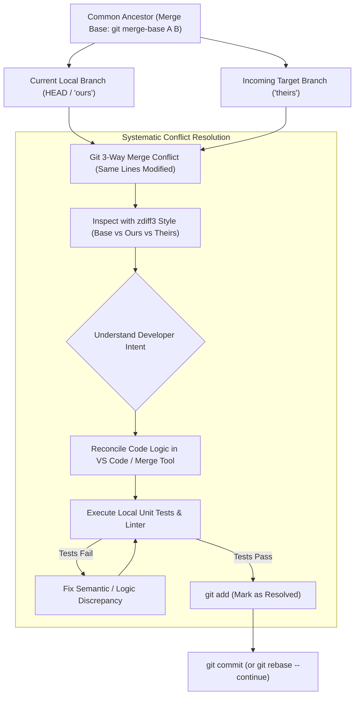

## Fast Revision (10-Second Recall)
Merge conflicts occur when Git's 3-way merge algorithm cannot automatically reconcile differing edits to the same lines from a common ancestor (`merge base`). Configure `merge.conflictStyle = diff3` to view the original common ancestor code alongside current and incoming changes. Use `git rerere` to auto-remember and apply recurring conflict resolutions.

## The 30-Second Spoken Script
> "A merge conflict occurs when two branches modify the exact same lines of a file, or one branch deletes a file that another branch edits, making it impossible for Git's 3-way merge engine to deduce intent automatically. When tackling complex conflicts across dozens of files, avoiding panic requires a structured process. First, we upgrade Git's conflict style to `diff3` or `zdiff3`, which shows three code blocks: your current local branch (`HEAD`), the incoming branch, and critically, the common ancestor base state before either developer touched the file. Seeing the base state immediately explains *why* each developer made their changes. Second, we isolate structural conflicts—like renamed files or conflicting lockfiles (`package-lock.json` or `pnpm-lock.yaml`)—by regenerating lockfiles rather than manually editing JSON. Third, we enable `git rerere` (Reuse Recorded Resolution) so that if we resolve a conflict during a rebase, Git automatically reapplies the identical resolution if the conflict reappears during subsequent pulls."

## Scenario / Problem Context
An engineering team was preparing a major quarterly release. A feature branch refactored the database access layer across 45 files, while concurrent hotfixes modified queries in the same files on `main`. Merging `main` into the feature branch produced 18 conflicted files, a corrupt `pnpm-lock.yaml`, and semantic build errors where syntax was resolved but business logic broke. The lead engineer must guide the team through resolving the conflict safely without losing code.

## Architectural Workflow / Sequence


## Deep-Dive Analysis & Root Causes

### 1. Anatomy of Git's 3-Way Merge
Git does not simply compare two branches; it uses **three points in the DAG**:
1. **`HEAD` (Ours)**: Your current working commit.
2. **`MERGE_HEAD` (Theirs)**: The branch being pulled or merged in.
3. **`MERGE_BASE` (Ancestor)**: The most recent common commit shared by both branches:
   ```bash
   git merge-base main feature-branch
   ```
If both branches changed line 42 from the ancestor, Git stops and injects conflict markers.

### 2. Standard vs `diff3` Conflict Markers
By default, Git hides the common ancestor, showing only:
```text
<<<<<<< HEAD (Ours)
const timeout = 5000;
=======
const timeout = 10000;
>>>>>>> main (Theirs)
```
*The Problem*: You have no idea what the original value was or why it was changed.
With **`diff3` enabled** (`git config --global merge.conflictstyle zdiff3`), Git reveals:
```text
<<<<<<< HEAD (Ours: Changed for mobile network tolerance)
const timeout = 5000;
||||||| base (Ancestor: Original setting)
const timeout = 1000;
=======
const timeout = 10000; // (Theirs: Changed for slow database queries)
>>>>>>> main
```
*The Solution is Obvious*: Both developers increased the timeout from 1,000. Reconcile to `10000` or extract to a dynamic configuration variable.

### 3. Handling Lockfile Conflicts (`package-lock.json`, `pnpm-lock.yaml`)
Never attempt to manually resolve git conflict markers inside a 20,000-line lockfile!
- Accept one version cleanly: `git checkout --ours package-lock.json`.
- Regenerate the lockfile from the merged `package.json`: `npm install` (or `pnpm install`).
- Stage the cleanly regenerated lockfile.

### 4. `git rerere` (Reuse Recorded Resolution)
If you frequently rebase a long-lived feature branch against `main`, you will face the exact same conflict on every single rebase step.
- `git config --global rerere.enabled true`
- When you resolve a conflict once, Git records a fingerprint of the pre-image and post-image in `.git/rr-cache`.
- The next time the identical conflict occurs, Git resolves it automatically!

## Practical Debugging Commands & Code

#### Configuring Modern Diff3 and Rerere in Git
```bash
# Enable zdiff3 (shows base common ancestor, cleaner than standard diff3)
git config --global merge.conflictstyle zdiff3

# Enable Git Reuse Recorded Resolution
git config --global rerere.enabled true
git config --global rerere.autoupdate true
```

#### Step-by-Step Merge Conflict Resolution CLI Playbook
```bash
# 1. Start merge
git merge origin/main

# 2. Check which files are in conflicted status (UU = Unmerged)
git status -s | grep '^UU'

# 3. For package lockfile conflicts: Accept ours and regenerate cleanly
git checkout --ours pnpm-lock.yaml
pnpm install
git add pnpm-lock.yaml

# 4. Open visual merge tool (VS Code or Beyond Compare) for code files
git mergetool

# 5. After editing, verify no raw conflict markers remain
grep -rnE '^(<<<<<<<|=======|>>>>>>>)' src/

# 6. Run test suite to verify semantic correctness
npm test

# 7. Stage and complete merge
git add .
git commit -m "chore: merge origin/main and resolve billing conflict"
```

#### Aborting a Traumatic Merge
```bash
# Safely reset working directory back to pre-merge state
git merge --abort
```

## Prevention & Senior Best Practices

### 1. Architectural Guardrails
- **Short-Lived Feature Branches**: Merge branches back into `main` within 2 to 3 days. Long-lived feature branches that survive for 3 weeks accumulate massive, unavoidable merge conflicts.
- **Trunk-Based Development & Feature Flags**: Break large features into small PRs hidden behind runtime feature flags, continuously merging into `main` daily.

### 2. Operational Hardening
- **Automated PR Conflict Status in CI**: Configure GitHub/GitLab to block PR merges automatically if a branch is not up to date with the target branch.
- **Semantic Code Review Post-Conflict**: Whenever a merge conflict touches business logic (financial calculations, authorization gates), mandate a secondary peer review specifically focused on the conflict resolution block.

