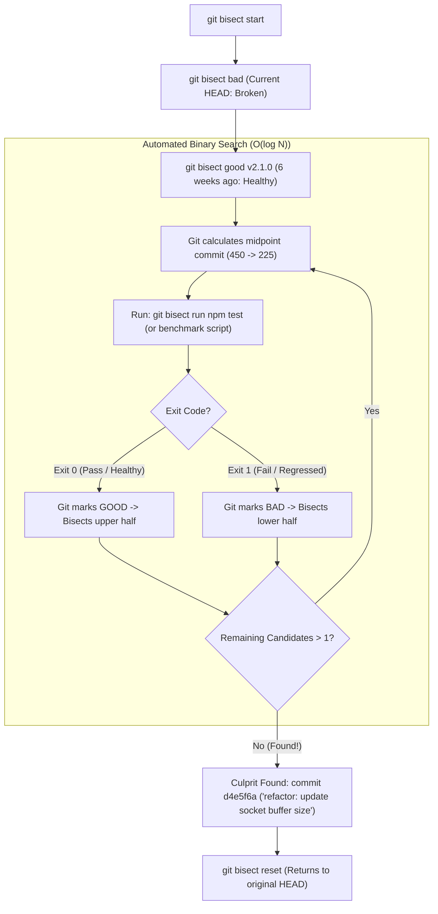

## Fast Revision (10-Second Recall)
`git bisect` uses binary search ($O(\log N)$) through commit history to isolate the exact commit that introduced a bug. Define a known "bad" commit (e.g. current `HEAD`) and a known "good" commit (e.g. `v2.0.0` from 3 months ago). Git checks out intermediate commits for testing. Automate the entire search in seconds using `git bisect run <test-script>`.

## The 30-Second Spoken Script
> "When a nasty performance regression or subtle bug is discovered in production, and you have no idea who broke it or when it happened over the last 1,000 commits, manually inspecting diffs is a hopeless task. `git bisect` is the ultimate forensic tool. It applies mathematical binary search to your Git DAG. In a range of 1,024 commits, binary search pinpoints the exact culprit in just 10 steps ($2^{10} = 1024$). You tell Git: 'the current commit is bad, but tag v2.1.0 last month was good.' Git calculates the midpoint commit and checks it out. You run a quick test and mark it 'good' or 'bad', halving the search space on each step. Even better, if you write a 5-line bash script or test command that exits with code 0 on success and non-zero on failure, you can run `git bisect run ./test.sh`. Git will automatically execute the binary search autonomously, checking out commits and testing them in a loop, handing you the exact breaking commit SHA, author, and pull request in under two minutes."

## Scenario / Problem Context
A high-throughput API gateway suddenly exhibited a 35% throughput regression, dropping from 15,000 req/sec to 9,700 req/sec. The regression was noticed today, but performance testing had not been run for 6 weeks, during which 450 commits were merged by 20 different engineers. No single commit looked obviously suspicious. The performance team must locate the exact commit responsible without spending days reading 450 code diffs.

## Architectural Workflow / Sequence


## Deep-Dive Analysis & Root Causes

### 1. Logarithmic Complexity ($O(\log_2 N)$)
Binary search reduces search spaces exponentially:
- 100 commits: $\approx 7$ steps.
- 1,000 commits: $\approx 10$ steps.
- 10,000 commits: $\approx 14$ steps.
- 100,000 commits: $\approx 17$ steps.
Instead of manually inspecting 1,000 commits for three days, `git bisect` tests only 10 commits.

### 2. Exit Code Semantics for `git bisect run`
When automating bisect with an external script:
- **Exit Code 0**: The commit is **GOOD** (the bug is NOT present).
- **Exit Code 1 to 127** (except 125): The commit is **BAD** (the bug IS present).
- **Exit Code 125**: The commit **CANNOT BE TESTED** (e.g., broken build, syntax error unrelated to the bug). Git skips this commit and picks a nearby neighbor (`git bisect skip`).

### 3. Handling Non-Linear Histories (Merge Commits)
Because `git bisect` navigates the Directed Acyclic Graph (DAG):
- A clean, linear history (via Rebase or Squash-and-Merge) makes bisecting trivial and deterministic.
- Tangled merge commits can cause bisect to wander through multiple divergent side branches, increasing test steps.

## Practical Debugging Commands & Code

#### Automated Binary Search CLI Playbook
```bash
# 1. Initialize bisect session
git bisect start

# 2. Tell Git that current HEAD has the regression (BAD)
git bisect bad

# 3. Tell Git that release tag v2.1.0 was working correctly (GOOD)
git bisect good v2.1.0

# Git responds:
# Bisecting: 450 revisions left to test after this (roughly 9 steps)
# [7f8a9b2c3d4e5f6] refactor: optimize database query builder

# 4. Automate the search using a test script
git bisect run npm test -- tests/perf/throughput.test.ts

# Git will now automatically checkout commits, run the test, evaluate the exit code,
# and repeat until it outputs the culprit:
#
# d4e5f6a1b2c3d4e is the first bad commit
# commit d4e5f6a1b2c3d4e
# Author: Jane Doe <jane@company.com>
# Date:   Wed Oct 14 14:22:10 2026 -0400
#
#     perf: reduce socket buffer size in connection pool

# 5. Clean up and return to your original working branch
git bisect reset
```

#### Writing a Standalone Bisect Validation Script (`check-bug.sh`)
```bash
#!/bin/bash
# check-bug.sh: Used by git bisect to test for latency regression

# 1. Ensure project builds cleanly; if build fails, skip commit
npm run build || exit 125

# 2. Run benchmark script and extract p99 latency in milliseconds
LATENCY=$(node scripts/benchmark.js | grep "p99" | awk '{print $2}')

# 3. If latency is greater than 200ms, consider it BAD (exit 1)
if (( $(echo "$LATENCY > 200" | bc -l) )); then
  echo "Commit is BAD: Latency is ${LATENCY}ms (> 200ms)"
  exit 1
else
  echo "Commit is GOOD: Latency is ${LATENCY}ms"
  exit 0
fi
```
Execute with:
```bash
git bisect run ./check-bug.sh
```

## Prevention & Senior Best Practices

### 1. Architectural Guardrails
- **Continuous Performance Benchmarks in CI**: Don't wait 6 weeks to discover a 35% latency regression. Run automated micro-benchmarks or load tests in nightly CI pipelines to catch regressions within 24 hours of merge.
- **Atomic Commits with Passing Tests**: Enforce CI so that every individual commit merged to `main` builds and passes tests. If intermediate commits on `main` have broken builds, `git bisect` is forced to skip commits (`exit 125`), degrading search efficiency.

### 2. Operational Hardening
- **Tag Every Production Deployment**: Ensure every production deploy creates an annotated git tag (`git tag -a v2.4.0`). These tags serve as the baseline `good` markers when initializing future bisect sessions.
- **Squash-and-Merge for PRs**: Squashing PRs into a single atomic commit guarantees that every commit on `main` represents a complete, functional feature, making `git bisect` 10x faster.

