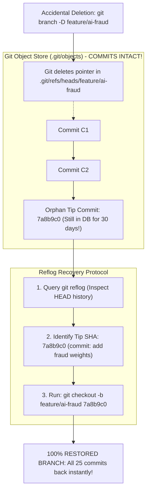

## Fast Revision (10-Second Recall)
In Git, a branch is merely a 41-byte text pointer referencing a commit SHA. Deleting a branch with `git branch -D` only removes the pointer; the underlying commits remain intact in the local `.git/objects` database for at least 30 days. Recover any deleted branch in seconds using `git reflog` to locate the tip commit SHA and running `git checkout -b <branch-name> <commit-sha>`.

## The 30-Second Spoken Script
> "One of the most terrifying moments for a developer is accidentally running `git branch -D` on a feature branch containing two weeks of unmerged work. But in Git, almost nothing is ever truly lost. A branch is not a folder of files; it is simply a lightweight pointer to a commit hash. When you delete a branch, Git only deletes that pointer file in `.git/refs/heads`. The commit objects, trees, and files remain completely safe in Git's internal object store for up to 30 days before garbage collection runs. To recover the branch, we query `git reflog`—the reference log that records every single movement of the `HEAD` pointer. We find the last action taken on that branch (like a commit or checkout), copy the 7-character commit SHA, and run `git checkout -b <branch-name> <sha>`. In less than 10 seconds, the branch, all its files, and its entire commit history are 100% resurrected."

## Scenario / Problem Context
A software engineer was cleaning up obsolete local branches using a bash cleanup script. The script mistakenly ran `git branch -D feature/ai-fraud-model`, deleting a branch containing 25 unpushed commits representing 3 weeks of algorithmic modeling. The engineer feared all work was permanently destroyed. The lead engineer must step in, demonstrate Git's internal object retention architecture, and recover the branch immediately.

## Architectural Workflow / Sequence


## Deep-Dive Analysis & Root Causes

### 1. How Git Stores Branches Internally
In `.git/refs/heads/feature/ai-fraud`, Git stores a single text file containing 40 characters:
```text
7a8b9c0d1e2f3a4b5c6d7e8f9a0b1c2d3e4f5a6b
```
When you run `git branch -D`:
- Git deletes that tiny 41-byte text file.
- Git does **NOT** touch the blobs, trees, or commit objects in `.git/objects`.
- The commits become "unreachable" (orphan commits), but they remain on disk until Git runs a prune cycle (`git prune` or `git gc`), which by default retains unreachable objects for **30 to 90 days** (`gc.reflogExpire = 90 days`).

### 2. The Power of `git reflog`
`git log` shows only commits reachable from current branches.
`git reflog` (Reference Log) shows **every single action you have taken in this repository**:
- Every `commit`, `checkout`, `rebase`, `merge`, `reset`, and `pull`.
- Even if you switch branches, hard-reset, or delete branches, `reflog` maintains an immutable audit log of where `HEAD` was pointing at each second.

### 3. Recovering a Deleted Remote Branch
If someone accidentally deleted a remote branch on GitHub/GitLab (`git push origin --delete feature-branch`):
- Check local machines: Any teammate who checked out or fetched that branch recently still has the complete branch in their local repository!
- They simply run:
  ```bash
  git push origin <local-branch>:refs/heads/<remote-branch>
  ```
- Alternatively, check GitHub Events API: `https://api.github.com/repos/:owner/:repo/events` to find the deleted `head.sha` and re-create the branch via the GitHub UI.

## Practical Debugging Commands & Code

#### Resurrecting a Deleted Local Branch Step-by-Step
```bash
# 1. Query the reference log to find the deleted branch's tip commit
git reflog

# Output:
# 3c4d5e6 HEAD@{0}: checkout: moving from feature/ai-fraud to main
# 7a8b9c0 HEAD@{1}: commit: feat(ml): add fraud tensor weights  <-- The tip of our deleted branch!
# 1f2e3d4 HEAD@{2}: commit: feat(ml): add training pipeline

# 2. Inspect the commit to verify it is the correct work
git show 7a8b9c0

# 3. Resurrect the branch with its original name pointing directly to the commit SHA
git checkout -b feature/ai-fraud 7a8b9c0

# 4. Verify branch history is completely restored
git log --oneline -5
# Output confirms all 25 commits are back!
```

#### Recovering Orphan Commits via `git fsck` (When Reflog Fails)
If for some reason the reflog entry was expired or cleared:
```bash
# Search Git object database for all unreachable (dangling) commits
git fsck --lost-found | grep commit

# Inspect each dangling commit to find the lost work
git show <dangling-commit-sha>

# Re-attach a branch to the discovered dangling commit
git branch recovered-branch <dangling-commit-sha>
```

## Prevention & Senior Best Practices

### 1. Architectural Guardrails
- **Safe Branch Deletion (`-d` vs `-D`)**:
  - `git branch -d`: Safe delete. Git will refuse to delete the branch if it has unmerged commits (`error: The branch is not fully merged`).
  - `git branch -D`: Force delete. Bypasses the safety check.
  - **Rule**: Never use `-D` unless you are 100% certain the code should be thrown away.
- **Push Early and Often**: Push feature branches to remote forks (`git push -u origin feature-branch`). Even if you destroy your local laptop, the branch remains safe on GitHub.

### 2. Operational Hardening
- **Repository Branch Deletion Protection**: In GitHub/GitLab, disable branch deletion on important branches (`main`, `staging`, `release/*`).
- **Audit Webhook Alerts**: Configure a Slack webhook alert when a branch deletion event occurs on the remote repository to catch accidental deletions in real time.

