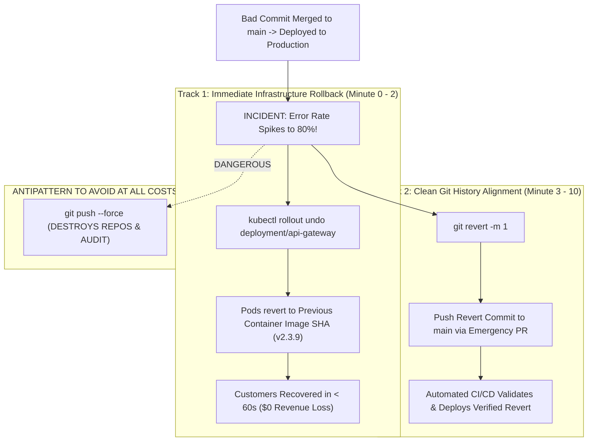

## Fast Revision (10-Second Recall)
When broken code reaches production, prioritize customer recovery over Git perfection. Never force-push (`git push --force`) to a shared production branch. Immediately roll back the deployment using container image redeployment in Kubernetes, generate a forward-revert commit (`git revert <bad-sha> -m 1`), push the revert through CI/CD, and conduct a post-incident review.

## The 30-Second Spoken Script
> "When bad code is pushed to production and breaks live users, the first rule of incident response is: do not panic and do not rewrite Git history. Running `git reset --hard` and force-pushing to the production branch disrupts all colleagues' repositories and wipes out audit trails. Instead, we execute a two-track recovery protocol. Track 1 is immediate customer mitigation: we bypass the source code pipeline and trigger an instant infrastructure rollback at the Kubernetes or CDN layer, rolling deployment pods back to the previously known good container image SHA in under 60 seconds. Track 2 is Git alignment: we generate a forward-reverting commit using `git revert <commit-sha>` (or `git revert -m 1 <merge-commit-sha>` if a PR was merged). A `git revert` is completely safe: it computes the exact inverse patch of the faulty commit and appends a clean new commit to the branch. This passes standard CI/CD checks, documents the incident cleanly, and allows the team to debug the root cause locally without production pressure."

## Scenario / Problem Context
A pull request introducing a bug in a payment gateway calculation was merged to `main`. The automated CI/CD pipeline built the artifact and deployed it to production. Within 3 minutes, checkout error rates spiked to 80%, losing $15,000 in sales per minute. A junior engineer suggested running `git reset --hard HEAD~1` and force-pushing to `main`. The engineering incident commander must take control and execute the correct recovery playbook.

## Architectural Workflow / Sequence


## Deep-Dive Analysis & Root Causes

### 1. Why `git push --force` to Production is an Anti-Pattern
Running `git reset --hard` and force-pushing to `main` during a live incident causes catastrophic secondary problems:
- **Corrupts Teammates' Working Clones**: Every developer with an active clone of `main` will face divergent history errors on their next `git pull`, risking accidental re-introduction of the bad code!
- **Destroys the Audit Trail**: Compliance frameworks (SOC 2, ISO 27001, PCI-DSS) require an immutable audit trail of what code was deployed when.
- **Race Conditions**: If another developer merges a clean PR during the force-push, their clean work is permanently overwritten and lost.

### 2. Forward Rollback via `git revert`
- `git revert <commit-sha>` does not rewrite history; it moves history **forward**.
- It creates a brand-new commit that applies the exact inverse mathematical diff of the bad commit:
  - Lines added $\rightarrow$ deleted.
  - Lines deleted $\rightarrow$ re-added.
- It can be pushed directly through standard branch protections, triggers standard automated CI test runs, and preserves the complete incident history.

### 3. Reverting a Merge Commit (`-m 1`)
If the bad code arrived via a Pull Request (a merge commit with two parents), running standard `git revert <sha>` fails with:
`error: commit is a merge but no -m option was given.`
- **Why**: Git does not know which of the two parents represents the mainline branch you wish to keep.
- **Solution**: Pass `-m 1` (`--mainline 1`):
  ```bash
  git revert -m 1 <merge-commit-sha>
  ```
  This tells Git to keep the primary branch (parent 1) and revert all changes introduced by the merged feature branch (parent 2).

## Practical Debugging Commands & Code

#### Incident Response Playbook: Step-by-Step
```bash
# =========================================================================
# STEP 1: IMMEDIATE INFRASTRUCTURE ROLLBACK (Do this FIRST!)
# =========================================================================
# Roll back Kubernetes deployment to previous revision in seconds
kubectl rollout undo deployment/payment-service -n prod

# Verify live rollback status
kubectl rollout status deployment/payment-service -n prod


# =========================================================================
# STEP 2: GIT REVERT (Align source code with production)
# =========================================================================
# Ensure your local main is up to date
git checkout main
git pull origin main

# Find the SHA of the bad commit or merge commit
git log --oneline -5

# A) If it was a single regular commit:
git revert <bad-commit-sha> --no-edit

# B) If it was a merged Pull Request (Merge Commit):
git revert -m 1 <bad-merge-commit-sha> --no-edit

# Push the revert commit to remote
git push origin main
# (Or open an expedited Emergency Revert PR if direct pushes are blocked)
```

#### Re-Reverting When Ready to Re-Introduce the Fixed Code
A famous Git trap: If you revert a merge commit, you cannot simply re-merge the feature branch later! Git will say `Already up to date` because the commits are already in history.
- To re-introduce the branch after fixing the bug, **revert the revert commit**:
  ```bash
  git revert <the-revert-commit-sha>
  ```

## Prevention & Senior Best Practices

### 1. Architectural Guardrails
- **Decouple Deployment from Release**: Use Feature Flags (LaunchDarkly, Unleash). If bad code reaches production, flip the kill-switch flag off in 5 seconds without needing any Git commits or container redeployments.
- **Canary Deployments with Automated Rollback**: Deploy new code to a 2% canary pool first. If HTTP 5xx error rates spike, Argo Rollouts or Flagger automatically rolls back within 30 seconds before 100% of traffic is exposed.

### 2. Operational Playbooks
- **Documented Incident Roles**: Designate a single Incident Commander during outages. Individual engineers must not execute ad-hoc Git commands or cloud modifications without the Commander's authorization.
- **Blameless Post-Mortem**: Conduct a post-mortem focusing on systemic failure: Why did unit and integration tests miss the bug? Why did staging validation not catch the discrepancy?

