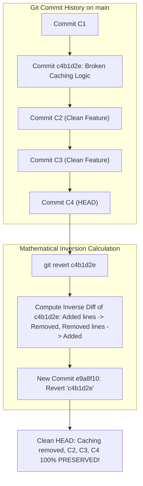

## Fast Revision (10-Second Recall)
`git revert <commit-sha>` safely undoes the changes of a target commit by appending an inverse commit to the history, preserving complete DAG traceability. For merge commits, specify the mainline parent with `-m 1`. When reverting multiple commits, use `git revert -n <range>` to batch inverse changes into a single clean commit.

## The 30-Second Spoken Script
> "`git revert` is the standard, production-safe way to undo commits that have already been pushed to a remote repository. Unlike `git reset`, which deletes commits from history and forces dangerous force-pushes, `git revert` is non-destructive: it calculates the exact mathematical inverse of the specified commit and creates a brand-new commit containing the reversal. This preserves an accurate historical audit trail, passes automated CI/CD checks, and avoids breaking teammates' clones. If you need to revert a merge commit from a merged pull request, you must pass `-m 1` to designate the mainline branch as the parent to keep. If you need to revert three consecutive bad commits, using `git revert -n` (no-commit) allows you to batch all three reversals into a single clean commit rather than cluttering Git history with multiple undo commits."

## Scenario / Problem Context
Three days ago, a developer committed a caching optimization `c4b1d2e` to `main`. Today, customer support reported that this specific commit caused race conditions under high concurrency, corrupting user profile sessions. However, 15 other critical, unrelated bug fixes have been committed to `main` since then. The team cannot roll back the branch or reset history. They must surgically neutralize commit `c4b1d2e` while leaving all 15 subsequent commits intact.

## Architectural Workflow / Sequence


## Deep-Dive Analysis & Root Causes

### 1. Mathematical Inversion
When `git revert <SHA>` executes:
$$\text{Revert Diff} = \text{Diff}(\text{Target}, \text{Parent of Target})$$
- If `c4b1d2e` added `const cache = new Redis()` at line 10, the revert commit removes that line.
- If lines around line 10 were modified by subsequent commits ($C_2, C_3$), Git triggers a merge conflict. The engineer resolves the conflict by removing the cache call while keeping the new features.

### 2. Reverting a Range of Commits (`--no-commit`)
If a faulty feature consisted of 5 separate commits (`A..E`):
- Running `git revert` 5 times creates 5 separate "Revert ..." commits, creating noise in the git log.
- **Batch Reversal Pattern**:
  ```bash
  git revert -n A..E
  git commit -m "revert: rollback dynamic pricing feature (commits A through E)"
  ```
  The `-n` (`--no-commit`) flag applies all inverse diffs to the staging area, allowing you to commit the entire reversal as a single atomic commit.

### 3. The Parent Selection Rule for Merge Commits (`-m`)
When reverting a merge commit:
- Parent 1 (`-m 1`): The branch you were on when you merged (e.g. `main`).
- Parent 2 (`-m 2`): The branch that was merged in (e.g. `feature-branch`).
- By specifying `-m 1`, Git removes all changes brought in by `feature-branch` while keeping `main`'s baseline intact.

### 4. The Re-Reverting Workflow (Re-introducing the Feature)
If you revert a feature branch, fix the bug on the feature branch, and try to merge it again:
- **Git will NOT apply the feature code!**
- Why: Git sees that the feature commits are already in the branch ancestry.
- **How to fix**: You must **revert the revert commit**:
  ```bash
  git revert <revert-commit-sha>
  ```
  This inverts the inversion, bringing all original feature code back to life cleanly.

## Practical Debugging Commands & Code

#### CLI Playbook: Surgical Revert Scenarios
```bash
# Scenario 1: Revert a single standard commit
git revert c4b1d2e -m "revert: remove race-condition-prone caching logic"

# Scenario 2: Revert a merged Pull Request (Merge Commit) keeping main
git revert -m 1 7f8a9b2 --no-edit

# Scenario 3: Batch revert a range of commits into a single clean commit
# Reverts all commits from commit1 up to and including commit3
git revert -n commit1^..commit3
git commit -m "revert: rollback experimental payment integration"

# Scenario 4: Resolving conflicts during a revert
git status # Find conflicted files
# Edit files to resolve conflicts, then stage:
git add src/cache.ts
# Finalize the revert:
git revert --continue

# (If the revert has too many cascading conflicts and you need to abort):
git revert --abort
```

#### Finding the Parent Numbers of a Merge Commit
```bash
# Inspect merge commit to verify parent ordering
git show --pretty=format:"Parents: %P" 7f8a9b2 -s
# Parents: a1b2c3d (Parent 1 = main) e4f5a6b (Parent 2 = feature)
```

## Prevention & Senior Best Practices

### 1. Architectural Guardrails
- **Descriptive Revert Commit Messages**: Always explain *why* the commit was reverted in the commit message body:
  ```text
  revert: rollback caching layer in order service
  
  Reverts commit c4b1d2e.
  Reason: Caused severe race conditions and connection pool exhaustion under p99 load.
  Tracking Ticket: INC-9921
  ```
- **Automated CI Regression Runs**: Run the full integration test suite on the revert commit before deploying, verifying that reverting the target commit didn't inadvertently break a downstream dependency that relied on it.

### 2. Operational Hardening
- **Never Manually Undo Code Instead of Reverting**: Don't manually delete lines and create a "fix bug" commit. Using `git revert` guarantees that Git's internal 3-way merge engine knows the change was intentionally undone, preventing future merge conflicts.

