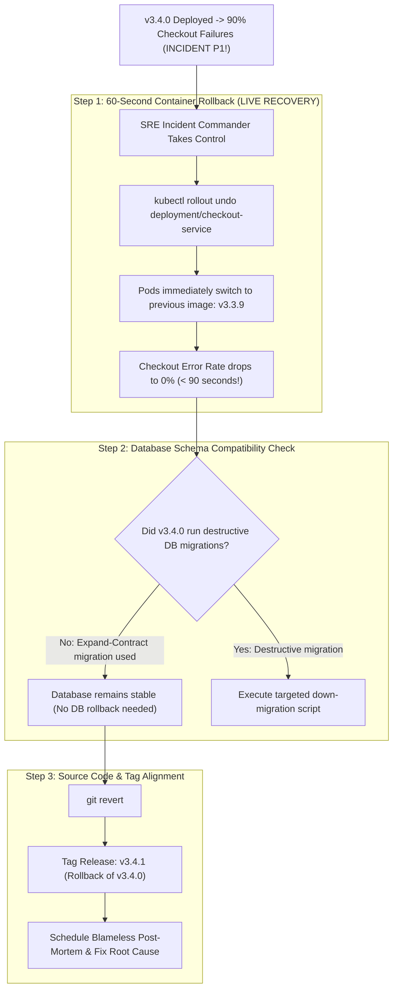

## Fast Revision (10-Second Recall)
When a release fails in production, execute immediate infrastructure rollback first (re-deploy the prior immutable container tag in Kubernetes), handle database schema rollbacks carefully (ensure backward-compatible migrations), and align Git history second using forward-reverting PRs (`git revert`).

## The 30-Second Spoken Script
> "Rolling back a production release under active incident conditions requires separating infrastructure recovery from source code version control. Attempting to fix code, re-compile, and wait 20 minutes for CI/CD while customers suffer is an operational failure. In our incident playbook, Step 1 is the 60-second Infrastructure Rollback: we trigger an immediate Kubernetes rollout undo (`kubectl rollout undo deployment/<service>`), which points the pod replicas back to the previous, certified immutable container image SHA. Step 2 is verifying the database: because our engineering standards mandate backward-compatible migrations (the Expand-Contract pattern), the older container code runs seamlessly against the newly expanded database schema without needing a risky database rollback. Step 3 is Git Alignment: once production is stable, the on-call engineer opens a `git revert` PR against the release branch, re-running test suites and documenting the regression cleanly."

## Scenario / Problem Context
An enterprise fintech platform deployed version `v3.4.0` at 10:00 AM. By 10:15 AM, database connection saturation caused 90% of checkout transactions to fail. The engineering manager panicked and suggested editing code on `main` to find the bug. Meanwhile, customers were abandoning carts, losing $40,000 per minute. The lead Site Reliability Engineer (SRE) must take charge, execute an immediate rollback, and restore checkout availability in under 2 minutes.

## Architectural Workflow / Sequence


## Deep-Dive Analysis & Root Causes

### 1. The Rollback Hierarchy of Speed
When an outage is active, every second equals lost revenue:
1. **Feature Flag Flip**: 5 seconds (fastest, zero deployment required).
2. **CDN / Traffic Switch (Blue/Green or Canary)**: 15 seconds (switch load balancer target group to green pool).
3. **Container Rollout Undo**: 60 seconds (`kubectl rollout undo`).
4. **Git Revert + Full CI/CD Build**: 15 to 30 minutes (too slow for active Sev-1 outages!).
- **Core Lesson**: Always roll back at the **lowest layer available** (Feature Flag > Load Balancer > Container > Git).

### 2. The Database Migration Rollback Trap
Why do database rollbacks cause data loss?
- If `v3.4.0` added a new column `tax_rate`, and 500 orders were created during the 15 minutes it was live:
  - Running a destructive "Down Migration" (`ALTER TABLE orders DROP COLUMN tax_rate`) permanently wipes out tax data for those 500 completed orders!
- **Senior Rule: Expand-Contract Migrations**:
  - Never drop columns or rename tables in the same release as code changes.
  - Old code must be able to run against new database schemas without crashing.

### 3. Git Release Tag Semantics
What do you do with Git tags after a rollback?
- **Never delete or move existing Git tags** (`git tag -d v3.4.0`).
  - Deleting tags breaks deployment histories and causes Docker image caching confusion.
- **Always move forward**:
  - Cut a new SemVer patch release: `v3.4.1`.
  - The release notes document: `v3.4.1: Rollback release of v3.4.0 due to INC-4029`.

## Practical Debugging Commands & Code

#### Emergency Production Rollback CLI Runbook
```bash
# =========================================================================
# STEP 1: INFRASTRUCTURE CONTAINER ROLLBACK (Execute Immediately!)
# =========================================================================
# Roll back Kubernetes deployment to previous revision
kubectl rollout undo deployment/checkout-service -n prod

# Monitor pods rolling back to the previous healthy container image
kubectl rollout status deployment/checkout-service -n prod

# Verify live HTTP health check status
curl -f https://api.company.com/healthz || echo "Still unhealthy!"


# =========================================================================
# STEP 2: GIT REVERT AND ALIGNMENT (Execute after users are safe)
# =========================================================================
git checkout main
git pull origin main

# Revert the bad merge commit that was deployed
git revert -m 1 <bad-merge-commit-sha> -m "revert: rollback release v3.4.0 due to checkout incident INC-4029"

# Push the revert to main
git push origin main

# =========================================================================
# STEP 3: SEMVER ROLLBACK TAGGING
# =========================================================================
# Create new patch tag v3.4.1 reflecting the rollback
git tag -a v3.4.1 -m "Release v3.4.1: Production rollback of v3.4.0"
git push origin v3.4.1
```

#### Inspecting Kubernetes Revision History
```bash
# View all recent deployment revisions and image SHAs
kubectl rollout history deployment/checkout-service -n prod

# Roll back to a specific older revision number (e.g. revision 12)
kubectl rollout undo deployment/checkout-service -n prod --to-revision=12
```

## Prevention & Senior Best Practices

### 1. Architectural Guardrails
- **Blue-Green Deployments**: Maintain two identical production environments (Blue and Green). Traffic routes to Blue. When Green is deployed and fails, flip router back to Blue in 5 seconds.
- **Automated Canary Rollouts (Argo Rollouts)**: Deploy new releases to 5% of traffic. If Prometheus detects p99 latency spikes or error rates above 1%, the canary aborts and rolls back automatically without human intervention.

### 2. Operational Hardening
- **One-Click Rollback in CI/CD**: Ensure the CI/CD pipeline (GitLab CI, GitHub Actions, Octopus) has a prominent "Rollback to Previous Release" button that triggers container image redeployment with zero approval friction.
- **Regular Rollback Drills**: Conduct simulated rollback drills in staging every quarter to ensure on-call engineers can execute container rollbacks in under 90 seconds under pressure.

