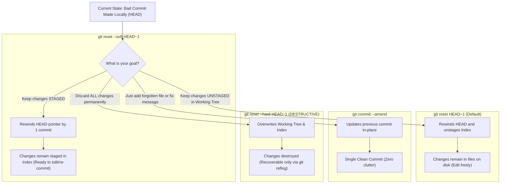

## Fast Revision (10-Second Recall)
To fix the last commit without losing code, use `git reset --soft HEAD~1` (moves the branch pointer back and leaves changes staged). To unstage changes while keeping them on disk, use `git reset HEAD~1` (mixed reset). To fix minor typos or add forgotten files to the last commit, use `git commit --amend --no-edit`. Use `git reset --hard` only when you intentionally wish to permanently destroy changes.

## The 30-Second Spoken Script
> "Undoing mistakes in Git depends entirely on whether the commit has been pushed to a shared remote repository and whether you want to keep your code. If the commit is purely local, you have complete freedom to reshape history. If you committed too early or want to split a monolithic commit into three smaller commits, use `git reset --soft HEAD~1`. This rewinds the commit history by one step, but preserves all your edited files directly in the Git staging area. If you forgot to include a single file or made a minor typo in the commit message, running `git add <file>` followed by `git commit --amend` updates the existing commit in place without creating a second commit. If you want to unstage files, use `git restore --staged <file>`. Only use `git reset --hard` when you genuinely want to throw away all code back to the previous commit; even then, Git's safety net `git reflog` can rescue lost commits within 30 days."

## Scenario / Problem Context
A software engineer committed code containing temporary debugging statements (`console.log`, hardcoded mock API tokens) to their local branch. They realized the mistake before pushing to remote GitHub. The engineer needs to undo the commit, remove the debug lines, keep the valid feature code intact, and re-commit cleanly without leaving messy 'undo' or 'revert' commits in the branch history.

## Architectural Workflow / Sequence


## Deep-Dive Analysis & Root Causes

### 1. Understanding Git's Three Trees
To master undoing commits, you must understand Git's internal architecture:
1. **Working Directory**: The actual files on your filesystem that you edit in VS Code.
2. **Index (Staging Area)**: The prepared snapshot waiting to become the next commit (`git add`).
3. **Commit History (`HEAD`)**: The pointer to the latest committed snapshot in the DAG.

### 2. The Three Modes of `git reset`
| Command | Moves `HEAD`? | Updates Index (Staging)? | Modifies Working Directory Files? |
|---|---|---|---|
| **`git reset --soft HEAD~1`** | **YES** (rewinds 1 commit) | **NO** (changes remain staged) | **NO** (files remain identical) |
| **`git reset --mixed HEAD~1`** (default) | **YES** (rewinds 1 commit) | **YES** (unstages files) | **NO** (files remain identical) |
| **`git reset --hard HEAD~1`** | **YES** (rewinds 1 commit) | **YES** (clears staging) | **YES** (permanently overwrites files to match target commit!) |

### 3. Modern Git Restoration Primitives (Git 2.23+)
In modern Git, `git checkout` was split into two dedicated commands to eliminate confusion:
- **`git switch`**: Switches branches (`git switch main`).
- **`git restore`**: Restores working tree files (`git restore <file>`) or unstages files (`git restore --staged <file>`).

### 4. Safety Net: The Git Reflog
Even if an engineer accidentally runs `git reset --hard HEAD~1`:
- Git **never immediately deletes commits** from its `.git/objects` database.
- The reference log (`git reflog`) tracks every single movement of the `HEAD` pointer.
- The wiped commit can be resurrected in 5 seconds by pointing a branch back to the lost SHA.

## Practical Debugging Commands & Code

#### CLI Playbook: Undoing and Fixing Local Commits
```bash
# Scenario 1: Rewind commit, keeping all changes staged in the index
git reset --soft HEAD~1

# Scenario 2: Unstage specific file while keeping your edits on disk
git restore --staged src/debug-logger.ts

# Scenario 3: Discard edits to a specific file, reverting it back to HEAD
git restore src/debug-logger.ts

# Scenario 4: Forgot to add a file to the last commit? Amend it in-place!
git add src/forgotten-file.ts
git commit --amend --no-edit

# Scenario 5: Just fix a typo in the last commit message
git commit --amend -m "feat(billing): properly calculate tax rates"

# Scenario 6: Undoing multiple commits (e.g. rewind 3 commits, keep code in files)
git reset HEAD~3
```

#### Rescuing Code from an Accidental `git reset --hard`
```bash
# 1. View the history of all HEAD pointer movements
git reflog
# Output:
# 1a2b3c4 HEAD@{0}: reset: moving to HEAD~1  <-- The accidental hard reset!
# 5d6e7f8 HEAD@{1}: commit: critical feature code  <-- The commit we want back!

# 2. Resurrect the lost commit immediately!
git reset --hard HEAD@{1}
# Or branch from it:
git branch recovered-work 5d6e7f8
```

## Prevention & Senior Best Practices

### 1. Architectural Guardrails
- **Golden Rule**: Use `git reset` ONLY for local, unpushed commits. If a commit has already been pushed to `main` or a shared branch, use `git revert` instead to maintain linear history without rewriting remote refs.
- **Micro-Commit Discipline**: Commit in small, logical units. A single atomic commit is trivially easy to amend, drop, or cherry-pick compared to an 800-line monolithic commit.

### 2. Operational Hardening
- **Check Status Before Commit**: Always run `git status` and `git diff --staged` before committing to verify that no secret files, `.env` manifests, or debug statements were staged by accident.
- **Pre-Commit Linting**: Install `husky` and `lint-staged` to automatically reject commits containing `debugger;` or unformatted files before Git creates the commit object.

