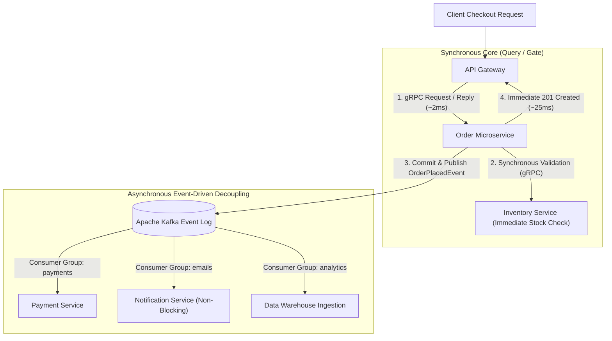

## Fast Revision (10-Second Recall)
Use synchronous communication (gRPC with Protocol Buffers or HTTP/REST) for immediate, request-reply user queries where the caller cannot proceed without the result. Use asynchronous communication (Kafka event streaming or RabbitMQ message queues) for long-running workflows, background side-effects, and decoupled state updates to prevent temporal coupling and cascading latency.

## The 30-Second Spoken Script
> "Designing inter-service communication requires choosing between synchronous request-reply and asynchronous event-driven paradigms based on temporal coupling. Synchronous communication using gRPC over HTTP/2 provides type-safe, binary multiplexed performance with sub-millisecond serialization overhead—ideal for queries where an API gateway requires an immediate response, such as fetching real-time account authorization. However, chaining multiple synchronous HTTP calls introduces severe availability degradation: if Service A calls B, which calls C, which calls D, total latency is additive and overall availability is the product of all four services. Therefore, for state transitions and side effects—such as order placement, payment confirmations, and notifications—we mandate asynchronous event-driven communication using Kafka or RabbitMQ. The emitting service publishes an event to an immutable log and acknowledges the user immediately, while downstream services consume and process the event independently without blocking the caller."

## Scenario / Problem Context
An e-commerce platform built on microservices implemented synchronous REST HTTP calls for its checkout flow: `Order Service` made blocking HTTP calls to `Inventory Service`, `Payment Gateway`, `Fraud Detection Service`, `Email Notification Service`, and `Analytics Service`. During a holiday flash sale, a latency spike in the third-party email provider backed up HTTP connections in the Order Service, exhausting all worker threads and crashing the entire checkout funnel. The team must redesign inter-service communication to decouple systems.

## Architectural Workflow / Sequence


## Deep-Dive Analysis & Root Causes

### 1. The Additive Latency and Multiplicative Availability Problem
In a synchronous call chain ($A \rightarrow B \rightarrow C \rightarrow D$):
- **Latency**: $L_{\text{total}} = L_A + L_B + L_C + L_D$.
- **Availability**: If each service maintains $99.9\%$ ($3\text{ nines}$) availability:
  $$A_{\text{total}} = 0.999 \times 0.999 \times 0.999 \times 0.999 \approx 99.6\%$$
  A single chain of four $99.9\%$ services drops total uptime to under $99.6\%$ (over 35 hours of annual downtime).
- **Temporal Coupling**: All four services must be online, healthy, and responsive at the exact same millisecond for the transaction to succeed.

### 2. Protocol Comparison: REST vs gRPC vs Kafka vs RabbitMQ
| Protocol | Type | Transport | Data Format | Best Used For |
|---|---|---|---|---|
| **REST / HTTP 1.1** | Synchronous | TCP | Text (JSON) | Public external client APIs |
| **gRPC** | Synchronous | HTTP/2 (Multiplexed) | Binary (Protobuf) | Internal low-latency RPC queries |
| **RabbitMQ** | Asynchronous | AMQP | Binary / JSON | Task queues, complex routing (direct/topic) |
| **Apache Kafka** | Asynchronous | TCP (Commit Log) | Binary (Avro/Protobuf) | High-throughput event streams, replayability |

### 3. Event-Carried State Transfer vs Event Notification
- **Event Notification**: Emits `OrderCreated { orderId: 101 }`. Consumers must call back synchronously: `GET /orders/101` (re-introducing coupling!).
- **Event-Carried State Transfer**: Emits `OrderCreated { orderId: 101, customerId: 44, items: [...], total: 89.99 }`. Consumers process the event entirely from the payload with zero synchronous callbacks.

## Practical Debugging Commands & Code

#### gRPC Synchronous Client with Deadlines (Node.js & TypeScript)
```typescript
import * as grpc from '@grpc/grpc-js';
import * as protoLoader from '@grpc/proto-loader';

const packageDefinition = protoLoader.loadSync('inventory.proto', {
  keepCase: true,
  longs: String,
  enums: String,
  defaults: true,
  oneofs: true,
});

const protoDescriptor = grpc.loadPackageDefinition(packageDefinition) as any;
const client = new protoDescriptor.inventory.InventoryService(
  'inventory-service.internal:50051',
  grpc.credentials.createInsecure()
);

export function checkInventorySync(productId: string, quantity: number): Promise<boolean> {
  return new Promise((resolve, reject) => {
    // CRITICAL: Always attach strict deadline (e.g. 500ms) to prevent hanging
    const deadline = new Date();
    deadline.setMilliseconds(deadline.getMilliseconds() + 500);

    client.CheckStock({ productId, quantity }, { deadline }, (err: any, response: any) => {
      if (err) {
        if (err.code === grpc.status.DEADLINE_EXCEEDED) {
          console.error('[gRPC Timeout] Inventory service exceeded 500ms deadline');
        }
        return reject(err);
      }
      resolve(response.inStock);
    });
  });
}
```

#### Asynchronous Event Publisher (KafkaJS)
```typescript
import { Kafka, Partitioners } from 'kafkajs';

const kafka = new Kafka({
  clientId: 'order-service',
  brokers: ['kafka-broker-1:9092', 'kafka-broker-2:9092'],
});

const producer = kafka.producer({
  createPartitioner: Partitioners.DefaultPartitioner,
  idempotent: true, // Guarantees exactly-once publishing per producer session
});

export async function publishOrderPlacedEvent(orderData: object, orderId: string) {
  await producer.connect();
  
  // Publish partitioned by orderId to guarantee strict ordering for this order
  await producer.send({
    topic: 'orders.v1.events',
    messages: [
      {
        key: orderId,
        value: JSON.stringify({
          eventType: 'ORDER_PLACED',
          timestamp: new Date().toISOString(),
          payload: orderData,
        }),
      },
    ],
  });
}
```

## Prevention & Senior Best Practices

### 1. Architectural Guardrails
- **Mandate Deadlines on All RPCs**: Never allow an HTTP or gRPC client to run without an explicit timeout (e.g. 200 ms to 1,000 ms). An unbounded synchronous call will eventually take down the calling service.
- **Transactional Outbox Pattern**: When saving an entity to the database and publishing an event to Kafka, never execute them as two uncoordinated steps. Use the Outbox Pattern to guarantee that events are committed transactionally with the database row.

### 2. Operational Hardening
- **Monitor Consumer Group Lag**: Alert on Kafka consumer group lag (`kafka_consumergroup_lag`) when downstream services fall behind by more than 5,000 messages.
- **Trace Inter-Service Calls with Distributed Tracing**: Propagate W3C `traceparent` headers across both HTTP/gRPC requests and Kafka record headers to visualize end-to-end latency.

