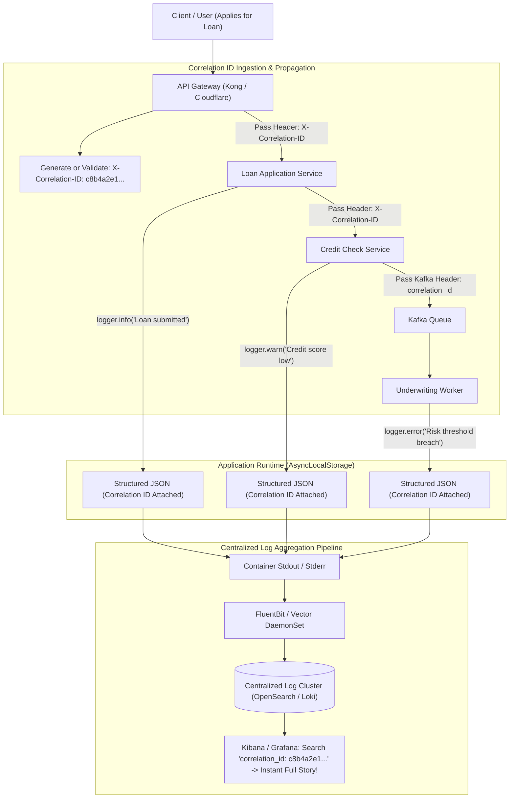

## Fast Revision (10-Second Recall)
In a microservices architecture, never log to local files. Generate a unique Correlation ID (`X-Correlation-ID`) at the API Gateway, propagate it across all downstream HTTP, gRPC, and message queue calls, attach it to every structured JSON log line using request context (`AsyncLocalStorage`), and stream logs to a centralized search cluster (Elasticsearch, OpenSearch, Grafana Loki).

## The 30-Second Spoken Script
> "When a system consists of 30 microservices deployed across 200 container pods, SSHing into individual servers to `tail -f` log files is completely impossible. To troubleshoot errors in a distributed system, we implement a centralized, structured logging pipeline with end-to-end Correlation ID propagation. When a request enters our API Gateway, we check for an incoming `X-Correlation-ID` header; if missing, we generate a cryptographically random UUID. We store this ID in the thread's execution context—using `AsyncLocalStorage` in Node.js or `context.Context` in Go. Every application log is formatted as a structured JSON object that automatically includes the Correlation ID, service name, environment, and timestamp. Containers write strictly to `stdout`, where a lightweight daemon like FluentBit ships the logs to an Elasticsearch or Grafana Loki cluster. An on-call engineer can take a single Correlation ID from an error report and instantly query all log lines across all 30 microservices that touched that transaction in chronological order."

## Scenario / Problem Context
A banking customer reports that a loan application failed with a generic '500 Internal Server Error' message. To debug the issue, the support engineer must search through logs across 7 microservices: API Gateway, User Auth, Credit Check, Document Verification, Underwriting, Risk Engine, and Core Banking. Because each service logs in different formats to local container files without a common identifier, reconstructing the error takes three days and requires manual log correlation across 50 container pods.

## Architectural Workflow / Sequence


## Deep-Dive Analysis & Root Causes

### 1. The Twelve-Factor App Logging Mandate
The Twelve-Factor App specifies: **Treat logs as event streams**.
- A microservice must never manage log files, rotate logs, or write to local disks.
- Microservices write strictly unbuffered JSON strings to `stdout` and `stderr`.
- The container runtime (Docker / containerd) captures the stream, and a cluster-level DaemonSet (FluentBit) collects, parses, and forwards the records.

### 2. Correlation ID vs Trace ID
- **Correlation ID (`X-Correlation-ID`)**: A human-readable business tracking ID passed in HTTP headers to correlate all logs produced during a single transaction across services.
- **Trace ID**: A 128-bit hex string specifically used by distributed tracing systems (OpenTelemetry/Jaeger) to measure span durations and call graphs.
- *Senior Best Practice*: In modern systems, the OpenTelemetry `trace_id` is often reused as the Correlation ID to avoid redundant header propagation.

### 3. Context Storage Without Manual Parameter Passing
Passing `correlationId` as an explicit argument to every internal function (`doWork(user, correlationId)`) produces bloated code.
- **Node.js**: Use `AsyncLocalStorage` to store the request context across asynchronous execution chains.
- **Go**: Pass `ctx context.Context` as the first function parameter.
- **Java**: Use `MDC` (Mapped Diagnostic Context) with SLF4J/Logback.

## Practical Debugging Commands & Code

#### Correlation ID Middleware with AsyncLocalStorage & Pino (TypeScript)
```typescript
import express, { Request, Response, NextFunction } from 'express';
import { AsyncLocalStorage } from 'async_hooks';
import crypto from 'crypto';
import pino from 'pino';

const asyncLocalStorage = new AsyncLocalStorage<{ correlationId: string }>();

// 1. Structured JSON Logger that automatically injects Correlation ID from context
const baseLogger = pino();

export const logger = new Proxy(baseLogger, {
  get(target, propKey, receiver) {
    const store = asyncLocalStorage.getStore();
    const correlationId = store?.correlationId || 'NO_CORRELATION_ID';
    // Bind correlationId to every log record
    const childLogger = baseLogger.child({ correlationId, service: 'loan-service' });
    return Reflect.get(childLogger, propKey, receiver);
  },
});

// 2. Correlation ID Middleware
export function correlationIdMiddleware(req: Request, res: Response, next: NextFunction) {
  // Use existing header or generate brand-new UUID
  const correlationId =
    (req.headers['x-correlation-id'] as string) || crypto.randomUUID();

  // Set response header so client receives tracking ID for support tickets
  res.setHeader('X-Correlation-ID', correlationId);

  // Run downstream handlers inside AsyncLocalStorage context
  asyncLocalStorage.run({ correlationId }, () => {
    next();
  });
}

// 3. Outbound HTTP Client automatically propagating Correlation ID
export async function fetchWithCorrelation(url: string, options: RequestInit = {}) {
  const store = asyncLocalStorage.getStore();
  const headers = new Headers(options.headers || {});

  if (store?.correlationId) {
    headers.set('X-Correlation-ID', store.correlationId);
  }

  return fetch(url, { ...options, headers });
}
```

#### Querying Centralized Logs in Elasticsearch / OpenSearch via CLI
```bash
# Query Elasticsearch to fetch all log lines from all microservices for a single correlation ID
curl -X GET "http://elasticsearch:9200/microservice-logs-*/_search" \
  -H 'Content-Type: application/json' \
  -d '{
    "query": {
      "term": { "correlationId.keyword": "c8b4a2e1-4bf9-4da6-a3ce-929d0e0e4736" }
    },
    "sort": [ { "@timestamp": { "order": "asc" } } ],
    "_source": ["@timestamp", "service", "level", "message", "error"]
  }' | jq '.hits.hits[]._source'
```

## Prevention & Senior Best Practices

### 1. Architectural Guardrails
- **Return Correlation ID in All Error Responses**: When an API returns a 4xx or 5xx error, always include the Correlation ID in the JSON body (`{ error: "Internal Error", correlationId: "c8b4..." }`). Support agents can paste this directly into search dashboards.
- **Log Sampling on High Volume**: For high-frequency read endpoints, sample `INFO` and `DEBUG` logs (e.g., 5%), but **always record 100% of `WARN` and `ERROR` logs**.

### 2. Operational Hardening
- **Never Log Secrets or Passwords**: Ensure the logging proxy or FluentBit scrubber masks `password`, `ssn`, `token`, and `authorization` headers before logs are indexed.
- **Set Hot-Warm-Cold Storage Policies**: Retain indexed logs on high-performance SSD storage for 7-14 days, transition to warm storage for 30 days, and archive to cold S3 Glacier storage for 365 days to control observability costs.

