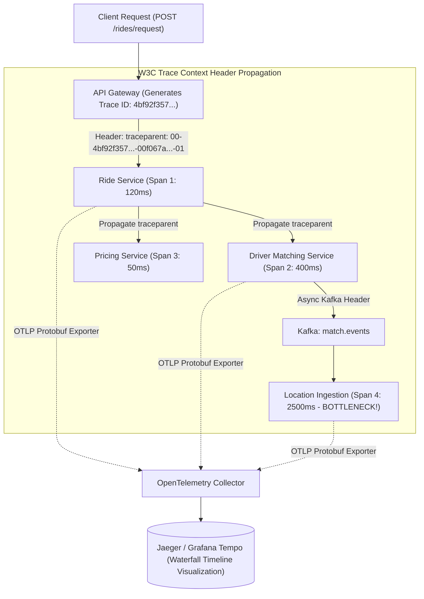

## Fast Revision (10-Second Recall)
Trace requests across microservices using OpenTelemetry standards: propagate W3C Trace Context headers (`traceparent` containing `trace_id` and `parent_span_id`) across all HTTP, gRPC, and Kafka boundaries, generate nested child spans for database and cache operations, and export telemetry via OTLP to backends like Jaeger or Grafana Tempo.

## The 30-Second Spoken Script
> "In a microservices architecture, a single user click might traverse 8 distinct services, 4 database queries, and an asynchronous message queue. When a user experiences a 2-second delay, looking at isolated server logs is useless because no single log reveals the bottleneck. Distributed tracing solves this by stitching together every hop in the execution lifecycle. We use OpenTelemetry—the vendor-neutral CNCF standard. When a request enters our API Gateway, an initial root span and a globally unique 128-bit `trace_id` are created. As the request calls downstream services, our HTTP and gRPC clients automatically propagate the standard W3C `traceparent` header. Each receiving service extracts the header, creates a new child `span_id` linked to the same `trace_id`, records span attributes (like SQL queries or HTTP status codes), and reports spans asynchronously via OTLP to Jaeger or Grafana Tempo. In the UI, engineers view a complete waterfall timeline pinpointing the exact microservice responsible for latency."

## Scenario / Problem Context
A ride-hailing app's 'Request Ride' endpoint intermittently spikes to 4,500 ms for 1% of users, resulting in cancelled rides. The API touches 9 microservices: Gateway, Rider Auth, Location, Driver Matching, Pricing, ETA, Fraud Detection, Notification, and Payment. Each service reports p50 latencies under 50 ms. Engineers are blaming each other's services because there is no distributed visibility into where the request actually stalls.

## Architectural Workflow / Sequence


## Deep-Dive Analysis & Root Causes

### 1. The W3C Trace Context Standard
To achieve polyglot interoperability across Go, Java, Node.js, and Python services, the W3C standardized the HTTP header:
```text
traceparent: 00-4bf92f3577b34da6a3ce929d0e0e4736-00f067aa0ba902b7-01
              |                |                               |          |
           Version          Trace ID                        Span ID     Flags (01 = Sampled)
```
- **Trace ID**: 32 hex characters (128-bit). Identifies the entire distributed transaction from start to finish.
- **Parent Span ID**: 16 hex characters (64-bit). Identifies the immediate parent caller that triggered this child operation.
- **Trace Flags**: Indicates whether this trace should be recorded (sampled) to disk.

### 2. Context Propagation Mechanics
Context propagation requires two steps:
1. **Injection**: Before sending an outbound HTTP request, gRPC call, or Kafka message, the OpenTelemetry SDK serializes the active span context into outgoing headers.
2. **Extraction**: The receiving service reads the incoming header, extracts the `trace_id` and `span_id`, and sets them as the parent of its own local context.

### 3. Sampling Strategies (Managing Storage Costs)
Generating traces for 100% of 100,000 requests per second will generate terabytes of trace data daily and overload storage backends:
- **Head-Based Sampling**: The API Gateway decides upfront to record 5% of requests randomly.
- **Tail-Based Sampling**: The OpenTelemetry Collector buffers spans in memory for 30 seconds. If a trace contains an error (`status.code == ERROR`) or total latency exceeds 1,000 ms, 100% of the trace is retained; otherwise, boring fast traces are dropped.

## Practical Debugging Commands & Code

#### OpenTelemetry Distributed Tracing Setup (Node.js & Express)
```typescript
import { NodeSDK } from '@opentelemetry/sdk-node';
import { getNodeAutoInstrumentations } from '@opentelemetry/auto-instrumentations-node';
import { OTLPTraceExporter } from '@opentelemetry/exporter-trace-otlp-proto';
import { trace, context, SpanStatusCode } from '@opentelemetry/api';

// 1. Initialize OpenTelemetry Node SDK before importing other libraries
const sdk = new NodeSDK({
  serviceName: 'order-service',
  traceExporter: new OTLPTraceExporter({
    url: 'http://otel-collector.monitoring:4318/v1/traces',
  }),
  instrumentations: [getNodeAutoInstrumentations()],
});

sdk.start();

// 2. Creating Custom Business Spans inside application code
const tracer = trace.getTracer('order-service-custom');

export async function processPaymentWithTracing(orderId: string, amount: number) {
  // Start custom span as child of active request context
  return tracer.startActiveSpan('processPaymentOperation', async (span) => {
    span.setAttribute('order.id', orderId);
    span.setAttribute('payment.amount', amount);

    try {
      // Outbound fetch automatically injects W3C traceparent header via auto-instrumentation
      const response = await fetch('http://payment-service.internal:8080/charge', {
        method: 'POST',
        headers: { 'Content-Type': 'application/json' },
        body: JSON.stringify({ orderId, amount }),
      });

      if (!response.ok) {
        throw new Error(`Payment failed with HTTP ${response.status}`);
      }

      span.setStatus({ code: SpanStatusCode.OK });
      return await response.json();
    } catch (err: any) {
      span.recordException(err);
      span.setStatus({ code: SpanStatusCode.ERROR, message: err.message });
      throw err;
    } finally {
      span.end(); // Must end span to record duration
    }
  });
}
```

#### Querying Active Traces via Jaeger API
```bash
# Fetch recent traces for service 'order-service' with latency > 1000ms
curl "http://jaeger.internal:16686/api/traces?service=order-service&minDuration=1s&limit=10" | jq '.data[0].spans[] | {operationName, duration}'
```

## Prevention & Senior Best Practices

### 1. Architectural Guardrails
- **Automated Ingress Instrumentation**: Configure ingress gateways (Envoy, Kong, AWS ALB) to generate `traceparent` headers for all incoming external requests that lack one.
- **Asynchronous Telemetry Export**: Always export traces using the OpenTelemetry Collector over gRPC/OTLP asynchronously, ensuring that tracing overhead never adds more than 0.5% latency to application requests.

### 2. Operational Hardening
- **Propagate Tracing Through Message Queues**: Inject trace context into Kafka message headers or RabbitMQ AMQP properties so background workers are seamlessly linked to the user request that triggered them.
- **Correlate Traces with Logs**: Automatically inject `trace_id` and `span_id` into structured JSON application logs, enabling one-click transitions from a log line in Datadog/Elastic directly to its Jaeger trace waterfall.

