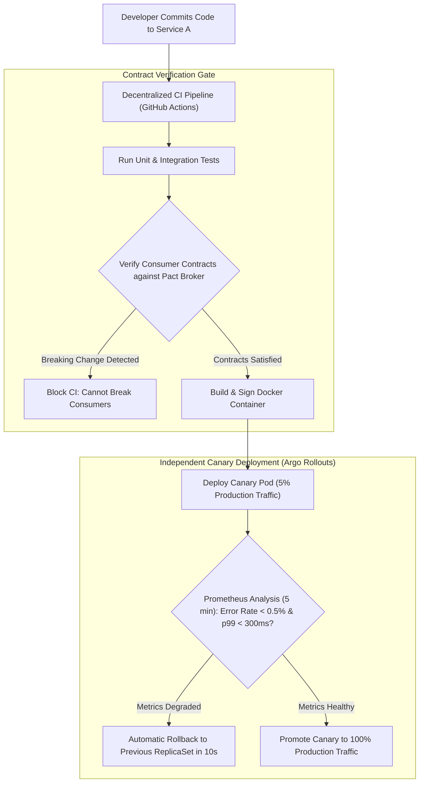

## Fast Revision (10-Second Recall)
True microservices must deploy independently without coordinated release trains. Achieve independent deployments through strict backward-compatible database schema migrations (Expand-Contract pattern), Consumer-Driven Contract testing (Pact) in CI, decentralized CI/CD pipelines, and progressive canary rollouts (Argo Rollouts/Flagger).

## The 30-Second Spoken Script
> "The primary business justification for microservices is organizational velocity—allowing autonomous teams to deploy independently multiple times a day without waiting for other teams. If Team A must schedule a joint deployment window with Team B and Team C, the organization has built a distributed monolith. To enable genuinely independent deployments, we enforce three architectural rules: First, Consumer-Driven Contract testing in CI/CD using Pact. Every service verifies that changes won't break consumer expectations before merging. Second, zero-downtime database evolution using the Expand-Contract pattern: we add new columns or tables in Phase 1, deploy the new service in Phase 2, and clean up legacy columns only after all services have migrated. Third, automated progressive delivery via Argo Rollouts or Istio canary deployments: new versions receive 5% of traffic, evaluate automated Prometheus error rate metrics, and roll back automatically in seconds if anomalies occur, without human intervention."

## Scenario / Problem Context
An enterprise organization divided its monolith into 25 microservices. However, deployments required an 8-hour Saturday release window with 40 engineers on a Zoom bridge because services frequently failed on startup due to unannounced database schema changes or incompatible API expectations. If one service failed, all 25 services had to be rolled back together. The leadership mandates independent continuous deployment for all teams.

## Architectural Workflow / Sequence


## Deep-Dive Analysis & Root Causes

### 1. The Distributed Monolith Trap
A distributed monolith has all the operational overhead of microservices (network latency, partial failures, distributed tracing) without any of the benefits (independent deployments, independent scaling).
- **Symptom 1**: Lock-step deployments ("Services A, B, and C must deploy together").
- **Symptom 2**: Shared relational database schemas between multiple microservices.
- **Symptom 3**: Cascading build failures in monolithic CI pipelines.

### 2. The Expand-Contract Database Migration Pattern
Never deploy a breaking database change in a single step:
- **Phase 1 (Expand)**: Add the new column `email_v2` as nullable. Deploy migration. Existing microservices continue writing to `email`.
- **Phase 2 (Dual-Write)**: Deploy Service A update. Service A reads `email_v2` with fallback to `email`, and writes to both.
- **Phase 3 (Backfill)**: Run an asynchronous background script to copy historical data from `email` to `email_v2`.
- **Phase 4 (Contract)**: Update all consumers to use `email_v2` exclusively. Once telemetry confirms zero reads on `email`, drop the old column.

### 3. Consumer-Driven Contract Testing (Pact)
Instead of running expensive, flaky end-to-end staging environments with all 25 services running:
- Consumer Service B defines its contract: *"I expect `GET /orders/1` to return `{ id: string, total: number }`"*.
- The contract is published to a centralized **Pact Broker**.
- When Producer Service A runs its CI pipeline, it downloads all consumer contracts and validates its controllers against them. If Service A renames `total` to `price`, CI breaks instantly *before* code merge.

## Practical Debugging Commands & Code

#### Argo Rollouts Canary Specification (Kubernetes)
```yaml
apiVersion: argoproj.io/v1alpha1
kind: Rollout
metadata:
  name: order-service
  namespace: prod
spec:
  replicas: 10
  strategy:
    canary:
      # Progressive traffic shifting steps
      steps:
        - setWeight: 5
        - pause: { duration: 5m } # Evaluate Prometheus metrics for 5 mins
        - setWeight: 20
        - pause: { duration: 10m }
        - setWeight: 50
        - pause: { duration: 5m }
      analysis:
        templates:
          - templateName: success-rate-metric
        args:
          - name: service-name
            value: order-service
---
# Automated metric analysis template
apiVersion: argoproj.io/v1alpha1
kind: AnalysisTemplate
metadata:
  name: success-rate-metric
spec:
  metrics:
    - name: success-rate
      interval: 30s
      successCondition: result[0] >= 0.995 # 99.5% success rate required
      failureLimit: 3
      provider:
        prometheus:
          address: http://prometheus.monitoring:9090
          query: |
            sum(rate(http_requests_total{service="order-service",status=~"2.*"}[1m])) 
            / 
            sum(rate(http_requests_total{service="order-service"}[1m]))
```

#### CLI Deployment Inspection & Emergency Abort
```bash
# Watch live status of independent canary rollout
kubectl argo rollouts get rollout order-service -n prod --watch

# Manually abort and rollback rollout immediately if unexpected business bug detected
kubectl argo rollouts abort order-service -n prod
kubectl argo rollouts undo order-service -n prod
```

## Prevention & Senior Best Practices

### 1. Architectural Guardrails
- **One Database per Microservice**: Strictly enforce that no microservice can access another service's database directly. All cross-boundary data access must flow through documented APIs or events.
- **Decentralized Repositories / Monorepo with Scoped CI**: If using a monorepo, configure CI toolchains (Nx, Turborepo, Bazel) so that a commit to `services/order` triggers CI and deployment *strictly* for the order service.

### 2. Operational Hardening
- **Automated Rollback SLAs**: Ensure automated canary analysis detects errors and rolls back within 60 seconds of traffic shifting, limiting customer impact to under 0.1% of requests.
- **Feature Flags (LaunchDarkly / Unleash)**: Decouple code deployment from feature release. Deploy dormant code behind feature flags, allowing product teams to activate features independently of infrastructure deployments.

