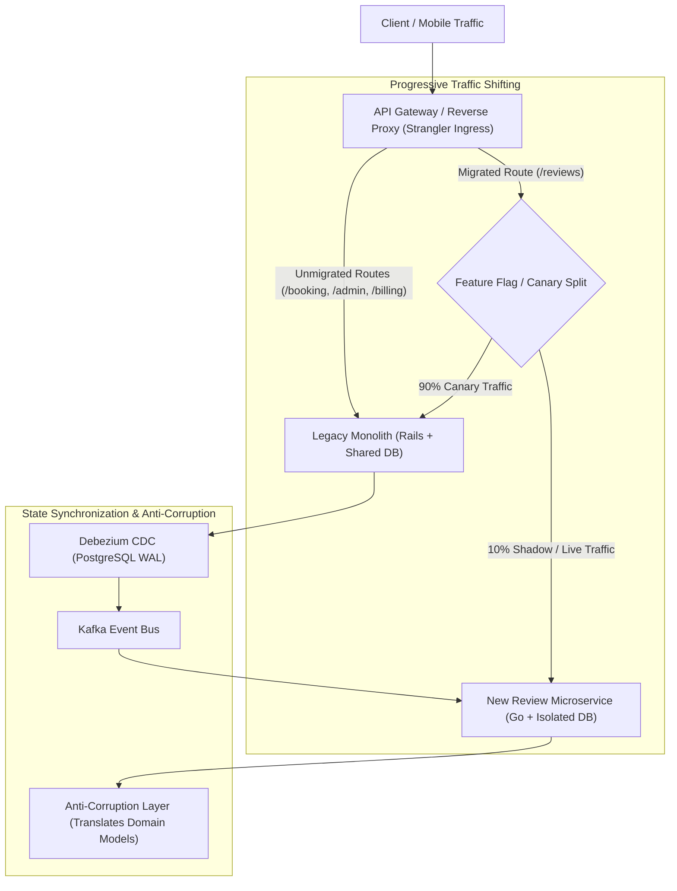

## Fast Revision (10-Second Recall)
Never attempt a 'Big Bang' rewrite of a legacy monolith. Use the Strangler Fig pattern: place an API Gateway / Ingress proxy in front of the monolith, extract one bounded context into a new microservice, synchronize data using Change Data Capture (CDC) and an Anti-Corruption Layer (ACL), shift traffic progressively via canary routing, verify consistency, and repeat until the monolith is retired.

## The 30-Second Spoken Script
> "Migrating from a monolith to microservices through a Big Bang rewrite is the number one cause of project failure—it takes years, business requirements diverge, and the new system fails on day one. The proven senior engineering methodology is the Strangler Fig Pattern, inspired by Australian strangler vines that gradually envelop and replace a host tree. First, we place an API Gateway or reverse proxy like Nginx or Envoy in front of the monolith. Second, we identify a clear, cohesive bounded context with high business velocity—like the Notification or Product Review module—and build it as an independent microservice. Third, to bridge legacy and modern schemas, we deploy an Anti-Corruption Layer (ACL) and synchronize state using Change Data Capture via Debezium. Fourth, we implement a dual-run verification phase where the gateway shadows 10% of traffic to the new service, comparing response payloads for parity. Finally, we cut traffic over to the microservice and repeat the process context by context until the legacy monolith is safely decommissioned."

## Scenario / Problem Context
A 10-year-old monolithic Rails/PostgreSQL application processes $2 billion annually in travel bookings. Over 150 developers commit to the same single codebase, causing daily merge conflicts, 4-hour test suite runs, and frequent deployment regressions. Executive leadership demanded a total rewrite, but after 18 months and $12 million spent, the rewrite project stalled. The team needs an incremental, risk-free decomposition strategy that delivers continuous business value.

## Architectural Workflow / Sequence


## Deep-Dive Analysis & Root Causes

### 1. Why Big Bang Rewrites Almost Always Fail
1. **The Feature Parity Moving Target**: While developers spend 2 years rewriting the monolith, the business continues adding 200 new features to the existing monolith. The rewrite never catches up.
2. **Hidden Tribal Knowledge**: Edge cases, bug workarounds, and implicit business rules baked into 10-year-old code are forgotten during rewrites.
3. **Massive Blast Radius**: Flipping a switch on a 100% new platform exposes all undiscovered bugs simultaneously under real load.

### 2. The Four Stages of the Strangler Fig Pattern
1. **Intercept**: Deploy an API Gateway in front of the monolith. All client traffic flows through the gateway, which forwards 100% of traffic to the monolith initially.
2. **Extract**: Pick a slice of functionality. Criteria for the first extraction:
   - High business value (benefits from frequent releases).
   - Low data entanglement (few foreign key ties to other tables).
   - Examples: Notifications, Product Reviews, Image Processing.
3. **Coexist (Dual-Run & Anti-Corruption Layer)**:
   - Run both systems concurrently.
   - Use an **Anti-Corruption Layer (ACL)**: A translator service or adapter that maps legacy data models to modern clean domain models, preventing legacy technical debt from polluting the new microservice.
   - Shadow traffic or dual-write to verify data parity.
4. **Cutover & Strangle**: Route 100% of traffic for that route to the new microservice. Remove legacy code from the monolith. Repeat for the next domain slice.

### 3. Handling Shared Database Dependencies
The hardest part of decomposition is separating the shared monolithic database:
- Monolith foreign keys: `reviews.booking_id -> bookings.id`.
- If the Review service moves to its own database, relational joins are no longer possible.
- **Solution**: Replace foreign keys with logical references (`booking_id` stored as UUID) and fetch data via events or API calls. Use Debezium CDC to replicate booking metadata into the Review service's local read model.

## Practical Debugging Commands & Code

#### Nginx Strangler Fig Ingress Routing Configuration
```nginx
upstream monolith_backend {
    server monolith.internal:3000;
}

upstream review_microservice {
    server review-service.internal:8080;
}

server {
    listen 80;
    server_name api.company.com;

    # 1. Extracted Route: Route to new microservice
    location /api/v1/reviews/ {
        proxy_pass http://review_microservice;
        proxy_set_header Host $host;
        proxy_set_header X-Forwarded-For $remote_addr;
        proxy_set_header X-Strangler-Route "microservice";
    }

    # 2. Legacy Catch-All: Route everything else to the monolith
    location / {
        proxy_pass http://monolith_backend;
        proxy_set_header Host $host;
        proxy_set_header X-Forwarded-For $remote_addr;
        proxy_set_header X-Strangler-Route "monolith";
    }
}
```

#### Dual-Run Shadow Verification (TypeScript Middleware)
```typescript
import { Request, Response, NextFunction } from 'express';

export function createShadowComparator(primaryUrl: string, shadowUrl: string) {
  return async (req: Request, res: Response) => {
    // 1. Execute live call against legacy monolith
    const primaryStart = Date.now();
    const primaryResp = await fetch(`${primaryUrl}${req.originalUrl}`, {
      method: req.method,
      headers: req.headers as any,
      body: ['POST', 'PUT'].includes(req.method) ? JSON.stringify(req.body) : undefined,
    });
    const primaryBody = await primaryResp.json();
    const primaryDuration = Date.now() - primaryStart;

    // Return real response to client immediately
    res.status(primaryResp.status).json(primaryBody);

    // 2. Fire asynchronous shadow call to new microservice in background (Zero impact on user)
    process.nextTick(async () => {
      try {
        const shadowStart = Date.now();
        const shadowResp = await fetch(`${shadowUrl}${req.originalUrl}`, {
          method: req.method,
          headers: req.headers as any,
          body: ['POST', 'PUT'].includes(req.method) ? JSON.stringify(req.body) : undefined,
        });
        const shadowBody = await shadowResp.json();
        const shadowDuration = Date.now() - shadowStart;

        // Compare payloads for parity
        const isMatch = JSON.stringify(primaryBody) === JSON.stringify(shadowBody);
        if (!isMatch) {
          console.warn(`[Parity Discrepancy] URL: ${req.originalUrl}`);
          console.warn('Primary:', primaryBody);
          console.warn('Shadow:', shadowBody);
        } else {
          console.log(`[Parity Match] Latency Primary: ${primaryDuration}ms, Microservice: ${shadowDuration}ms`);
        }
      } catch (err) {
        console.error('[Shadow Error] Failed to query shadow service:', err);
      }
    });
  };
}
```

## Prevention & Senior Best Practices

### 1. Architectural Guardrails
- **Modular Monolith as First Step**: Before creating separate network deployments, enforce strict module boundaries within the monolith (using tools like Packwerk in Ruby or ArchUnit in Java). If code is spaghetti inside the monolith, cutting it across network boundaries produces a distributed disaster.
- **Never Share Databases**: When creating a new microservice, provision a brand-new database instance immediately. Never allow the new service to read directly from the monolith's database tables.

### 2. Operational Hardening
- **Data Parity Audits**: Run continuous reconciliation jobs during the shadow phase that verify database record parity between the monolith and the microservice.
- **Celebrate Incremental Deletions**: Track and celebrate the deletion of legacy monolith lines of code (`git rm`) as team milestones to maintain migration momentum.

