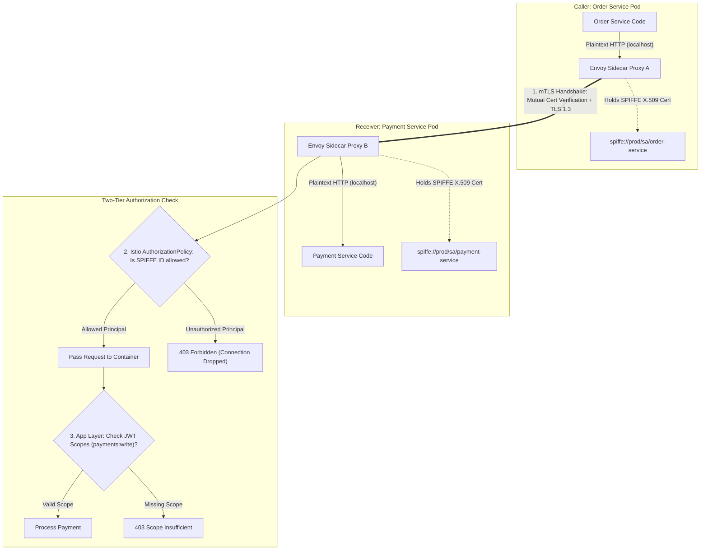

## Fast Revision (10-Second Recall)
Never trust the internal VPC network. Secure inter-service communication with Zero-Trust principles: enforce mutual TLS (mTLS) for transport encryption and cryptographic workload authentication (SPIFFE/SPIRE via Istio/Envoy), and layer application-level authorization using OAuth2 Client Credentials grants or short-lived signed JWTs.

## The 30-Second Spoken Script
> "Securing communication between microservices requires moving past the outdated 'castle-and-moat' mindset where any service inside the VPC is trusted. If an attacker exploits an SSRF flaw or compromises a single container, an unencrypted internal network allows lateral movement and packet inspection. In our Zero-Trust architecture, we secure communication at two distinct layers: At the transport layer, we mandate Mutual TLS (mTLS) managed by a service mesh like Istio or Linkerd. Both client and server microservices present short-lived, cryptographically signed X.509 certificates containing SPIFFE IDs to authenticate identity and encrypt traffic in transit. At the application layer, we enforce fine-grained authorization using the OAuth2 Client Credentials grant: the calling service presents a cryptographically signed JWT containing specific permission scopes (like `orders:write`), ensuring that even if Service A can establish a TCP connection to Service B, it cannot execute unauthorized administrative endpoints."

## Scenario / Problem Context
A ride-sharing enterprise suffered an internal breach when a low-privilege customer support tool container was compromised. The attacker used standard curl commands over the internal flat Kubernetes network to call the unauthenticated internal `/internal/v1/driver/payouts` endpoint on the Payment Service, transferring driver earnings. The platform lacked both cryptographic identity verification and fine-grained authorization between internal services.

## Architectural Workflow / Sequence


## Deep-Dive Analysis & Root Causes

### 1. Transport Security (mTLS) vs Application Authorization (JWT)
- **Layer 4/7 Transport Security (mTLS / SPIFFE)**:
  - Answers: *"Which exact service instance is calling me?"* (e.g. `spiffe://cluster.local/ns/prod/sa/order-service`).
  - Encrypts traffic against packet sniffing (`tcpdump`) on shared Kubernetes cluster nodes.
  - Automatically handled by Envoy/Istio sidecars with zero application code changes.
- **Layer 7 Application Authorization (OAuth2 / JWT)**:
  - Answers: *"What specific business action is this service authorized to perform, and on whose behalf?"*
  - Passes user context (e.g. User ID `88`) along with the calling service's credentials.

### 2. SPIFFE and SPIRE Fundamentals
- **SPIFFE (Secure Production Identity Framework for Everyone)**: Standardizes workload naming:
  ```text
  spiffe://trust-domain/ns/namespace/sa/service-account-name
  ```
- **SPIRE**: Automatically mints and rotates short-lived X.509 certificates (e.g., 1-hour validity) directly into memory. Eliminates static long-lived TLS private keys on disk.

### 3. OAuth2 Client Credentials Flow for Services
When services authenticate without an interactive user:
1. Service A calls centralized Auth Server (Keycloak / Okta / Vault):
   ```http
   POST /oauth/token
   grant_type=client_credentials&client_id=order_svc&client_secret=...
   ```
2. Auth Server returns signed JWT with scopes: `scope: ["inventory:read", "payments:create"]`.
3. Service A attaches `Authorization: Bearer <JWT>` on outbound calls to Service B.
4. Service B verifies JWT signature offline using cached public keys (JWKS).

## Practical Debugging Commands & Code

#### Istio Declarative Authorization Policy (Zero-Trust mTLS)
```yaml
apiVersion: security.istio.io/v1beta1
kind: PeerAuthentication
metadata:
  name: default
  namespace: prod
spec:
  # Enforce STRICT mTLS: Reject any plaintext or unverified TCP connection
  mtls:
    mode: STRICT
---
apiVersion: security.istio.io/v1beta1
kind: AuthorizationPolicy
metadata:
  name: payment-strict-rbac
  namespace: prod
spec:
  selector:
    matchLabels:
      app: payment-service
  action: ALLOW
  rules:
    - from:
        - source:
            # Strictly allow requests ONLY from order-service SPIFFE identity
            principals: ["cluster.local/ns/prod/sa/order-service-sa"]
      to:
        - operation:
            methods: ["POST"]
            paths: ["/api/v1/payments/process"]
```

#### Application Layer JWT Scoped Authorization Middleware (TypeScript)
```typescript
import { Request, Response, NextFunction } from 'express';
import jwt from 'jsonwebtoken';
import jwksClient from 'jwks-rsa';

const client = jwksClient({
  jwksUri: 'https://auth.internal.company.com/.well-known/jwks.json',
  cache: true,
  rateLimit: true,
});

function getKey(header: any, callback: any) {
  client.getSigningKey(header.kid, (err, key) => {
    const signingKey = key?.getPublicKey();
    callback(null, signingKey);
  });
}

export function requireServiceScope(requiredScope: string) {
  return (req: Request, res: Response, next: NextFunction) => {
    const authHeader = req.headers['authorization'];
    if (!authHeader || !authHeader.startsWith('Bearer ')) {
      return res.status(401).json({ error: 'Missing service authorization token' });
    }

    const token = authHeader.split(' ')[1];
    jwt.verify(token, getKey, { algorithms: ['RS256'] }, (err, decoded: any) => {
      if (err) {
        return res.status(401).json({ error: 'Invalid service token signature' });
      }

      // Verify required OAuth2 scope
      const scopes: string[] = (decoded.scope || '').split(' ');
      if (!scopes.includes(requiredScope)) {
        return res.status(403).json({
          error: 'Forbidden: Service lacks required scope',
          required: requiredScope,
        });
      }

      (req as any).servicePrincipal = decoded.sub;
      next();
    });
  };
}
```

#### Verifying mTLS Status with Istioctl
```bash
# Check if mTLS is strictly enforced between order-service and payment-service
istioctl authn tls-check order-service.prod.svc.cluster.local payment-service.prod.svc.cluster.local

# Inspect active SPIFFE X.509 certificate inside Envoy proxy
istioctl proxy-config secret deployment/order-service.prod
```

## Prevention & Senior Best Practices

### 1. Architectural Guardrails
- **Automated Certificate Rotation**: Restrict mTLS certificate validity to between 1 and 12 hours. Automated rotation eliminates the operational complexity of handling Certificate Revocation Lists (CRLs).
- **Default-Deny Ingress and NetworkPolicies**: Apply Kubernetes `NetworkPolicy` rules that drop all cross-namespace traffic by default, explicitly whitelisting only authorized egress/ingress connections.

### 2. Operational Hardening
- **Propagate End-User Context**: When Service A calls Service B on behalf of an end-user, propagate a signed `X-Forwarded-User-Context` JWT to ensure downstream services can enforce user-level data tenancy.
- **Audit Unauthorized mTLS Probes**: Alert on Prometheus metric `istio_authorization_denied_total` to detect lateral scanning or rogue containers probing internal service endpoints.

