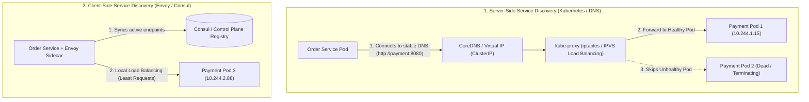

## Fast Revision (10-Second Recall)
Service discovery dynamically maps microservice logical names to shifting container IP addresses and ports. Use Server-Side discovery (Kubernetes Services with CoreDNS and kube-proxy) for platform-native simplicity and polyglot stacks. Use Client-Side discovery (Envoy / Netflix Eureka) with local routing tables for high-performance, fine-grained client load balancing and circuit breaking.

## The 30-Second Spoken Script
> "In dynamic containerized environments like Kubernetes, microservice instances scale up, scale down, and get rescheduled constantly, meaning hardcoded IP addresses are impossible. Service discovery automates how services locate each other. In Server-Side Service Discovery—the standard model in Kubernetes—the calling microservice connects to a stable logical DNS name like `http://payment-service.prod.svc.cluster.local`. An intermediate reverse proxy or virtual IP layer (`kube-proxy` via iptables/IPVS) resolves the request and routes it to an active, healthy pod instance. In Client-Side Service Discovery—often powered by service meshes like Envoy or Consul—the calling client queries a service registry, caches the list of healthy IP endpoints locally, and executes its own load balancing algorithms (like least-connections or p2c) directly. While server-side discovery is language-agnostic and simpler, client-side discovery eliminates the extra proxy network hop and enables advanced traffic routing like canary splits."

## Scenario / Problem Context
A microservices system deployed on bare VMs used static IP configuration files. When scaling up instances during traffic spikes, engineers had to manually update Nginx upstream blocks and reload configurations, leading to 10-minute delays, dropped connections, and requests routed to crashed IP addresses. The engineering team must implement an automated, dynamic service discovery mechanism across the microservice fleet.

## Architectural Workflow / Sequence


## Deep-Dive Analysis & Root Causes

### 1. The Core Components of Service Discovery
Every service discovery architecture requires three components:
1. **Service Registry**: A centralized, highly consistent database holding active service instances and network coordinates (IP + Port), such as etcd, Consul, or ZooKeeper.
2. **Registration / Health Checker**: When a service pod starts, it registers its IP with the registry and responds to continuous health probes (`/healthz`). If a pod fails 3 consecutive heartbeats, the registry purges it.
3. **Lookup / Routing Mechanism**: How callers resolve the logical name to an active IP address.

### 2. Client-Side vs Server-Side Discovery
| Feature | Server-Side Discovery (K8s Service / AWS ALB) | Client-Side Discovery (Envoy / Eureka) |
|---|---|---|
| **Architecture** | Client calls Load Balancer $\rightarrow$ LB routes to Pod | Client checks Registry cache $\rightarrow$ calls Pod directly |
| **Network Hops** | 1 extra hop through load balancer / proxy | 0 extra hops (direct point-to-point connection) |
| **Polyglot Support** | 100% universal (uses standard TCP / DNS) | Requires client SDK or sidecar proxy |
| **Load Balancing** | Handled by network proxy (round robin) | Sophisticated (least-request, p2c, latency-weighted) |
| **Failure Point** | Load balancer proxy outage impacts all traffic | Registry outage doesn't stop traffic (clients use cache) |

### 3. DNS Caching Pitfalls in Polyglot Microservices
When using DNS-based service discovery (like Kubernetes CoreDNS or AWS Cloud Map):
- Runtimes like the Java Virtual Machine (JVM) historically cache DNS resolutions **forever** (`networkaddress.cache.ttl = -1`).
- If Pod A dies and its IP is reassigned, the Java app continues firing HTTP requests at the dead IP indefinitely!
- *Fix*: Set JVM DNS cache TTL to 5 seconds (`networkaddress.cache.ttl=5`). In Node.js, use a custom DNS resolver with short TTLs.

## Practical Debugging Commands & Code

#### Kubernetes Service Declaration (Server-Side Discovery)
```yaml
apiVersion: v1
kind: Service
metadata:
  name: payment-service
  namespace: prod
spec:
  type: ClusterIP
  selector:
    app: payment-service # Directs traffic to pods matching this label
  ports:
    - name: http
      protocol: TCP
      port: 8080
      targetPort: 8080
---
# Pod with automated liveness and readiness health checks
apiVersion: apps/v1
kind: Deployment
metadata:
  name: payment-service
spec:
  template:
    spec:
      containers:
        - name: payment
          image: company/payment:v1.2
          readinessProbe:
            httpGet:
              path: /readyz
              port: 8080
            initialDelaySeconds: 5
            periodSeconds: 5 # Unregistered immediately if probe fails
```

#### Node.js DNS TTL Configuration to Prevent Stale IP Resolution
```typescript
import dns from 'dns';
import http from 'http';

// Configure DNS cache expiration to 5 seconds for dynamic Kubernetes pod IPs
dns.setDefaultResultOrder('ipv4first');

const agent = new http.Agent({
  keepAlive: true,
  maxSockets: 100,
  // Ensure DNS is re-queried periodically
});

export async function callService(serviceName: string, path: string) {
  // Resolves via CoreDNS: payment-service.prod.svc.cluster.local
  const url = `http://${serviceName}.prod.svc.cluster.local:8080${path}`;
  return fetch(url, { agent } as any);
}
```

#### Diagnostic Commands for Service Discovery Triage
```bash
# Query CoreDNS directly from inside a pod to check resolved endpoint IPs
nslookup payment-service.prod.svc.cluster.local

# Inspect active Endpoints mapped to a Kubernetes service
kubectl get endpoints payment-service -n prod

# Check iptables / IPVS forwarding rules configured by kube-proxy
sudo iptables-save | grep payment-service
```

## Prevention & Senior Best Practices

### 1. Architectural Guardrails
- **Strict Readiness Probes**: Never route traffic to a pod until its readiness probe passes. A liveness probe checks if a pod should be killed, but a readiness probe checks if it is ready to receive traffic (DB pools initialized, cache warmed).
- **Service Mesh for High Scale**: When microservices exceed 50 distinct components, adopt Envoy or Istio for client-side discovery to eliminate kube-proxy iptables bottlenecks (iptables evaluation is $O(N)$ with number of rules).

### 2. Operational Hardening
- **CoreDNS Autoscaling**: CoreDNS pods must scale automatically with cluster node count using `cluster-proportional-autoscaler` to prevent DNS latency bottlenecks during cluster scale-outs.
- **Graceful Termination Handshakes**: Handle `SIGTERM` signals in container code by sleeping for 5 seconds before closing listeners. This allows `kube-proxy` and ingress controllers time to remove the terminating pod IP from discovery endpoints before sockets close.

