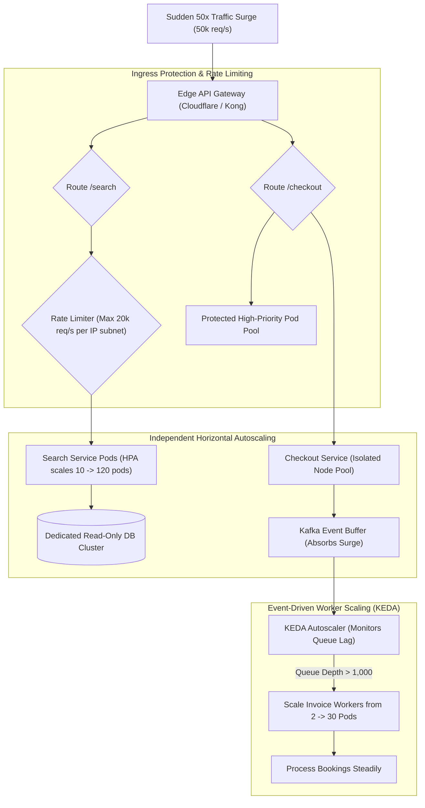

## Fast Revision (10-Second Recall)
Handle asymmetric traffic spikes by decoupling independent microservices: scale individual stateless services horizontally using Kubernetes Horizontal Pod Autoscaler (HPA) and KEDA (scaling based on queue depth), isolate database resources, buffer surges through message queues, and enforce token-bucket rate limiting and circuit breakers at the API Gateway.

## The 30-Second Spoken Script
> "In a microservices architecture, traffic is inherently asymmetric: an e-commerce catalog search service might handle 100,000 requests per second, while the checkout service handles 1,000, and the invoice generation worker processes 20. If one service spikes unexpectedly—like search surging during a Black Friday campaign—we must prevent it from starving or cascading into adjacent services. First, microservices scale independently: we configure the Kubernetes Horizontal Pod Autoscaler (HPA) on CPU/memory, but more importantly, we deploy KEDA (Kubernetes Event-driven Autoscaling) to scale worker services dynamically based on Kafka consumer lag or RabbitMQ queue depth. Second, we isolate infrastructure: each service runs with dedicated resource limits (CPU/RAM requests and limits) and connects to independent, appropriately sized databases or read replicas. Third, we buffer spikes using asynchronous message queues rather than synchronous HTTP calls, allowing downstream services to process at their optimal throughput without collapsing under peak bursts."

## Scenario / Problem Context
A ticketing platform experienced a 50x traffic surge on its search and seat reservation microservices when tickets for a world tour went on sale. The search service scaled from 10 to 120 pods, consuming all cluster worker node memory and starving the payment and checkout services, which crashed. Concurrently, the unthrottled search traffic generated 40,000 queries per second against a shared MySQL instance, knocking the entire database offline for all services.

## Architectural Workflow / Sequence


## Deep-Dive Analysis & Root Causes

### 1. Why Monolithic Scaling Fails in Microservices
In a monolith, scaling up requires duplicating the entire application stack, which is inefficient.
In microservices:
- Services scale **asymmetrically**:
  - `Search Service`: Scales on CPU and network I/O.
  - `Image Resizing Service`: Scales on GPU or memory.
  - `Notification Worker`: Scales on Kafka queue lag.
- **The Noisy Neighbor Risk**: If Service A has no Kubernetes resource limits (`resources.limits`), it can consume all node CPU/RAM, causing Kubernetes to evict mission-critical Service B pods!

### 2. Metric-Based vs Event-Driven Autoscaling (HPA vs KEDA)
- **Standard Kubernetes HPA**:
  - Scales on CPU/RAM utilization.
  - *Drawback*: CPU spikes *after* the service is already drowning. Scaling is reactive and slow (can take 2-3 minutes to spin up pods).
- **KEDA (Kubernetes Event-driven Autoscaling)**:
  - Scales on external queue metrics (e.g. `kafka_lag > 500` or `redis_list_length > 200`).
  - *Advantage*: Proactive. If 10,000 items land in SQS or Kafka, KEDA immediately scales the worker fleet from 2 to 40 pods before CPU even registers the spike.

### 3. Compute and Node Pool Isolation
To prevent one service from starving others:
- **Kubernetes Taints, Tolerations, and Node Affinity**:
  - Place high-churn, volatile search pods on dedicated compute node groups.
  - Keep payment, auth, and database pods on separate, dedicated node pools with guaranteed capacity.

## Practical Debugging Commands & Code

#### Kubernetes HPA and KEDA ScaledObject Specification
```yaml
# 1. HPA for CPU-intensive Stateless API Service
apiVersion: autoscaling/v2
kind: HorizontalPodAutoscaler
metadata:
  name: search-service-hpa
  namespace: prod
spec:
  scaleTargetRef:
    apiVersion: apps/v1
    kind: Deployment
    name: search-service
  minReplicas: 5
  maxReplicas: 100
  metrics:
    - type: Resource
      resource:
        name: cpu
        target:
          type: Utilization
          averageUtilization: 70
---
# 2. KEDA ScaledObject for Asynchronous Worker Service (Scales on Kafka Lag)
apiVersion: keda.sh/v1alpha1
kind: ScaledObject
metadata:
  name: invoice-worker-scaler
  namespace: prod
spec:
  scaleTargetRef:
    name: invoice-worker
  minReplicaCount: 2
  maxReplicaCount: 40
  triggers:
    - type: apache-kafka
      metadata:
        bootstrapServers: kafka:9092
        topic: orders.v1.events
        consumerGroup: invoice-workers
        lagThreshold: "100" # Add 1 pod for every 100 messages of queue lag
```

#### Pod Resource Requests and Limits (Preventing Starvation)
```yaml
apiVersion: apps/v1
kind: Deployment
metadata:
  name: search-service
spec:
  template:
    spec:
      containers:
        - name: search
          image: company/search:v2.1
          resources:
            requests:
              cpu: "500m"
              memory: "512Mi"
            limits:
              cpu: "2000m"
              memory: "2Gi" # Hard cap prevents OOM killing adjacent pods
```

#### Live Cluster Autoscaling Inspection
```bash
# Check current HPA target utilization and live replica count
kubectl get hpa -n prod

# Check KEDA ScaledObjects and trigger status
kubectl get scaledobjects -n prod

# Check top CPU and memory-consuming pods across the cluster
kubectl top pods -n prod --sort-by=cpu | head -n 15
```

## Prevention & Senior Best Practices

### 1. Architectural Guardrails
- **Mandatory Resource Requests and Limits**: Enforce Kubernetes `LimitRange` and `ResourceQuota` policies on all namespaces. Disallow deployment of any container without explicit CPU/memory requests and limits.
- **Dedicated Database Scaling**: Never connect high-traffic asymmetric services to the primary transactional database. Route all search and read operations to dedicated read replicas or Elasticsearch.

### 2. Operational Hardening
- **Pre-Scale Ahead of Known Events**: For scheduled product launches, manually adjust `minReplicas` 30 minutes in advance to avoid container initialization cold starts during traffic surges.
- **Circuit Breaker on Downstream Calls**: Ensure the high-volume service implements circuit breakers to drop calls to lower-capacity downstream services if they start degrading.

