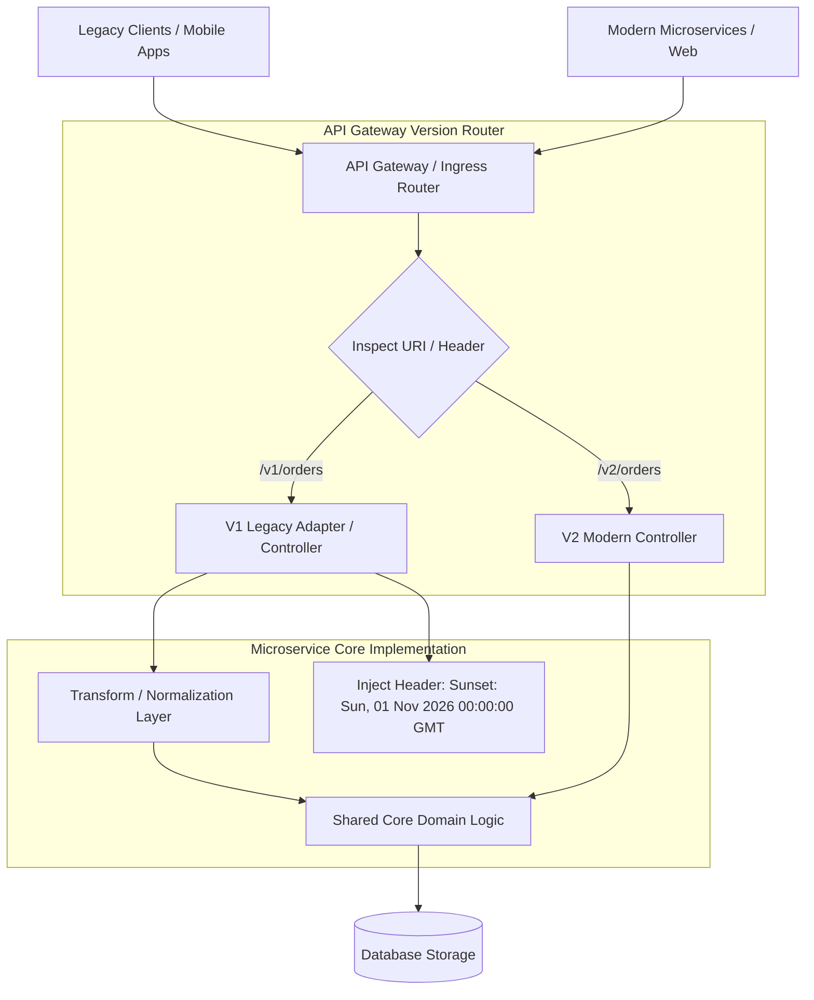

## Fast Revision (10-Second Recall)
Follow Postel's Law (be conservative in what you send, liberal in what you accept). Prefer non-breaking additive schema changes over hard major version forks. When breaking changes are unavoidable, support concurrent versions using URI pathing (`/v1`, `/v2`) or custom headers (`Accept-Version`), route via API Gateway, and enforce strict deprecation sunset schedules (RFC 8594).

## The 30-Second Spoken Script
> "In a distributed microservice architecture, deploying lock-step updates across callers and callees is an anti-pattern. If Service B requires a synchronized deployment with Service A to avoid 500 errors, you don't have microservices—you have a distributed monolith. We design API versioning around the Tolerant Reader Pattern and additive schema evolution. First, we never delete or rename fields in existing payloads; we only add new optional fields. Callers ignore unfamiliar fields, ensuring zero breakage. Second, when a genuine breaking change is required—such as fundamentally altering a data structure—we introduce a concurrent version using URI pathing like `/api/v2/orders` or header-based content negotiation. Third, we route traffic at the API Gateway, allowing Service B to support both V1 and V2 concurrently. Finally, we attach RFC 8594 `Sunset` and `Deprecation` HTTP headers, monitor telemetry until V1 traffic drops to zero, and safely decommission the old endpoints."

## Scenario / Problem Context
A team maintaining a billing microservice renamed `billingAddress` to `invoicingAddress` and changed `amount` from an integer (cents) to a float (dollars) in `/api/orders`. The deployment caused an immediate cascading outage across the mobile app, shipping service, and analytics worker because consumers expected the legacy JSON field structure. The organization must implement an API versioning governance framework that prevents breaking downstream consumers.

## Architectural Workflow / Sequence


## Deep-Dive Analysis & Root Causes

### 1. The Tolerant Reader Pattern & Postel's Law
- **Postel's Law**: *"Be conservative in what you do, be liberal in what you accept from others."*
- **Tolerant Reader**: JSON deserializers in consumer services must be configured to ignore unrecognized properties (`DeserializationFeature.FAIL_ON_UNKNOWN_PROPERTIES = false` in Jackson or `strip()` in Zod).
- If Service B adds a new field `trackingNumber`, Service A simply ignores it without crashing.

### 2. URI Versioning vs Header Versioning vs Content Negotiation
| Strategy | Example | Pros | Cons |
|---|---|---|---|
| **URI Pathing** | `/v1/orders` vs `/v2/orders` | Explicit, easy to route at API Gateway/CDN, clear in logs | Violates strict REST purism (URI identifies resource, not version) |
| **Custom Header** | `X-API-Version: 2` | Clean URIs, easy client switching | Harder to test via plain browser, edge caching requires `Vary` |
| **Content Negotiation** | `Accept: application/vnd.company.v2+json` | Pure RESTful standard | Complex client configuration, fragile tooling support |

*Senior Consensus*: **URI Pathing (`/v1/`, `/v2/`)** is the industry standard for microservices and public APIs due to unmatched operational clarity and edge CDN routing efficiency.

### 3. Protobuf / gRPC Field Tagging Rules
In gRPC and Protocol Buffers, versioning is built into the binary protocol:
- Fields are identified by **integer tag numbers**, not field names:
  ```protobuf
  message Order {
    string id = 1;
    int64 amount_cents = 2;
    // string old_address = 3 [deprecated = true];
    string new_address = 4; // Additive field with new tag
  }
  ```
- **Golden Rule**: Never change the tag number of an existing field. If a field is deprecated, mark it `reserved` so the tag is never reused.

## Practical Debugging Commands & Code

#### Supporting Concurrent V1 and V2 Controllers (Express & TypeScript)
```typescript
import express, { Request, Response } from 'express';

const app = express();

// Shared domain service
async function getOrderDetails(orderId: string) {
  return {
    id: orderId,
    amountCents: 4500, // Normalized internal domain representation
    address: '100 Market St, San Francisco, CA',
  };
}

// V1 Endpoint: Legacy schema with Deprecation and Sunset headers
app.get('/api/v1/orders/:id', async (req: Request, res: Response) => {
  const order = await getOrderDetails(req.params.id);

  // RFC 8594 Standard Deprecation Headers
  res.setHeader('Deprecation', 'true');
  res.setHeader('Sunset', 'Sat, 01 Nov 2026 00:00:00 GMT');
  res.setHeader('Link', '<https://api.example.com/docs/v2-migration>; rel="sunset"');

  // V1 Response Format (amount in cents as integer)
  return res.json({
    order_id: order.id,
    amount: order.amountCents, // Legacy field name
    billing_address: order.address,
  });
});

// V2 Endpoint: Modern schema
app.get('/api/v2/orders/:id', async (req: Request, res: Response) => {
  const order = await getOrderDetails(req.params.id);

  // V2 Response Format (amount in dollars as decimal, renamed address)
  return res.json({
    id: order.id,
    amountDollars: (order.amountCents / 100).toFixed(2),
    invoicingAddress: order.address,
    currency: 'USD',
  });
});
```

#### Detecting Legacy API Usage via Access Log Telemetry
```bash
# Query API Gateway access logs to check percentage of traffic still on v1
awk '$7 ~ /^\/api\/v1\// {v1++} $7 ~ /^\/api\/v2\// {v2++} END {print "V1:", v1, "V2:", v2}' /var/log/nginx/access.log

# Extract unique User-Agents still hitting deprecated v1 endpoints
grep '/api/v1/' /var/log/nginx/access.log | awk -F'"' '{print $6}' | sort | uniq -c | sort -nr
```

## Prevention & Senior Best Practices

### 1. Architectural Guardrails
- **Additive Evolution First**: Before creating `/v2`, attempt additive backward-compatible changes (adding new fields, relaxing constraints). Only fork major versions when data semantics fundamentally clash.
- **Contract Testing with Pact**: Use consumer-driven contract testing (Pact / OpenAPI Spec diffs) in CI/CD pipelines. A pull request that deletes or alters an expected field will fail CI before merge.

### 2. Operational Hardening
- **Strict Sunset Timelines**: Establish an explicit deprecation SLA (e.g., 6 months for internal microservices, 12-24 months for public third-party APIs).
- **Proactive Consumer Outreach**: Monitor logs for the top 5 consumer services still querying deprecated endpoints 60 days before the sunset date and schedule migration sprints with their owners.

