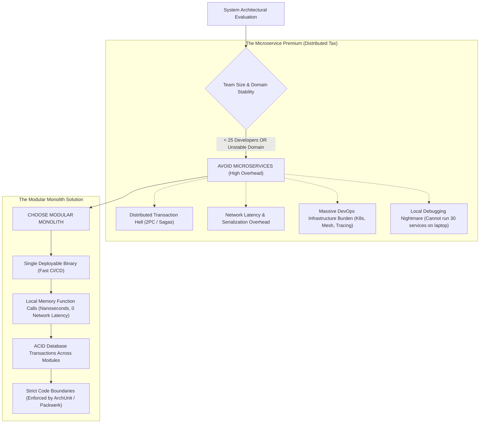

## Fast Revision (10-Second Recall)
Avoid microservices for early-stage startups with fluid domain boundaries, small engineering teams (under 25 developers), projects lacking mature DevOps automation (CI/CD, Kubernetes, distributed tracing), and systems requiring ultra-low latency ACID transactions across tightly coupled entities. In these cases, adopt a well-structured Modular Monolith.

## The 30-Second Spoken Script
> "Microservices are not an architecture for writing software; they are an organizational architecture for scaling engineering organizations. Martin Fowler coined the 'Microservice Premium': you pay a massive tax in distributed system complexity—network latency, partial failures, distributed tracing, eventual consistency, and complex CI/CD—in exchange for organizational autonomy. If your team is under 20 developers, adopting microservices slows you down by 5x. Similarly, for early-stage startups whose product-market fit is still evolving, drawing bounded contexts prematurely leads to high cross-service coupling where a single feature requires changes to 6 services. In these scenarios, the superior architectural choice is a Modular Monolith: an application deployed as a single unified binary, but with strictly enforced module boundaries, separate database schemas, and clean internal interfaces. You get fast local debugging, simple ACID transactions, and zero network serialization overhead, with the option to extract microservices later if scale demands it."

## Scenario / Problem Context
A Series-A fintech startup with 8 software engineers spent 9 months building 32 microservices on Kubernetes using gRPC, Kafka, and Istio. A simple task like adding a 'discount code' to the checkout page required updating 7 different Git repositories, orchestrating 7 Docker builds, and debugging distributed Saga failures. The team averaged only 1 release every three weeks, burning runway while competitors shipped daily. The VP of Engineering must evaluate migrating back to a Modular Monolith.

## Architectural Workflow / Sequence


## Deep-Dive Analysis & Root Causes

### 1. The Distributed System Tax
When a function call `orderService.calculateTotal(cart)` is replaced with an HTTP/gRPC network call:
- **Latency**: Increases from 50 nanoseconds (CPU memory pointer) to 5-15 milliseconds (TCP handshake, serialization, network traversal).
- **Failure Modes**: A function call either succeeds or throws an exception. A network call can suffer connection timeouts, socket resets, DNS failures, or packet loss.
- **Data Consistency**: ACID database transactions are lost. You are forced into eventual consistency, idempotent event consumers, and compensating distributed Sagas.

### 2. Conway's Law and Team Size
Conway's Law states: *"Organizations design systems that mirror their own communication structures."*
- If an organization has 8 developers sitting in the same room, dividing the system into 30 microservices creates artificial barriers and friction.
- Microservices become valuable when you have **100+ developers** in 15 independent two-pizza teams who cannot commit to the same repo without stepping on each other's toes.

### 3. Domain Boundary Instability
In early-stage companies, business models pivot constantly:
- What you thought was an `Inventory` domain suddenly merges into `Pricing`.
- Refactoring across 5 microservice repositories, 5 database migrations, and 5 CI pipelines is 10x more painful than refactoring folders within a monolithic codebase.

### 4. The Modular Monolith Alternative
A Modular Monolith provides the best of both worlds:
- Packaged as a single deployable unit (e.g. one Spring Boot JAR, one Go binary, or one NestJS service).
- Internal modules communicate via in-memory interfaces, not network sockets.
- Tooling like ArchUnit (Java) or Packwerk (Ruby) strictly prevents Module A from importing private classes of Module B.

## Practical Debugging Commands & Code

#### Enforcing Architectural Boundaries in a Modular Monolith (TypeScript / ESLint)
```javascript
// .eslintrc.js - Enforces that modules cannot import each other's private internals
module.exports = {
  plugins: ['import'],
  rules: {
    'import/no-restricted-paths': [
      'error',
      {
        zones: [
          // Billing module cannot access Inventory internals directly
          {
            target: './src/modules/billing',
            from: './src/modules/inventory/internals',
            message: 'Violates Architecture: Billing must use public inventory API interface.',
          },
          // Orders module cannot touch Database repositories of Users directly
          {
            target: './src/modules/orders',
            from: './src/modules/users/repositories',
            message: 'Violates Architecture: Cross-module direct DB access forbidden.',
          },
        ],
      },
    ],
  },
};
```

#### Simple ACID Transaction in a Modular Monolith (Impossible in Microservices)
```typescript
import { db } from './database';

// Single clean atomic ACID transaction across multiple domain modules
export async function completeCheckout(userId: string, cartId: string, amountCents: number) {
  return db.$transaction(async (tx) => {
    // 1. Inventory Module: Deduct stock
    const item = await tx.inventoryItem.update({
      where: { id: cartId },
      data: { stock: { decrement: 1 } },
    });

    // 2. Billing Module: Create charge ledger record
    const charge = await tx.charge.create({
      data: { userId, amountCents, status: 'SUCCESS' },
    });

    // 3. Order Module: Create order record
    const order = await tx.order.create({
      data: { userId, chargeId: charge.id, itemId: item.id },
    });

    // If any step fails, the entire transaction rolls back cleanly with ZERO distributed Sagas!
    return order;
  });
}
```

## Prevention & Senior Best Practices

### 1. Architectural Guardrails
- **Start Monolithic by Default**: Follow Martin Fowler's "MonolithFirst" principle. Build a clean, modular monolith first. Only extract a microservice when a specific bounded context requires independent hardware scaling or dedicated team ownership.
- **Enforce Separate Database Schemas**: Even within a single PostgreSQL database, place each module's tables in a dedicated PostgreSQL schema (`CREATE SCHEMA billing; CREATE SCHEMA orders;`). This prevents cross-module SQL joins while retaining the simplicity of single-node backups.

### 2. Operational Hardening
- **Cost-to-Value Analysis**: Regularly audit cloud infrastructure bills. If maintaining Kubernetes control planes, service meshes, and observability stacks consumes more engineering time than building customer features, consider consolidating microservices.
- **Local Developer Ergonomics**: Ensure any engineer can clone the repository and run `npm run dev` or `go run main.go` to have the entire system working on their laptop in under 30 seconds without spinning up 20 Docker containers.

