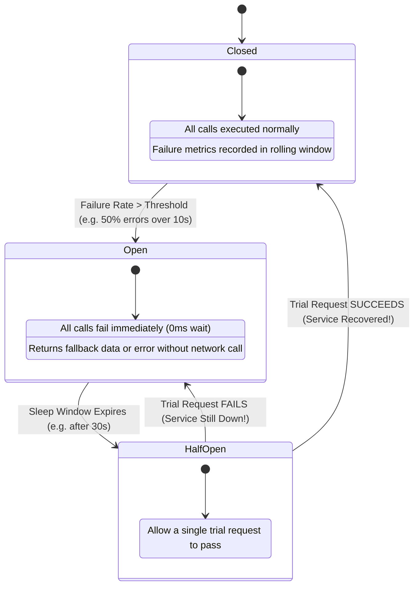

## Fast Revision (10-Second Recall)
A Circuit Breaker monitors downstream network calls through a three-state machine: CLOSED (normal flow), OPEN (tripped after error threshold; calls fail fast immediately without making network requests), and HALF-OPEN (testing recovery with a small trial request). It prevents cascading resource exhaustion and provides failing downstream services time to recover.

## The 30-Second Spoken Script
> "In an electrical circuit, a circuit breaker trips to cut the current when an overload occurs, preventing the house from catching fire. In software microservices, a Circuit Breaker does the exact same thing for distributed network calls. Under normal operations, the circuit is in the CLOSED state, allowing requests to pass through while recording success and failure metrics. If downstream failure rates exceed a configured threshold—say, 50% of requests time out over a 10-second window—the circuit trips to the OPEN state. In the OPEN state, all subsequent calls fail fast immediately or execute a fallback in under 1 millisecond, without making any outbound network requests. This accomplishes two critical goals: it prevents our application from exhausting its own worker threads waiting for doomed timeouts, and it stops bombarding the struggling downstream service, giving it breathing room to heal. After a sleep window, the circuit transitions to HALF-OPEN, sending a single probe request to test if the dependency has recovered before resetting to CLOSED."

## Scenario / Problem Context
A flight booking system calls a third-party airline reservation API to confirm ticket purchases. During a holiday rush, the airline API degraded, taking 45 seconds to respond with 504 Gateway Timeouts. Because the booking system had no circuit breaker, 5,000 incoming user booking attempts spawned 5,000 concurrent threads waiting 45 seconds each. Node.js ran out of file descriptors and memory, crashing the entire booking platform. The team must implement a Circuit Breaker pattern to protect system stability.

## Architectural Workflow / Sequence


## Deep-Dive Analysis & Root Causes

### 1. The Three States of a Circuit Breaker
1. **CLOSED (Healthy)**:
   - Requests flow directly to downstream service.
   - Failures (timeouts, 500s) increment error counters in a sliding time window.
   - If error percentage breaches the limit (e.g. 50%), trip to **OPEN**.
2. **OPEN (Tripped / Failing Fast)**:
   - Outbound network requests are **blocked immediately**.
   - No TCP connection is opened; no threads wait.
   - Returns instantaneous error (`503 Service Unavailable`) or executes a predefined fallback.
   - Starts a recovery timer (e.g. 30 seconds).
3. **HALF-OPEN (Canary Probe)**:
   - When the recovery timer expires, the breaker transitions to HALF-OPEN.
   - Allows a limited number of trial requests (typically 1 to 3) to pass through to the downstream service.
   - If the trial requests succeed: reset error counters and transition back to **CLOSED**.
   - If any trial request fails: assume the service is still impaired, reset the timer, and immediately trip back to **OPEN**.

### 2. Tuning Circuit Breaker Parameters
Misconfiguring a circuit breaker can cause false alarms or delayed protection:
- **`volumeThreshold` (Minimum Requests)**: Don't evaluate failure percentage until at least 20 requests occur in the window (avoids tripping on 1 failure out of 2 requests).
- **`errorThresholdPercentage`**: Typically set between 40% and 50%.
- **`timeout`**: Maximum execution duration before considering a call failed (e.g. 1,000 ms).
- **`resetTimeout`**: How long to stay in OPEN before attempting HALF-OPEN (e.g. 15,000 to 30,000 ms).

### 3. Application-Level (Opossum/Resilience4j) vs Mesh-Level (Envoy/Istio)
- **Application Level (Resilience4j in Java, Opossum in Node.js)**: Gives granular control over business fallbacks (returning cached data or default objects).
- **Service Mesh Level (Envoy Outlier Detection)**: Enforces circuit breaking at the infrastructure layer by automatically ejecting unhealthy pod IPs from the load balancing pool without requiring application code changes.

## Practical Debugging Commands & Code

#### Full Circuit Breaker Implementation with Opossum (TypeScript)
```typescript
import CircuitBreaker from 'opossum';

// Function making the actual remote HTTP call
async function callAirlineBookingApi(bookingPayload: object): Promise<{ bookingRef: string }> {
  const controller = new AbortController();
  const timeoutId = setTimeout(() => controller.abort(), 1500); // 1.5s hard socket timeout

  const response = await fetch('https://api.airline.com/v1/bookings', {
    method: 'POST',
    headers: { 'Content-Type': 'application/json' },
    body: JSON.stringify(bookingPayload),
    signal: controller.signal,
  });
  clearTimeout(timeoutId);

  if (!response.ok) {
    throw new Error(`Airline API failed with status ${response.status}`);
  }

  return response.json();
}

// Circuit Breaker Configuration
const breakerOptions: CircuitBreaker.Options = {
  timeout: 2000,                  // If action takes longer than 2s, trigger failure
  errorThresholdPercentage: 50,  // Trip open if 50% of requests fail
  resetTimeout: 30000,            // Wait 30s in OPEN state before trying HALF-OPEN
  rollingCountTimeout: 10000,     // 10-second rolling analysis window
  rollingCountBuckets: 10,        // 10 buckets of 1 second each
  volumeThreshold: 10,            // Minimum 10 requests required in window to trip
};

export const bookingCircuitBreaker = new CircuitBreaker(callAirlineBookingApi, breakerOptions);

// Observability and State Monitoring Hooks
bookingCircuitBreaker.on('open', () => {
  console.error('[CRITICAL ALERT] Booking Circuit Breaker TRIPPED to OPEN state! Failing fast.');
});

bookingCircuitBreaker.on('halfOpen', () => {
  console.log('[Circuit Breaker] Entering HALF-OPEN state. Sending trial probe request...');
});

bookingCircuitBreaker.on('close', () => {
  console.log('[Circuit Breaker] Downstream service healthy! Resetting to CLOSED state.');
});

// Define Fallback Behavior
bookingCircuitBreaker.fallback((bookingPayload, err) => {
  console.warn('[Circuit Breaker Fallback] Executing asynchronous queue fallback:', err?.message);
  // Queue booking for asynchronous offline retry rather than failing customer
  return { bookingRef: 'PENDING_OFFLINE_QUEUE' };
});
```

#### Envoy Outlier Detection (Mesh Circuit Breaker in Kubernetes)
```yaml
apiVersion: networking.istio.io/v1alpha3
kind: DestinationRule
metadata:
  name: airline-api-circuit-breaker
  namespace: prod
spec:
  host: airline-service.prod.svc.cluster.local
  trafficPolicy:
    connectionPool:
      tcp:
        maxConnections: 100 # Maximum concurrent TCP connections
      http:
        http1MaxPendingRequests: 50
        maxRequestsPerConnection: 10
    outlierDetection:
      consecutive5xxErrors: 3     # Eject pod after 3 consecutive 5xx errors
      interval: 10s              # Evaluation interval
      baseEjectionTime: 30s      # Pod ejected from routing for 30s
      maxEjectionPercent: 50     # At most 50% of pods can be ejected
```

## Prevention & Senior Best Practices

### 1. Architectural Guardrails
- **Combine Circuit Breakers with Bulkheads**: A circuit breaker stops calls *after* failures accumulate, but a bulkhead limits concurrency *before* the breaker trips. Always pair both patterns for rock-solid resilience.
- **Never Use Default Client Timeouts**: Ensure every third-party SDK or HTTP client has explicit connection and read timeouts configured; default timeouts in libraries like Python `requests` or Java HTTP clients are often infinite.

### 2. Operational Hardening
- **Export Circuit Breaker State to Prometheus**: Expose metric `circuit_breaker_state{name="airline_api", state="open"}` and set high-priority alerts when any circuit remains OPEN for $>60\text{ seconds}$.
- **Simulate Failures in Production Canary**: Regularly verify circuit breaker trip and recovery behavior in staging using network chaos tools.

