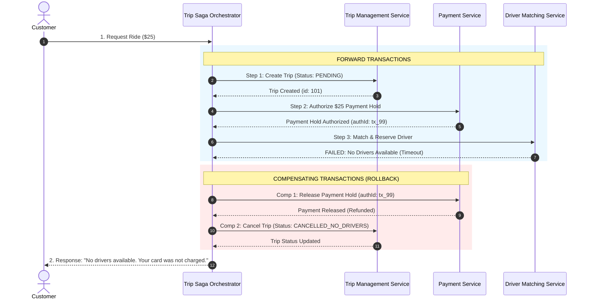

## Fast Revision (10-Second Recall)
When a transaction spans three or more microservices (e.g. Order $\rightarrow$ Payment $\rightarrow$ Inventory), coordinate the workflow using a state-machine-driven Saga pattern. If any intermediate step fails (e.g. payment succeeds but inventory runs out), the workflow coordinator fires backward compensating transactions (e.g. refunding payment and cancelling the order) to restore system consistency.

## The 30-Second Spoken Script
> "Handling a transaction across three microservices—like an e-commerce checkout involving the Order Service, Payment Service, and Inventory Service—is where ACID guarantees break down. We cannot wrap three separate services and databases in a single SQL `BEGIN TRANSACTION`. If we charge the customer's card in Payment Service, reserve items in Inventory Service, but then Order Service fails to record the final order, the system is left in an inconsistent state. The industry standard solution is the Saga Pattern. A Saga breaks the distributed transaction into a sequence of local transactions. Each service executes its local transaction and publishes an event or reports back to an orchestrator. If all three succeed, the Saga completes. However, if step 3 fails—say the inventory is out of stock—the Saga triggers a series of backward **compensating transactions**: executing a refund API call in Payment Service, and updating the order status to `CANCELLED_OUT_OF_STOCK` in Order Service, bringing the distributed system back to eventual consistency."

## Scenario / Problem Context
A ride-hailing booking requires three microservices: `Trip Management Service` (creates ride ticket), `Payment Service` (places a $25 authorization hold on credit card), and `Driver Matching Service` (assigns and reserves a driver). If the Trip Service creates a trip and Payment Service successfully holds the $25, but Driver Matching fails to find any available drivers within 2 minutes, the $25 hold must be immediately released and the trip marked cancelled. The system must guarantee that a customer is never billed for a ride that never had a driver assigned.

## Architectural Workflow / Sequence


## Deep-Dive Analysis & Root Causes

### 1. The Death of ACID in Distributed Systems
In a single monolithic database, transactions guarantee:
- **Atomicity**: All or nothing.
- **Consistency**: Integrity constraints enforced.
- **Isolation**: In-flight transactions cannot see each other.
- **Durability**: Committed data persists to disk.
In a multi-service architecture:
- Each service has its own database.
- **Isolation is lost**: Intermediate states (e.g. `$25 Hold Placed` before driver is found) are visible to other queries.
- We trade ACID for **BASE** (Basically Available, Soft-state, Eventual consistency).

### 2. Forward Recovery vs Backward Recovery (Compensation)
- **Forward Recovery**: Retrying failed operations until they eventually succeed. Suitable for transient errors (e.g., temporary network glitches).
- **Backward Recovery (Compensation)**: Undoing previous successful steps when a fatal business error occurs (e.g., item out of stock, card declined).
- **Semantic Rollback**: You cannot "undo" a credit card charge with `ROLLBACK`. You must execute a new forward compensating transaction (a `REFUND` API call).

### 3. Orchestration vs Choreography for 3+ Services
When 3 or more services participate in a transaction:
- **Choreography (Event-Driven)**: Services emit events and listen to each other.
  - *Risk*: Becomes "event soup" when errors occur. Tracing which service needs to compensate becomes brittle and difficult to debug.
- **Orchestration (State-Machine Driven)**: A centralized coordinator (e.g. Temporal, AWS Step Functions, or custom state machine) explicitly calls each service and handles compensations.
  - *Senior Best Practice*: **Always use Orchestration when 3 or more services participate in a business transaction.**

### 4. Pivot Transactions in a Saga
Every Saga has three types of transactions:
1. **Compensable Transactions**: Steps that can be undone via compensation (e.g., reserving stock, placing a hold).
2. **Pivot Transaction**: The point of no return. Once this step succeeds, the Saga *must* complete forward; no compensation is possible.
3. **Retriable Transactions**: Steps occurring *after* the pivot transaction. They cannot be compensated, so they must be retried until they succeed (e.g., sending the confirmation email).

## Practical Debugging Commands & Code

#### State-Machine Orchestrator for 3-Service Saga (TypeScript)
```typescript
interface SagaContext {
  sagaId: string;
  userId: string;
  amount: number;
  tripId?: string;
  paymentAuthId?: string;
  driverId?: string;
  status: 'PENDING' | 'SUCCESS' | 'COMPENSATED' | 'FAILED';
}

export class TripBookingSagaOrchestrator {
  static async execute(userId: string, amount: number): Promise<SagaContext> {
    const context: SagaContext = {
      sagaId: crypto.randomUUID(),
      userId,
      amount,
      status: 'PENDING',
    };

    try {
      // Step 1: Create Trip record in Trip Service
      console.log(`[Saga ${context.sagaId}] Step 1: Creating trip`);
      context.tripId = await TripServiceClient.createTrip(userId);

      // Step 2: Authorize payment hold in Payment Service
      console.log(`[Saga ${context.sagaId}] Step 2: Placing payment hold`);
      context.paymentAuthId = await PaymentServiceClient.holdFunds(userId, amount);

      // Step 3: Match driver in Driver Service (Potential Failure Point)
      console.log(`[Saga ${context.sagaId}] Step 3: Matching driver`);
      context.driverId = await DriverServiceClient.assignDriver(context.tripId);

      // All 3 steps succeeded!
      context.status = 'SUCCESS';
      await TripServiceClient.activateTrip(context.tripId, context.driverId);
      return context;
    } catch (stepError: any) {
      console.error(`[Saga ${context.sagaId}] Step failed: ${stepError.message}. Initiating rollback!`);
      // Trigger Backward Compensating Transactions
      await this.rollback(context);
      context.status = 'COMPENSATED';
      throw new Error(`Booking failed: ${stepError.message}. Funds were released.`);
    }
  }

  // Idempotent Backward Compensation
  private static async rollback(context: SagaContext) {
    // Compensate Step 2: Release Payment Hold if authorized
    if (context.paymentAuthId) {
      try {
        console.log(`[Compensation] Releasing payment hold: ${context.paymentAuthId}`);
        await PaymentServiceClient.releaseHold(context.paymentAuthId);
      } catch (err) {
        console.error(`[CRITICAL] Compensation failed for payment ${context.paymentAuthId}! Requires manual alert.`);
      }
    }

    // Compensate Step 1: Cancel Trip if created
    if (context.tripId) {
      try {
        console.log(`[Compensation] Cancelling trip: ${context.tripId}`);
        await TripServiceClient.cancelTrip(context.tripId, 'NO_DRIVERS_AVAILABLE');
      } catch (err) {
        console.error(`[CRITICAL] Compensation failed for trip ${context.tripId}!`);
      }
    }
  }
}
```

#### Mocking Services for Verification
```typescript
class TripServiceClient {
  static async createTrip(userId: string) { return 'trip_9921'; }
  static async activateTrip(tripId: string, driverId: string) { return true; }
  static async cancelTrip(tripId: string, reason: string) { return true; }
}
class PaymentServiceClient {
  static async holdFunds(userId: string, amount: number) { return 'auth_7733'; }
  static async releaseHold(authId: string) { return true; }
}
class DriverServiceClient {
  static async assignDriver(tripId: string) {
    // Simulate driver matching failure
    throw new Error('No drivers within 5km radius');
  }
}
```

## Prevention & Senior Best Practices

### 1. Architectural Guardrails
- **Idempotent Compensating Actions**: All compensating endpoints (`refundPayment`, `releaseHold`, `cancelOrder`) must be strictly idempotent. If a network timeout occurs during compensation, the orchestrator must be able to safely retry the compensation without duplicate refunds.
- **Workflow Engines for Production Sagas**: For enterprise-critical flows, avoid home-grown scripts and adopt proven workflow orchestration engines like **Temporal.io** or **AWS Step Functions**, which persist execution state machines to disk and guarantee recovery across process crashes.

### 2. Operational Hardening
- **Alert on Compensation Failures**: If a compensating transaction fails after multiple retries, raise an immediate high-priority PagerDuty alert. These "stuck Sagas" require human intervention to avoid financial or ledger discrepancies.
- **Saga Execution History Audit**: Persist every Saga step, payload, and timestamp in an append-only audit log table to facilitate regulatory auditing and customer dispute resolution.

