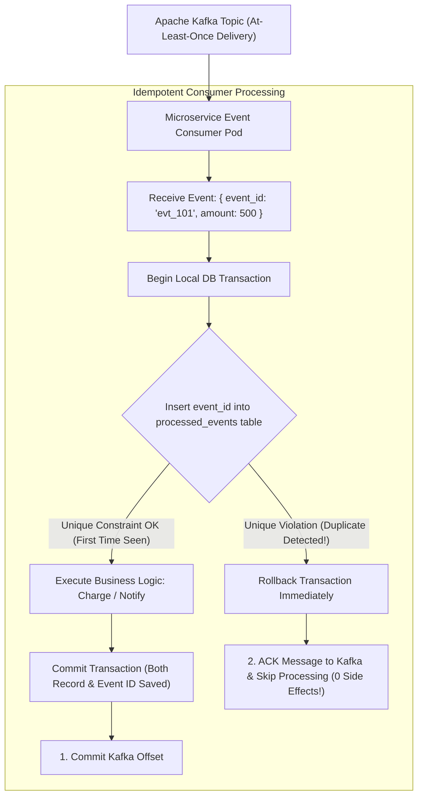

## Fast Revision (10-Second Recall)
In distributed systems, true network-wide 'exactly-once' delivery is a myth—networks provide at-least-once delivery, meaning duplicate events are inevitable. Protect against duplicates by enforcing strict consumer idempotency: assign a unique UUID (`event_id` or `idempotency_key`) to every message, verify against a dedup store before execution, and insert processed IDs within an atomic database transaction.

## The 30-Second Spoken Script
> "In event-driven microservices using Kafka, RabbitMQ, or AWS SQS, consumer applications must assume that duplicate messages will arrive as a routine operational condition. Duplicate events happen during consumer rebalances, network timeouts where an ACK is lost, or producer retry loops. If a payment consumer processes an event twice, the customer gets billed twice. We prevent this by designing strictly Idempotent Consumers. Every event must carry a globally unique `event_id` or business key like `order_id`. When the consumer receives a message, it begins a database transaction and attempts to insert the `event_id` into a `processed_events` table configured with a UNIQUE constraint. If the insert succeeds, it processes the business logic and commits both operations atomically. If the insert throws a unique constraint violation, the consumer immediately recognizes a duplicate, logs a warning, and acknowledges the message to the broker without re-executing the business logic."

## Scenario / Problem Context
A banking notification service consumed `PaymentProcessedEvent` from an Apache Kafka cluster. During a routine Kubernetes rolling restart, a consumer pod crashed before committing its Kafka consumer offset. When the new consumer pod spun up, it re-read the last 500 uncommitted messages from the partition offset, causing 500 customers to receive duplicate SMS alerts stating their accounts had been charged twice, resulting in panicked customer support calls.

## Architectural Workflow / Sequence


## Deep-Dive Analysis & Root Causes

### 1. Why Duplicate Events Occur
1. **Producer-Side Retries**: The producer sends an event to Kafka. The broker writes to disk, but the network ACK drops. The producer retries and writes the message a second time.
2. **Consumer Rebalance**: A consumer processes 50 messages, but before it can commit its offset to Kafka (`__consumer_offsets`), the pod is killed or rebalances. The replacement pod restarts from the last committed offset and reprocesses all 50 messages.
3. **Dead-Letter Queue (DLQ) Replays**: Engineers manually replaying failed messages from a dead-letter queue will inadvertently reprocess messages that previously succeeded.

### 2. The Idempotency Key Design Pattern
An operation is **idempotent** if applying it multiple times produces the exact same result as applying it once:
$$f(f(x)) = f(x)$$
- Mathematical example: `ABS(-5) = 5`, and `ABS(ABS(-5)) = 5`.
- HTTP example: `PUT /users/1 { name: "Alice" }` is idempotent. `POST /users/1/transactions { amount: 10 }` is NOT idempotent unless guarded by an `Idempotency-Key`.

### 3. Database Unique Constraint vs Redis Dedup
| Mechanism | Storage | Atomicity with Business State | Best Used For |
|---|---|---|---|
| **RDBMS Unique Constraint** | PostgreSQL / MySQL | **100% Atomic** (same transaction as business data) | Financial transactions, order processing, inventory |
| **Redis `SETNX` with TTL** | Redis RAM | Eventual (requires two network hops) | Rate limiting, metrics, notification deduplication |

## Practical Debugging Commands & Code

#### Idempotent Kafka Consumer with PostgreSQL (TypeScript)
```typescript
import { EachMessagePayload } from 'kafkajs';
import { db } from './database';

interface PaymentEvent {
  eventId: string; // Unique UUID generated by producer
  orderId: string;
  userId: string;
  amountCents: number;
}

export async function processPaymentEvent({ message }: EachMessagePayload) {
  if (!message.value) return;

  const event: PaymentEvent = JSON.parse(message.value.toString());

  // ATOMIC DEDUPLICATION: Process business logic and record eventId in same SQL transaction
  try {
    await db.$transaction(async (tx) => {
      // 1. Attempt to insert eventId into processed_events table
      // The table has a PRIMARY KEY or UNIQUE constraint on `event_id`
      await tx.processedEvent.create({
        data: {
          eventId: event.eventId,
          eventType: 'PAYMENT_PROCESSED',
          processedAt: new Date(),
        },
      });

      // 2. Execute business mutation (e.g. credit user balance)
      await tx.accountLedger.create({
        data: {
          userId: event.userId,
          orderId: event.orderId,
          amountCents: event.amountCents,
          entryType: 'CREDIT',
        },
      });

      console.log(`[Event Processed] Successfully processed event ${event.eventId} for user ${event.userId}`);
    });
  } catch (err: any) {
    // Check for Prisma unique constraint violation code (P2002) or Postgres code 23505
    if (err.code === 'P2002' || err.message?.includes('unique constraint')) {
      console.warn(`[DUPLICATE DETECTED] Event ${event.eventId} was already processed. Skipping business logic.`);
      // Return cleanly so Kafka consumer commits offset and does NOT retry!
      return;
    }

    // Real error (e.g. database down): rethrow to trigger Kafka retry
    console.error(`[Processing Error] Error processing event ${event.eventId}:`, err);
    throw err;
  }
}
```

#### SQL Schema for Processed Events Table
```sql
CREATE TABLE processed_events (
    event_id VARCHAR(64) PRIMARY KEY,
    event_type VARCHAR(100) NOT NULL,
    processed_at TIMESTAMP WITH TIME ZONE DEFAULT CURRENT_TIMESTAMP
);

-- Optional: Index on timestamp to prune events older than 30 days
CREATE INDEX idx_processed_events_time ON processed_events (processed_at);
```

#### Inspecting Kafka Consumer Offset Lag via CLI
```bash
# Check if consumer group is falling behind and risking duplicate rebalance batches
kafka-consumer-groups.sh --bootstrap-server kafka:9092 --describe --group payment-consumer-group
```

## Prevention & Senior Best Practices

### 1. Architectural Guardrails
- **Enforce Producer UUID Generation**: Prohibit producers from publishing events without an explicit `eventId` field in the root JSON schema. Use JSON schema validators or Protobuf contracts in CI.
- **Natural Business Keys as Fallback**: If an upstream system fails to provide a UUID, construct a deterministic composite hash from natural business keys:
  $$\text{DeduplicationKey} = \text{SHA256}(\text{userId} + \text{orderId} + \text{transactionType})$$

### 2. Operational Hardening
- **Prune Old Processed Event Records**: Schedule a daily cron job to delete records from `processed_events` older than 30 days (`DELETE FROM processed_events WHERE processed_at < NOW() - INTERVAL '30 days'`) to keep table size bounded.
- **Alert on High Duplicate Spikes**: Measure duplicate detection rate (`duplicate_events_total / total_events_consumed`). If duplicates exceed 1% of incoming traffic, inspect producer network stability or consumer heartbeat settings.

