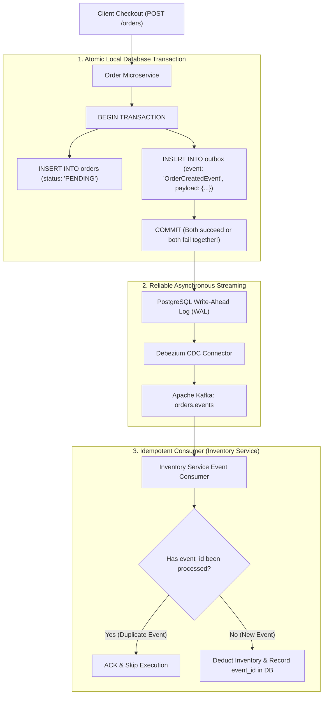

## Fast Revision (10-Second Recall)
In microservices, avoid synchronous distributed transactions (Two-Phase Commit / 2PC) due to high latency, locking, and single points of failure. Instead, maintain Eventual Consistency using the Transactional Outbox Pattern with Debezium Change Data Capture (CDC), asynchronous message publishing to Kafka, and strictly Idempotent Consumers with background reconciliation.

## The 30-Second Spoken Script
> "Maintaining data consistency across two microservices with independent databases is one of the most fundamental challenges in distributed systems. A naive attempt to update both databases synchronously within an API handler creates severe partial failure risks: if Service A charges a card in its database, but the network request to update Service B's order database fails, your data is corrupted. While Two-Phase Commit (2PC) offers theoretical ACID consistency, it is an anti-pattern in modern cloud architectures because it holds distributed database locks across network boundaries, destroying availability and throughput. The senior engineering pattern is Eventual Consistency powered by the Transactional Outbox Pattern: when Service A updates its entity, it writes an event record to an `outbox` table in the *same local database transaction*. A Change Data Capture tool like Debezium streams this outbox record into Kafka, guaranteeing at-least-once delivery. Service B consumes the event idempotently using an idempotency key table. Finally, we run periodic reconciliation jobs to detect and resolve any transient drift."

## Scenario / Problem Context
An e-commerce order checkout involves two services: `Order Service` (PostgreSQL) and `Inventory Service` (MySQL). The Order Service created an order, charged the customer, and then fired an HTTP POST request to reserve inventory in the Inventory Service. A network timeout occurred during the HTTP call. The customer's credit card was billed, but the inventory was never reserved, leading to order fulfillment failures and customer complaints. The team must implement guaranteed data consistency between the two services.

## Architectural Workflow / Sequence


## Deep-Dive Analysis & Root Causes

### 1. The Dual-Write Flaw
The most common junior mistake is uncoordinated dual-writes:
```typescript
// VULNERABLE: Not atomic!
await db.order.create({ data: orderData }); // Succeeds
await fetch('http://inventory-service/reserve'); // What if this throws or network drops?
```
If the network drops, process crashes, or Inventory Service responds with a 500 error, Order Service has already committed the order. The two services are now permanently out of sync.

### 2. Why Two-Phase Commit (2PC) Fails in Microservices
- **Phase 1 (Prepare)**: Coordinator asks both databases to prepare and hold locks.
- **Phase 2 (Commit)**: Coordinator orders both databases to commit.
*Why 2PC is avoided*:
- **Blocking Locks**: Rows remain locked in both databases while waiting for network ACKs. Throughput drops from thousands of transactions per second to double digits.
- **Coordinator Failure**: If the coordinator crashes between Phase 1 and Phase 2, database resources remain locked indefinitely.
- **CAP Theorem**: 2PC chooses Consistency over Availability, meaning a transient hiccup in either service blocks all transactions.

### 3. The Transactional Outbox Pattern
Solves the dual-write problem by using the local database's native ACID capabilities:
1. When modifying application state, insert an event record into an `outbox` table in the *same local database transaction*.
2. Because both writes are in the same local database transaction, it is impossible for the order to exist without the corresponding outbox record.
3. An asynchronous process (Debezium reading the database WAL, or a background worker polling the outbox table) publishes the event to Kafka.
4. Guarantees **At-Least-Once Delivery** to downstream consumers.

### 4. Idempotency at the Consumer
Because Kafka provides at-least-once delivery, downstream consumers must handle duplicate messages:
- Consumers store processed `event_id`s in a database table:
  ```sql
  INSERT INTO processed_events (event_id, processed_at) VALUES ('evt_101', NOW());
  ```
- If a message with `evt_101` arrives a second time, the unique primary key constraint blocks execution, guaranteeing exactly-once business processing.

## Practical Debugging Commands & Code

#### Transactional Outbox Implementation with Prisma (TypeScript)
```typescript
import { PrismaClient } from '@prisma/client';
import crypto from 'crypto';

const prisma = new PrismaClient();

export async function createOrderWithOutbox(userId: string, items: any[], totalAmount: number) {
  const orderId = crypto.randomUUID();
  const eventId = crypto.randomUUID();

  // ATOMIC TRANSACTION: Both the order and outbox event commit together
  const [newOrder, outboxEvent] = await prisma.$transaction([
    prisma.order.create({
      data: {
        id: orderId,
        userId,
        totalAmount,
        status: 'PENDING_INVENTORY',
      },
    }),
    prisma.outbox.create({
      data: {
        id: eventId,
        aggregateType: 'ORDER',
        aggregateId: orderId,
        eventType: 'ORDER_CREATED',
        payload: JSON.stringify({ orderId, userId, items, totalAmount }),
      },
    }),
  ]);

  return newOrder;
}
```

#### Idempotent Consumer Implementation (Inventory Service)
```typescript
import { db } from './database';

interface OrderCreatedEvent {
  eventId: string;
  orderId: string;
  items: { productId: string; quantity: number }[];
}

export async function handleOrderCreatedEvent(event: OrderCreatedEvent) {
  // Execute stock reservation and idempotency registration in a single transaction
  try {
    await db.$transaction(async (tx) => {
      // 1. Attempt to insert into processed_events table (Unique Constraint on eventId)
      await tx.processedEvents.create({
        data: {
          eventId: event.eventId,
          eventType: 'ORDER_CREATED',
        },
      });

      // 2. If insert succeeded, deduct inventory
      for (const item of event.items) {
        await tx.inventory.update({
          where: { productId: item.productId },
          data: { stock: { decrement: item.quantity } },
        });
      }

      console.log(`[Inventory Reserved] Successfully processed event: ${event.eventId}`);
    });
  } catch (err: any) {
    // If unique constraint violation (P2002 in Prisma), this is a duplicate event!
    if (err.code === 'P2002') {
      console.warn(`[Duplicate Event Ignored] Event ${event.eventId} was already processed.`);
      return; // Acknowledge message cleanly without re-executing stock deduction
    }
    throw err; // Real error: Retry message
  }
}
```

## Prevention & Senior Best Practices

### 1. Architectural Guardrails
- **Ban Cross-Database Synchronous Calls**: Enforce architectural guidelines that forbid synchronous REST/gRPC calls from executing mutative writes across two distinct microservice databases within a single request.
- **Debezium CDC over Outbox Polling**: Use Debezium to stream directly from database WAL logs rather than running `SELECT * FROM outbox WHERE processed = false` polling queries, which causes database CPU and table lock contention.

### 2. Operational Hardening
- **Automated Reconciliation Cron**: Schedule a nightly reconciliation job that queries Order and Inventory states, finds any orphan orders with unreserved stock, and alerts operators or automatically publishes compensating events.
- **Set Up Dead-Letter Queues (DLQ)**: If an event cannot be processed by the consumer after 5 retries (e.g., due to corrupt payload data), route it to a DLQ and alert the team to prevent message processing stalls.

