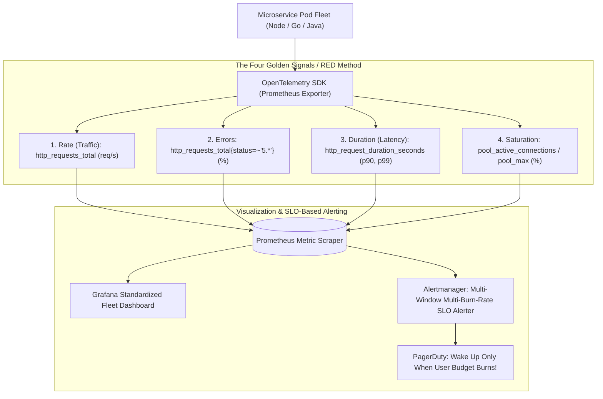

## Fast Revision (10-Second Recall)
Monitor microservices using Google's Four Golden Signals (Latency, Traffic, Errors, Saturation) and the RED method (Rate, Errors, Duration). Instrument standard Prometheus metrics via OpenTelemetry, track percentiles (p50, p95, p99) rather than misleading averages, and establish SLO-based burn-rate alerts to eliminate alert fatigue.

## The 30-Second Spoken Script
> "Monitoring microservices requires shifting from host-level infrastructure metrics like CPU and disk usage to user-centric service health signals. In our architecture, we standardize all microservices on Google's Four Golden Signals and the RED Method: Rate—how many requests per second we process; Errors—the percentage of requests failing with 5xx or unhandled exceptions; and Duration—the time it takes to process requests, tracked rigorously via p95 and p99 percentiles rather than averages. The fourth signal is Saturation: how close the service is to its resource limits (such as database connection pool utilization or thread queue capacity). We collect these metrics using OpenTelemetry and Prometheus, visualize them on standardized Grafana team dashboards, and tie our alerting strictly to Service Level Objectives (SLOs) using error budget burn-rate alerts rather than noisy, arbitrary thresholds."

## Scenario / Problem Context
An engineering organization running 45 microservices suffered from severe alert fatigue: on-call engineers received over 800 PagerDuty alerts weekly for harmless CPU blips or memory warnings, leading engineers to snooze notifications. Meanwhile, a silent database deadlock in the billing service went unnoticed for 4 hours because no alert checked HTTP error rates or transaction duration. The team must overhaul microservice monitoring around actionable Golden Signals.

## Architectural Workflow / Sequence


## Deep-Dive Analysis & Root Causes

### 1. The Flaw of System Metrics vs Service Metrics
- **Host Metrics (Old School)**: CPU 90%, RAM 85%.
  - *Why it fails*: A service running at 95% CPU can be happily and efficiently serving all requests in 10 ms with 0 errors. Alerting on CPU wakes people up for nothing.
- **Service Metrics (Golden Signals)**: Latency, Errors, Throughput.
  - *Why it wins*: Even if CPU is only 15%, if 30% of user requests are returning 500 errors, the service is broken. Golden Signals reflect real customer experience.

### 2. The Four Golden Signals (Google SRE Book)
1. **Latency**: The time it takes to service a request. Separate successful request latency from error latency (a 500 failing fast in 2 ms artificially lowers average latency!).
2. **Traffic**: A measure of demand on the system (HTTP requests/second, network I/O, or concurrent sessions).
3. **Errors**: The rate of requests that fail, either explicitly (HTTP 500), implicitly (returning empty response or wrong data), or by policy (HTTP 403 on misconfigured authorization).
4. **Saturation**: How "full" the service is. Measures the resource with the most constrained headroom: database connection pool, thread queue, memory buffer.

### 3. The Fallacy of Averages: Why Percentiles (p95 / p99) Matter
- If 99 requests take 10 ms and 1 request takes 10,000 ms:
  - Average Latency: $110\text{ ms}$ (looks acceptable!).
  - **p99 Latency: $10,000\text{ ms}$** (1 out of every 100 users experiences a 10-second freeze!).
- In an e-commerce flow with 20 microservice calls per page view:
  $$\text{Probability of hitting p99} = 1 - (0.99)^{20} \approx 18\%$$
  Nearly 1 in 5 users will experience the painful 10-second latency! Always monitor and alert on **p95 and p99**.

### 4. SLO-Based Burn Rate Alerting
Instead of setting arbitrary static alerts (`Alert if errors > 5`):
- Define an SLO: *99.9% of requests over 30 days must succeed in under 300 ms*.
- Error budget = $0.1\%$.
- Alert if error rate is burning through the 30-day budget at **$14.4\times$** the normal rate (burning 2% of budget in 1 hour).
- Eliminates 95% of false-positive pages.

## Practical Debugging Commands & Code

#### Prometheus Express Middleware for RED Metrics (Node.js & prom-client)
```typescript
import { Request, Response, NextFunction } from 'express';
import client from 'prom-client';

// Initialize Prometheus Registry
const register = new client.Registry();
client.collectDefaultMetrics({ register }); // Collects node CPU, memory, event loop lag

// 1. Rate & Error Counter: http_requests_total
export const httpRequestCounter = new client.Counter({
  name: 'http_requests_total',
  help: 'Total number of HTTP requests processed',
  labelNames: ['method', 'route', 'status_code'],
  registers: [register],
});

// 2. Duration Histogram: http_request_duration_seconds (calculates p50, p95, p99)
export const httpRequestDuration = new client.Histogram({
  name: 'http_request_duration_seconds',
  help: 'HTTP request duration in seconds',
  labelNames: ['method', 'route', 'status_code'],
  buckets: [0.005, 0.01, 0.025, 0.05, 0.1, 0.25, 0.5, 1, 2.5, 5], // 5ms to 5s buckets
  registers: [register],
});

// 3. Saturation Gauge: active_database_connections
export const dbConnectionGauge = new client.Gauge({
  name: 'db_connection_pool_active',
  help: 'Number of active database connections in pool',
  registers: [register],
});

// Middleware to record metrics per request
export function metricsMiddleware(req: Request, res: Response, next: NextFunction) {
  const start = process.hrtime();

  res.on('finish', () => {
    const diff = process.hrtime(start);
    const durationSeconds = diff[0] + diff[1] / 1e9;
    const route = req.route ? req.route.path : req.path;
    const statusCode = res.statusCode.toString();

    httpRequestCounter.inc({ method: req.method, route, status_code: statusCode });
    httpRequestDuration.observe({ method: req.method, route, status_code: statusCode }, durationSeconds);
  });

  next();
}

// Metrics endpoint scraped by Prometheus
export async function metricsEndpoint(req: Request, res: Response) {
  res.setHeader('Content-Type', register.contentType);
  res.send(await register.metrics());
}
```

#### Production Prometheus Alert Rules (PromQL)
```yaml
groups:
  - name: microservice-golden-signals
    rules:
      # 1. High Error Rate Alert (> 2% 5xx errors for 5 mins)
      - alert: MicroserviceHighErrorRate
        expr: |
          sum(rate(http_requests_total{status_code=~"5.*"}[5m])) 
          / 
          sum(rate(http_requests_total[5m])) > 0.02
        for: 5m
        labels:
          severity: critical
        annotations:
          summary: "Service {{ $labels.service }} has error rate > 2%"

      # 2. High Latency Alert (p99 > 1000ms for 5 mins)
      - alert: MicroserviceHighLatencyP99
        expr: |
          histogram_quantile(0.99, sum(rate(http_request_duration_seconds_bucket[5m])) by (le, service)) > 1.0
        for: 5m
        labels:
          severity: warning
        annotations:
          summary: "Service {{ $labels.service }} p99 latency exceeds 1 second"
```

## Prevention & Senior Best Practices

### 1. Architectural Guardrails
- **Automated Metric Instrumentation via Service Mesh / OTel**: Avoid relying on developers to manually wrap every route in code. Use Envoy access log metrics or OpenTelemetry auto-instrumentation agents to capture RED metrics automatically at the container ingress.
- **Normalize Route Labels**: In metrics, never use raw paths containing dynamic IDs (`/users/102938`). Always normalize to parameterized templates (`/users/:id`) to prevent high-cardinality explosions that crash Prometheus.

### 2. Operational Hardening
- **Standardized Grafana Dashboards**: Create an automated Grafana dashboard template for every service in the company displaying the same 4 Golden Signal panels in the same top-level grid.
- **Regular Alert Pruning**: Review alert firing history quarterly. If an alert fired more than 10 times in a month without requiring an immediate engineering action, delete or retune it.

