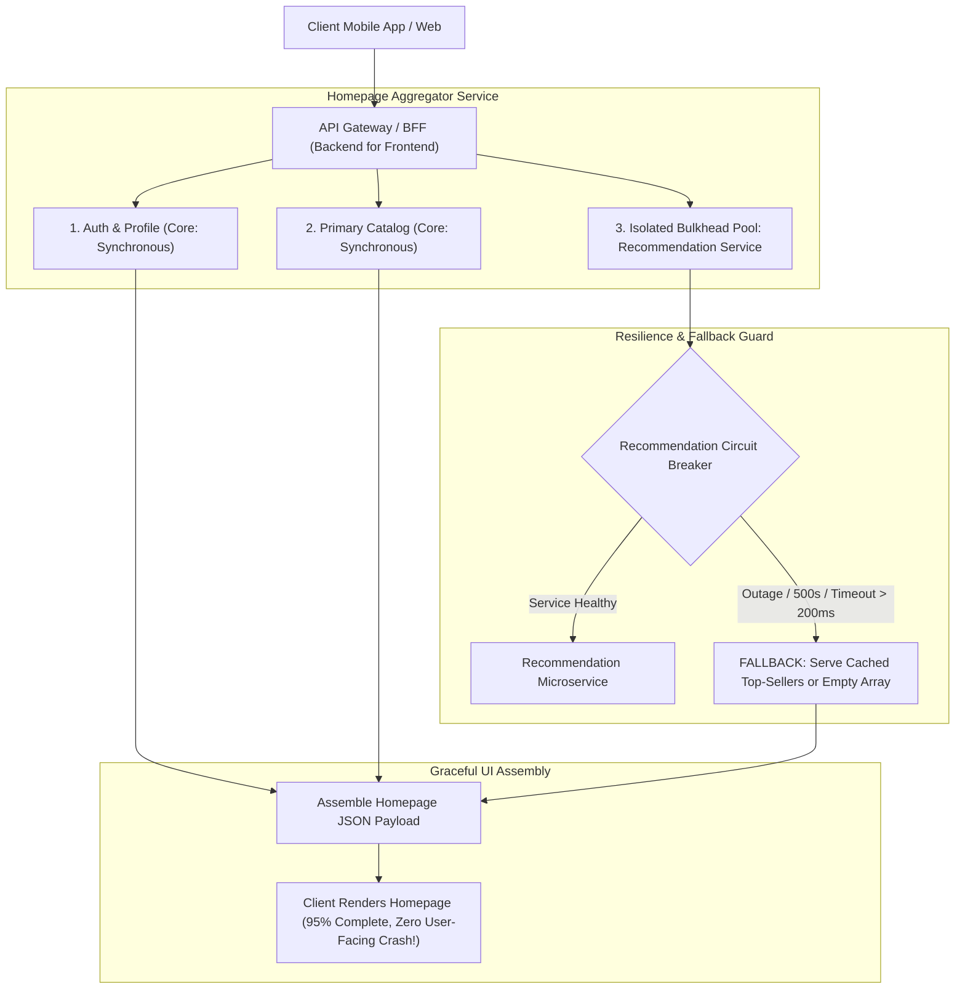

## Fast Revision (10-Second Recall)
Isolate failures to prevent full-system outages: enforce Bulkhead thread isolation, wrap external service calls in Circuit Breakers with predefined fallbacks (stale caches, empty arrays, or mock responses), implement graceful degradation at the UI layer, and decouple non-critical workflows using asynchronous message queues.

## The 30-Second Spoken Script
> "In a distributed system, failures are not an exception—they are an everyday certainty. The fundamental rule of microservices is that the failure of a non-critical peripheral service—like product recommendations, user reviews, or email notifications—must never prevent a customer from completing a core business transaction like checking out. We achieve this through four defensive layers: First, the Bulkhead pattern, partitioning thread pools and connection resources so that slow calls to the Recommendation service cannot exhaust worker threads needed for Order placement. Second, Circuit Breakers with fail-soft fallbacks: if the Recommendation service goes down, the circuit trips immediately and returns a cached static list of top-selling items or an empty array. Third, asynchronous decoupling via Kafka or SQS for non-critical side effects like notification emails, ensuring that email provider outages have zero impact on the checkout flow. Finally, graceful UI degradation, designing frontends to render gracefully even if individual microservice response blocks are missing."

## Scenario / Problem Context
An e-commerce mobile app's homepage completely failed to load, displaying a blank white screen with 'Network Error' for 3 million active users. The root cause was an outage in a third-party AI product recommendations service called during homepage assembly. Because the backend gateway waited 30 seconds for the recommendation service before timing out, and had no fallback logic, the entire homepage crashed. The executive team demands zero-downtime resilience against peripheral service failures.

## Architectural Workflow / Sequence


## Deep-Dive Analysis & Root Causes

### 1. Critical vs Non-Critical Service Classification
Every microservice in an ecosystem must be strictly classified:
- **Tier 1 (Critical / Core)**: System cannot function without it. Examples: Authentication, Cart, Payment.
  - *Strategy*: High redundancy, multi-region replication, tight SLA.
- **Tier 2 (Non-Critical / Peripheral)**: Enhances user experience, but core business can continue without it. Examples: Recommendations, User Reviews, Loyalty Points, Marketing Banners.
  - *Strategy*: Fail-soft fallback. If unavailable, hide the widget or serve cached data.

### 2. The Bulkhead Pattern (Ship Hull Isolation)
Named after compartmentalized watertight bulkheads in ships that prevent a single hull breach from sinking the entire vessel:
- If a service uses a shared global thread pool of 200 workers to call all downstream dependencies:
  - If Service B hangs, all 200 workers freeze waiting for Service B.
  - Requests for healthy Service C are rejected due to thread starvation!
- **Bulkhead Solution**: Assign dedicated, bounded thread pools:
  - Max 10 threads for Recommendation Service.
  - Max 50 threads for Payment Service.
  - Max 100 threads for Catalog Service.
  - A freeze in Recommendations can only consume its 10 allocated threads, leaving 190 threads free for core traffic.

### 3. Graceful UI Degradation
The frontend (BFF or SPA) must be built with resilient micro-frontends or defensive component rendering:
- If `recommendations` array is null or empty, the UI simply omits the "Recommended For You" carousel and moves the search grid up.
- The user completes their purchase completely unaware that an internal microservice is experiencing an outage.

## Practical Debugging Commands & Code

#### Fault-Tolerant Homepage Aggregator with Circuit Breaker Fallback (TypeScript)
```typescript
import CircuitBreaker from 'opossum';

interface Recommendation {
  id: string;
  title: string;
}

// 1. Raw call to third-party recommendation microservice
async function fetchRecommendations(userId: string): Promise<Recommendation[]> {
  const controller = new AbortController();
  const timeoutId = setTimeout(() => controller.abort(), 250); // 250ms hard timeout

  const response = await fetch(`http://recs-service.internal:8080/users/${userId}/recs`, {
    signal: controller.signal,
  });
  clearTimeout(timeoutId);

  if (!response.ok) throw new Error(`Recs service HTTP ${response.status}`);
  return response.json();
}

// 2. Wrap in Circuit Breaker with Safe Fallback
const recsBreaker = new CircuitBreaker(fetchRecommendations, {
  timeout: 300,
  errorThresholdPercentage: 50,
  resetTimeout: 10000,
});

// Predefined Fallback: Return static top-selling items if service is down
const STATIC_TOP_SELLERS: Recommendation[] = [
  { id: 'item_1', title: 'Trending Wireless Headphones' },
  { id: 'item_2', title: 'Popular Smartwatch Series 5' },
];

recsBreaker.fallback(() => {
  console.warn('[Graceful Degradation] Recs service failing; serving cached top sellers.');
  return STATIC_TOP_SELLERS;
});

// 3. Homepage Aggregator: Assembles Core + Non-Core components safely
export async function getHomepageData(userId: string) {
  // Execute core critical fetches and non-critical fetches concurrently
  const [userProfile, catalog, recommendations] = await Promise.all([
    fetchUserProfile(userId),           // Critical (Throws if fails)
    fetchCoreCatalog(),                 // Critical (Throws if fails)
    recsBreaker.fire(userId).catch(() => STATIC_TOP_SELLERS), // Resilient (Never throws!)
  ]);

  return {
    user: userProfile,
    products: catalog,
    recommended: recommendations, // Always populated, either fresh or fallback
  };
}

async function fetchUserProfile(userId: string) { return { id: userId, name: 'Alice' }; }
async function fetchCoreCatalog() { return [{ id: 'p1', name: 'Standard Product' }]; }
```

#### Simulating Downstream Failure in Staging (Chaos Engineering)
```bash
# Introduce 100% packet drop on recommendation service port using iptables
sudo iptables -A INPUT -p tcp --dport 8080 -j DROP

# Verify that homepage endpoint continues returning HTTP 200 with fallback data
curl -I https://staging.example.com/api/v1/home
# HTTP/2 200 OK (Verified: System degrades gracefully without crashing!)
```

## Prevention & Senior Best Practices

### 1. Architectural Guardrails
- **BFF (Backend for Frontend) Pattern**: Use a dedicated BFF layer to handle parallel dependency gathering, timeouts, and fallbacks, preventing client mobile apps from making brittle direct calls to dozens of internal services.
- **Fail-Silent / Fail-Safe Defaults**: For all non-transactional metadata (reviews, badges, telemetry), design APIs to return empty structures (`[]` or `{}`) rather than propagating 500 errors.

### 2. Operational Hardening
- **Automated Chaos Monkey Testing**: Run Chaos Mesh or Gremlin in staging weekly, randomly terminating non-critical microservices and asserting that end-to-end checkout integration tests maintain a 100% pass rate.
- **Alert on Tripped Circuit Breakers**: Fire PagerDuty alerts when a circuit breaker enters the `OPEN` state for more than 2 minutes to alert on-call teams of silent degradation.

