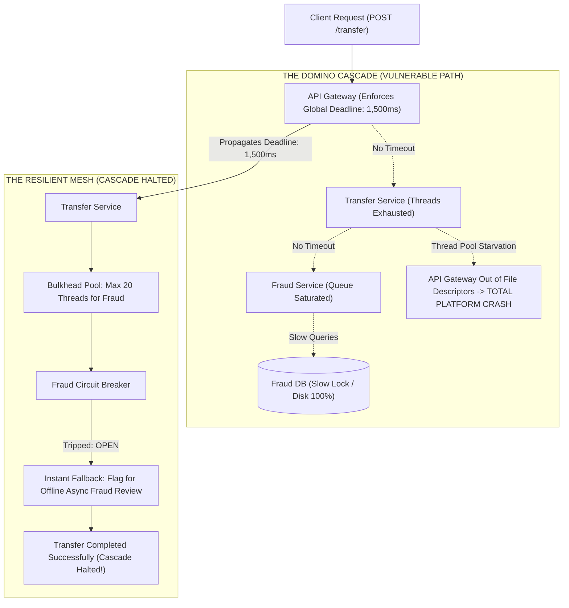

## Fast Revision (10-Second Recall)
Cascading failures occur when a failure in a downstream dependency ripples upstream, exhausting resources and taking down the entire service mesh like falling dominoes. Halt cascading failures by applying strict end-to-end deadlines/timeouts, Bulkhead resource isolation, Circuit Breakers that fail fast, and adaptive queue-based load shedding at the API Gateway.

## The 30-Second Spoken Script
> "A cascading failure is the ultimate nightmare in microservice architectures: a localized performance hiccup in a minor database or peripheral service propagates upstream, consuming threads, memory, and database connections until the entire ecosystem collapses. It happens because of synchronous dependency chaining: Service A calls B, which calls C, which calls a struggling Database D. When D slows down from 10 ms to 10 seconds, C's thread pool fills up waiting for D, which in turn causes B's threads to fill waiting for C, which ultimately causes A's API Gateway to exhaust its sockets, crashing all user traffic globally. We stop this domino effect dead in its tracks using four architectural circuit-breakers: First, strict, non-negotiable timeouts on every single remote hop. Second, end-to-end context deadlines (like gRPC deadlines) that prevent downstream services from wasting CPU on requests that have already timed out at the gateway. Third, Bulkhead resource isolation to ensure one struggling dependency cannot monopolize worker threads. Finally, adaptive load shedding at the gateway, which drops excess traffic early before internal queues saturate."

## Scenario / Problem Context
An online banking application experienced a complete global outage lasting 3 hours. A background fraud database index rebuild caused queries on the `Fraud Detection Service` to slow down from 20 ms to 8,000 ms. Because the `Transfer Service` waited synchronously for fraud checks with an infinite timeout, its 200 HTTP worker threads became stuck. The `API Gateway` then backed up waiting for the Transfer Service, exhausting file descriptors and causing health check probes to fail across all Kubernetes nodes, taking down completely unrelated services like Login and Statement Downloads.

## Architectural Workflow / Sequence


## Deep-Dive Analysis & Root Causes

### 1. The Anatomy of a Resource Exhaustion Cascade
Why do services crash when downstream dependencies slow down?
- A fast service requires very few concurrent threads. If a service processes 1,000 req/sec and each request takes 10 ms:
  $$\text{Concurrent Threads Needed} = 1,000 \times 0.010 = 10\text{ threads}$$
- If latency jumps to 10 seconds due to a downstream bottleneck:
  $$\text{Concurrent Threads Needed} = 1,000 \times 10 = 10,000\text{ threads}$$
- No JVM, Go runtime, or Node.js process can spawn 10,000 active concurrent worker threads without crashing from memory exhaustion or context-switching thrashing.

### 2. End-to-End Context Deadlines (gRPC / HTTP)
Setting independent timeouts on each service leads to wasted compute:
- Gateway timeout = 2.0s.
- Service A calls Service B with 1.5s timeout.
- Service B calls Service C with 1.5s timeout.
- If Service B takes 1.8 seconds, the Gateway has **already dropped the client connection** and returned a 504 to the user.
- Yet Service B and Service C continue grinding away, burning expensive CPU and database IOPS on a request that has already been abandoned!
- **Solution: Distributed Deadlines**: The Gateway passes an absolute timestamp deadline (`grpc-timeout: 1500m`). If Service C sees that the deadline has already passed, it aborts execution immediately without executing SQL queries.

### 3. Adaptive Load Shedding (Little's Law)
When incoming traffic exceeds maximum system capacity, queuing requests makes the situation worse because queued requests will time out before they are ever processed.
- **CoDel (Controlled Delay) / Little's Law**: Measure the time a request spends sitting in the internal worker queue before processing starts.
- If queue wait time exceeds 100 ms, drop the request immediately with `503 Service Unavailable` without executing any application code.
- This protects current in-flight transactions and ensures the service continues operating at maximum throughput rather than collapsing to zero.

## Practical Debugging Commands & Code

#### Distributed Deadline Propagation Middleware (TypeScript & Express)
```typescript
import { Request, Response, NextFunction } from 'express';

export function deadlineMiddleware(defaultTimeoutMs = 2000) {
  return (req: Request, res: Response, next: NextFunction) => {
    const rawDeadline = req.headers['x-request-deadline'] as string;
    let deadlineTimestamp: number;

    if (rawDeadline) {
      deadlineTimestamp = parseInt(rawDeadline, 10);
    } else {
      // Ingress Gateway sets initial deadline
      deadlineTimestamp = Date.now() + defaultTimeoutMs;
    }

    const remainingMs = deadlineTimestamp - Date.now();

    // 1. If deadline already expired, drop request immediately!
    if (remainingMs <= 0) {
      console.warn(`[Deadline Expired] Dropping request ${req.originalUrl} before execution.`);
      return res.status(504).json({ error: 'Request deadline exceeded upstream' });
    }

    (req as any).deadlineTimestamp = deadlineTimestamp;
    (req as any).remainingMs = remainingMs;

    // Attach AbortController tied to deadline
    const abortController = new AbortController();
    const timeoutId = setTimeout(() => abortController.abort(), remainingMs);

    (req as any).abortSignal = abortController.signal;

    res.on('finish', () => clearTimeout(timeoutId));
    next();
  };
}

// Outbound fetch helper that propagates the deadline header downstream
export async function fetchWithPropagatedDeadline(url: string, req: Request, options: RequestInit = {}) {
  const deadline = (req as any).deadlineTimestamp;
  const remaining = deadline ? deadline - Date.now() : 2000;

  if (remaining <= 0) {
    throw new Error('Deadline exceeded before outbound call');
  }

  const controller = new AbortController();
  const timer = setTimeout(() => controller.abort(), remaining);

  const headers = new Headers(options.headers || {});
  if (deadline) {
    headers.set('X-Request-Deadline', deadline.toString());
  }

  try {
    const resp = await fetch(url, { ...options, headers, signal: controller.signal });
    return resp;
  } finally {
    clearTimeout(timer);
  }
}
```

#### Monitoring Downstream Latency Spikes with Envoy Logs
```bash
# Filter Envoy proxy access logs for slow upstream responses (> 1000ms) triggering timeouts
awk '$10 > 1000 {print $1, $4, $7, $9, $10, $14}' /var/log/envoy/access.log | head -n 15

# Inspect active Linux socket states to identify connection accumulation (CLOSE_WAIT / TIME_WAIT)
netstat -ant | awk '{print $6}' | sort | uniq -c | sort -nr
```

## Prevention & Senior Best Practices

### 1. Architectural Guardrails
- **Zero Infinite Timeouts**: Configure automated linting rules or network policies that reject any HTTP/gRPC client configuration lacking explicit socket, connect, and read timeouts.
- **Fail-Fast Reverse Proxies**: Configure Nginx/Envoy with `proxy_connect_timeout 500ms;` and `proxy_read_timeout 2s;` so stalled backends are cut off before upstream worker pools saturate.

### 2. Operational Hardening
- **Load Shedding at Ingress**: Implement concurrency limits in API Gateways using Envoy's Adaptive Concurrency Limit filter, which dynamically measures p50 latency and drops incoming requests if latency starts climbing.
- **Chaos Game Days on Downstream Latency**: Introduce synthetic 5-second delays in downstream databases in staging to verify that upstream services fail fast without cascading.

