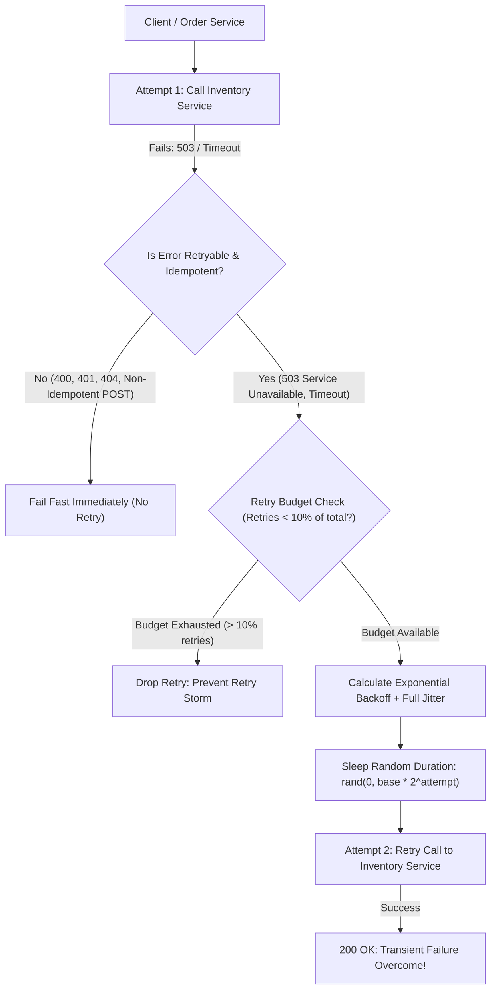

## Fast Revision (10-Second Recall)
Never retry immediately in a tight loop. Always implement Exponential Backoff ($t = \text{base} \times 2^{\text{attempt}}$) combined with Full Jitter to prevent synchronized retry storms. Strictly limit maximum retry attempts (2-3 max), only retry transient idempotent operations (HTTP 503, 429, timeouts; never 4xx client errors), and enforce a global Retry Budget (e.g. max 10% retries).

## The 30-Second Spoken Script
> "When a transient network glitch or momentary downstream overload causes an RPC call to fail, retrying the request can dramatically improve overall availability. However, implementing naive retries—such as retrying immediately 3 times—is one of the most common causes of catastrophic system crashes, turning a minor 5% slowdown into a 100% self-inflicted DDoS attack known as a Retry Storm. The senior engineering approach requires four strict rules: First, only retry transient errors like network timeouts or HTTP 503/429; never retry 4xx client errors like 400 Bad Request or 401 Unauthorized. Second, use Exponential Backoff so wait times double with each attempt. Third, inject Full Jitter—a randomized sleep window—so thousands of retrying callers don't hit the struggling server in synchronized harmonic waves. Fourth, enforce a strict Retry Budget at the client or gateway: if more than 10% of total traffic is retries, drop subsequent retries immediately to allow the downstream system to recover."

## Scenario / Problem Context
An order service called an inventory reservation service. When the inventory service experienced a momentary 2-second database checkpoint pause, 2,000 incoming requests failed. Because the order service was configured to immediately retry all failed calls 3 times with no delay, those 2,000 requests multiplied into 8,000 instantaneous requests, overwhelming the inventory service, locking its thread pool, and transforming a 2-second transient pause into a 35-minute complete system outage.

## Architectural Workflow / Sequence


## Deep-Dive Analysis & Root Causes

### 1. The Anatomy of a Retry Storm
Why naive retries kill systems:
- If a service normally operates at 80% capacity and experiences a 10% traffic spike, it begins dropping packets.
- If clients immediately retry 3 times without backoff:
  $$\text{Total Load} = \text{Base Load} \times (1 + 3) = 4\times\text{ Traffic}$$
- Traffic instantly surges to **320% capacity**, guaranteeing that the service can never recover on its own.

### 2. Exponential Backoff Formula
Wait time increases exponentially with each retry attempt:
$$\text{Backoff}(a) = \min(\text{Cap}, \text{Base} \times 2^a)$$
Where $\text{Base} = 100\text{ ms}$, $\text{Cap} = 5,000\text{ ms}$, and $a$ is the attempt index ($0, 1, 2\dots$):
- Attempt 0: 100 ms
- Attempt 1: 200 ms
- Attempt 2: 400 ms
- Attempt 3: 800 ms

### 3. Why Jitter Is Crucial (AWS Full Jitter)
Even with exponential backoff, if 1,000 clients fail at the exact same moment $T=0$:
- All 1,000 clients will sleep 100 ms and fire again at $T=100\text{ ms}$.
- All 1,000 clients will sleep 200 ms and fire again at $T=300\text{ ms}$.
- This creates **synchronized harmonic waves** that hammer the downstream service repeatedly.
- **AWS Full Jitter Formula**:
  $$\text{Sleep} = \text{UniformRandom}(0, \text{Backoff}(a))$$
  Instead of all clients sleeping exactly 400 ms, their sleep times are smoothly randomized between 0 ms and 400 ms, completely flattening the traffic spike.

### 4. Idempotency is a Strict Prerequisite
Never retry an operation unless it is guaranteed to be idempotent:
- `GET`, `PUT`, `DELETE`: Inherently idempotent by HTTP specification.
- `POST /payments`: **NOT** idempotent by default. If a timeout occurs, the payment may have succeeded on the server while the response packet was lost. Retrying without an `Idempotency-Key` header will charge the customer twice!

## Practical Debugging Commands & Code

#### Production Resilient Retry Client with Full Jitter and Budget (TypeScript)
```typescript
interface RetryOptions {
  maxRetries: number;
  baseDelayMs: number;
  maxDelayMs: number;
}

class RetryBudget {
  private totalRequests = 0;
  private retryRequests = 0;

  recordRequest(isRetry: boolean) {
    this.totalRequests++;
    if (isRetry) this.retryRequests++;

    // Reset counters every 10,000 requests to maintain rolling window
    if (this.totalRequests > 10000) {
      this.totalRequests = Math.floor(this.totalRequests / 2);
      this.retryRequests = Math.floor(this.retryRequests / 2);
    }
  }

  canRetry(): boolean {
    if (this.totalRequests < 100) return true; // Grace period during startup
    // Reject retries if retries exceed 10% of total outgoing requests
    return this.retryRequests / this.totalRequests < 0.10;
  }
}

const globalRetryBudget = new RetryBudget();

export async function fetchWithRetry<T>(
  url: string,
  options: RequestInit,
  config: RetryOptions = { maxRetries: 3, baseDelayMs: 100, maxDelayMs: 3000 }
): Promise<T> {
  let attempt = 0;

  while (true) {
    const isRetry = attempt > 0;
    globalRetryBudget.recordRequest(isRetry);

    try {
      const response = await fetch(url, options);

      // Return immediately on success or client errors (4xx should NEVER be retried)
      if (response.ok || (response.status >= 400 && response.status < 500 && response.status !== 429)) {
        return (await response.json()) as T;
      }

      // If we got a 5xx or 429, check if we can retry
      if (attempt >= config.maxRetries || !globalRetryBudget.canRetry()) {
        throw new Error(`Request failed with status ${response.status} (Retries exhausted or budget exceeded)`);
      }
    } catch (err: any) {
      if (attempt >= config.maxRetries || !globalRetryBudget.canRetry()) {
        throw err;
      }
    }

    // Calculate Full Jitter Backoff: UniformRandom(0, min(Cap, Base * 2^attempt))
    const exponentialBackoff = Math.min(config.maxDelayMs, config.baseDelayMs * Math.pow(2, attempt));
    const jitteredDelay = Math.floor(Math.random() * exponentialBackoff);

    console.warn(`[Retry Attempt ${attempt + 1}] Retrying ${url} in ${jitteredDelay}ms`);
    await new Promise((resolve) => setTimeout(resolve, jitteredDelay));

    attempt++;
  }
}
```

#### Envoy Route Retry Policy Configuration (Service Mesh)
```yaml
apiVersion: networking.istio.io/v1alpha3
kind: VirtualService
metadata:
  name: inventory-retry-policy
  namespace: prod
spec:
  hosts:
    - inventory-service
  http:
    - route:
        - destination:
            host: inventory-service
      retries:
        attempts: 2
        perTryTimeout: 500ms
        retryOn: "5xx,connect-failure,refused-stream,gateway-error"
        retryBackOff:
          baseInterval: 100ms
          maxInterval: 1000ms
```

## Prevention & Senior Best Practices

### 1. Architectural Guardrails
- **Enforce Global Idempotency Keys**: Require clients to pass `Idempotency-Key: <UUID>` on all mutative POST endpoints. The server caches the result of the UUID in Redis for 24 hours, guaranteeing that retries return the original cached response.
- **Never Retry Non-Idempotent Endpoints**: Configure API client SDKs so that `POST` requests without idempotency keys throw compile-time or runtime errors if wrapped in a retry handler.

### 2. Operational Hardening
- **Alert on High Retry Ratios**: Instrument Prometheus metric `client_retries_total / client_requests_total`. If the ratio exceeds 5%, fire a warning alert; if it exceeds 10%, trigger incident investigation.
- **Set Up Dead-Letter Queues (DLQ) for Asynchronous Retries**: For message queue consumers, never retry failing messages infinitely. After 3-5 failed attempts, route the poison message to a Dead-Letter Queue (DLQ) to prevent blocking the consumer queue.

