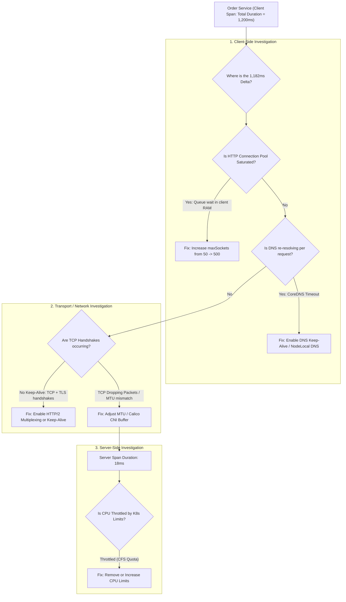

## Fast Revision (10-Second Recall)
When inter-service latency spikes, systematically isolate the delay using OpenTelemetry waterfall traces: determine whether time is spent in network transit (DNS, TCP handshakes, TLS, MTU issues), queue wait times (exhausted connection pools / thread contention), application serialization (JSON vs Protobuf), or downstream database/cache stalls.

## The 30-Second Spoken Script
> "When diagnosing high latency between microservices, jumping to conclusions like 'the network is slow' wastes hours. We apply a systematic, evidence-driven triage methodology using distributed tracing. First, we examine the OpenTelemetry waterfall trace for the slow request to identify the exact span where latency balloons. Second, we compare the client-side span duration against the server-side span duration: if the client reports a 500 ms wait, but the server's internal span reports execution took only 15 ms, the 485 ms delta is strictly network or queuing delay. Third, we inspect connection management: are HTTP keep-alive sockets reused, or is every call paying a 3-way TCP handshake plus TLS negotiation penalty? Are HTTP client connection pools exhausted, forcing requests to queue locally in memory before hitting the wire? Finally, we inspect transport infrastructure: checking Kubernetes CoreDNS resolution latencies, Linux socket backlog queues, and CPU throttling from strict container limits."

## Scenario / Problem Context
An order management service calls an internal pricing engine over HTTP/REST. While the pricing engine reports an average p99 execution duration of 18 ms in its internal metrics, the order service records an average p99 latency of 1,200 ms when calling the pricing service. The discrepancy is causing timeouts and degrading checkout throughput. The engineering team must isolate and eliminate the 1.1-second latency mystery.

## Architectural Workflow / Sequence


## Deep-Dive Analysis & Root Causes

### 1. The Client-Span vs Server-Span Differential
The single most powerful formula in distributed tracing:
$$\text{Transport \\& Queuing Overhead} = \text{Client Span Duration} - \text{Server Span Duration}$$
- **If Client Span $\approx$ Server Span**: The server's code, database queries, or external calls are genuinely slow. Profile the server application.
- **If Client Span $\gg$ Server Span**: The server is fast, but the request was stalled in the client's internal connection pool, DNS lookup, TCP handshake, network CNI, or reverse proxy queue.

### 2. The HTTP Connection Pool Starvation Trap
By default, many HTTP client libraries (e.g. Node.js `http.Agent`, Go `http.Transport`, Apache HttpClient) have tiny default connection limits:
- Node.js default: `maxSockets = Infinity` in modern Node, but libraries like Axios often configure `maxSockets = 10` or reuse misconfigured agents.
- If 100 concurrent requests attempt to call the pricing service with a 10-socket pool:
  - 10 requests fire immediately.
  - 90 requests wait in a JavaScript memory queue.
  - Latency balloons to seconds even though the server is processing in 15 ms!

### 3. CPU Throttling by the Linux Completely Fair Scheduler (CFS)
In Kubernetes, setting `resources.limits.cpu: "500m"` enforces Linux CFS quota:
- If a container uses its allocated 500 ms of CPU in the first 20 ms of a 100 ms period, the Linux kernel **freezes the container processes** for the remaining 80 ms!
- The container appears to have low average CPU usage (e.g. 30%), but requests experience periodic 80 ms latency spikes.
- Check metric: `container_cpu_cfs_throttled_periods_total`.

### 4. Serialization and Payload Overhead
- Serializing large JSON payloads (5 MB responses) in single-threaded runtimes (Node.js) blocks the event loop for 100-200 ms.
- Transitioning high-throughput inter-service traffic to **gRPC with Protocol Buffers** cuts serialization CPU time and payload sizes by 60-80%.

## Practical Debugging Commands & Code

#### Linux Network and Latency Diagnostics on Host/Pod
```bash
# 1. Measure raw network RTT latency between two pods (eliminates app layer)
kubectl exec -it order-service-pod -- ping -c 5 pricing-service.prod.svc.cluster.local

# 2. Check for TCP retransmissions (indicates packet loss / MTU issues)
netstat -s | grep -i retransmitted

# 3. Inspect socket backlog and queue sizes
ss -t -i 'sport = :8080'

# 4. Check if container is experiencing Linux CFS CPU throttling
kubectl exec -it pricing-service-pod -- cat /sys/fs/cgroup/cpu/cpu.stat
# nr_throttled: Number of periods the container was frozen by the kernel
```

#### Optimizing HTTP Client Keep-Alive and Connection Pool (Node.js)
```typescript
import http from 'http';
import https from 'https';

// Optimized persistent HTTP Agent to eliminate TCP handshakes and pool queuing
export const pricingServiceAgent = new http.Agent({
  keepAlive: true,              // Reuse TCP connections across requests
  keepAliveMsecs: 30000,        // Send TCP keep-alive packets every 30s
  maxSockets: 500,              // Allow up to 500 concurrent open sockets (prevents pool starvation)
  maxFreeSockets: 100,          // Keep up to 100 idle sockets open in pool
  timeout: 5000,                // Socket inactive timeout
});

export async function fetchPricing(productId: string) {
  const url = `http://pricing-service.prod.svc.cluster.local:8080/price/${productId}`;
  
  const response = await fetch(url, {
    agent: pricingServiceAgent,
    headers: { 'Connection': 'keep-alive' },
  } as any);

  return response.json();
}
```

## Prevention & Senior Best Practices

### 1. Architectural Guardrails
- **Adopt gRPC / HTTP/2 for High-Frequency RPCs**: HTTP/2 multiplexes multiple concurrent requests over a single TCP connection, eliminating head-of-line blocking and connection pool limits.
- **NodeLocal DNSCache in Kubernetes**: Deploy `NodeLocal DNSCache` as a DaemonSet to cache DNS queries locally on each node, slashing CoreDNS latency and UDP packet drops.

### 2. Operational Hardening
- **Alert on CFS CPU Throttling**: Set up Prometheus alerts when `rate(container_cpu_cfs_throttled_periods_total[5m]) > 0.20`. Either increase CPU limits or remove CPU limits entirely (using CPU requests only).
- **Track p99 vs p50 Discrepancy**: Alert when the ratio between p99 and p50 inter-service latency exceeds $5\times$, which indicates queue backing, garbage collection pauses, or connection pool stalls.

