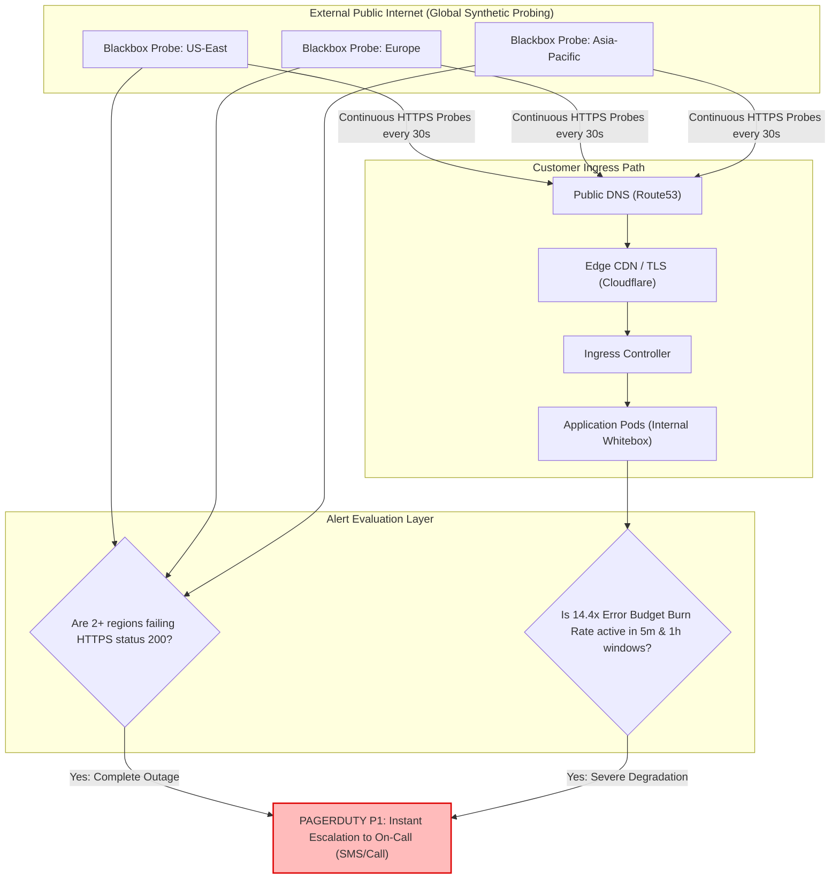

## Fast Revision (10-Second Recall)
- **The Core Goal:** Detect genuine customer-impacting application outages in under 60 seconds without triggering false-positive alerts on transient 5-second blips.
- **Why Naive Thresholds Fail:** A simple rule like *"Alert if error rate > 1% for 5 minutes"* either pages engineers for harmless 10-second spikes or fails to detect slow catastrophic outages that consume your entire 30-day error budget.
- **The Modern Standard:** Google SRE **Multi-Window Multi-Burn-Rate Alerts**. Measures how fast the error budget is being consumed across short (1 hour) and long (6 hour) windows.
- **External vs Internal Probing:** Internal Prometheus probes miss edge CDN, DNS, and TLS certificate failures. Combine internal whitebox metrics with external **Blackbox synthetic probes** (from AWS, Datadog, or Better Uptime).
- **Escalation Rules:** P1 (PagerDuty / Opsgenie: wake on-call engineer at 3 AM), P2 (Slack notification for next business hour triage).

## The 30-Second Spoken Script
> "Configuring alerts for application downtime requires moving beyond simple uptime checks to Google SRE **Multi-Window Multi-Burn-Rate alerting** coupled with **External Blackbox Probing**.
>
> If an application experiences downtime, we must detect it within 1 to 2 minutes. However, alerting on simple error spikes causes alert fatigue. We solve this using Burn Rate alerts against our Service Level Objective (SLO). For example, with a 99.9% uptime target, our monthly error budget is 0.1%. A **14.4x burn rate** means we will consume 100% of our monthly error budget in 2 days. When both a short window (5 minutes) and a long window (1 hour) confirm this burn rate, PagerDuty pages the on-call engineer immediately.
>
> Simultaneously, we protect against internal monitoring blind spots using **External Blackbox Exporters**. These probes make continuous HTTP requests from outside our cloud network (e.g., from multiple global geographic regions). If external probes cannot resolve our DNS, complete TLS handshakes, or receive HTTP 200 within 5 seconds across 2 consecutive regions, an outage alert fires immediately regardless of internal pod status."

## Scenario / Problem Context
A SaaS enterprise experienced a complete global outage on a Sunday morning. The company's TLS certificate on the Cloudflare edge proxy expired, causing browsers and mobile apps to display `NET::ERR_CERT_DATE_INVALID` warnings and blocking 100% of traffic.

The internal engineering team's Prometheus and Alertmanager systems were deployed inside the private Kubernetes VPC behind the load balancer. The pods were healthy, database connections were fine, and internal error rates were 0%. As a result, zero alerts fired.

The engineering team only realized the site was down 3 hours later when the CEO received a phone call from an enterprise client.

The post-mortem revealed two systemic flaws:
1. All monitoring was internal (whitebox); there was zero synthetic blackbox monitoring testing the application from the outside public internet.
2. The team had no automated multi-burn-rate alerts tracking customer-facing availability budgets.

The organization needs a resilient downtime alerting architecture that catches DNS, TLS, edge, and service failures instantly.

## Architectural Workflow / Sequence


## Deep-Dive Analysis & Root Causes

### 1. Whitebox vs Blackbox Monitoring
- **Whitebox Monitoring:** Metrics generated from inside the application (CPU, heap, DB pool, Prometheus metrics). Essential for diagnosing *why* something is broken.
- **Blackbox Monitoring:** Testing the application from the perspective of an external user (DNS resolution, TLS handshake, HTTP status, response payload). Essential for knowing *that* something is broken.

### 2. The Math of Multi-Window Multi-Burn-Rate Alerting
For an availability SLO of **99.9%** over 30 days:
- Total error budget = $0.1\% = 0.001$.
- **Burn Rate 1x:** Consumes 100% of error budget in 30 days.
- **Burn Rate 14.4x:** Consumes 100% of error budget in 2 days (2% of budget in 1 hour).
- **Burn Rate 144x:** Consumes 100% of error budget in 5 hours (2% of budget in 6 minutes). This is a catastrophic outage.
- To prevent false alarms, SRE best practice requires a **two-window condition**: both a short window (e.g. 5 minutes) and a long window (e.g. 1 hour) must exceed the burn-rate threshold before paging.

### 3. Avoiding False Alerts from Single Probe Failures
An alert should never page an engineer based on a single external probe failing from one location, as local ISP routing or transit provider issues can cause localized timeouts. Require quorum: at least 2 distinct geographic regions must confirm the failure.

## Practical Debugging Commands & Code

### Step 1: Configuring Prometheus Blackbox Exporter for External Downtime Probing
Deploy the Prometheus Blackbox Exporter to probe public endpoints over HTTPS:

```yaml
# blackbox.yaml
modules:
  https_2xx:
    prober: http
    timeout: 5s
    http:
      valid_http_versions: ["HTTP/1.1", "HTTP/2"]
      valid_status_codes: [200]
      method: GET
      fail_if_ssl: false
      fail_if_not_ssl: true
      tls_config:
        insecure_skip_verify: false # Catches expired TLS certs!
```

Prometheus scrape configuration:
```yaml
# prometheus.yaml
scrape_configs:
  - job_name: 'blackbox-external-availability'
    metrics_path: /probe
    params:
      module: [https_2xx]
    static_configs:
      - targets:
        - https://api.production.company.com/healthz
        - https://app.production.company.com
    relabel_configs:
      - source_labels: [__address__]
        target_label: __param_target
      - source_labels: [__param_target]
        target_label: instance
      - target_label: __address__
        replacement: blackbox-exporter:9115
```

### Step 2: Multi-Window Multi-Burn-Rate Prometheus Alert Rule (Google SRE Standard)
```yaml
# prometheus-rules/slo-downtime-alerts.yaml
groups:
  - name: availability_slo_alerts
    rules:
      # P1 Page: 14.4x Burn Rate (Consuming 2% of 30-day budget in 1 hour)
      - alert: CriticalErrorBudgetBurnRate14x
        expr: |
          (
            sum(rate(http_requests_total{status_code=~"5.."}[1h])) 
            / 
            sum(rate(http_requests_total[1h])) 
            > (14.4 * (1 - 0.999))
          )
          and
          (
            sum(rate(http_requests_total{status_code=~"5.."}[5m])) 
            / 
            sum(rate(http_requests_total[5m])) 
            > (14.4 * (1 - 0.999))
          )
        for: 2m
        labels:
          severity: page
          priority: P1
        annotations:
          summary: "Catastrophic Downtime: High Error Budget Burn Rate (14.4x)"
          description: "Over 1.44% of requests have failed over the last 1h and 5m. Monthly error budget will deplete in 48 hours."

      # P1 Page: External Blackbox Probe Outage (Probe fails from multiple regions)
      - alert: ExternalApplicationDown
        expr: probe_success{job="blackbox-external-availability"} == 0
        for: 60s
        labels:
          severity: page
          priority: P1
        annotations:
          summary: "External Blackbox Probe Failed: Site Unreachable"
          description: "External probe to {{ $labels.instance }} returned non-200 or timed out for >60s."
```

### Step 3: Fast Production Probing CLI Diagnostic
```bash
# Debug public endpoint reachability and certificate expiration in seconds
curl -Iv https://api.production.company.com/healthz 2>&1 | grep -E "Connected to|expire date|HTTP/"
```

## Prevention & Senior Best Practices
1. **Combine Whitebox and Blackbox Monitoring:** Never rely solely on internal pod metrics. Maintain external synthetic probes across multiple geographical regions to catch DNS, CDN, and TLS certificate failures.
2. **Implement Multi-Window Burn-Rate Alerts:** Adopt Google SRE multi-burn-rate alerting to eliminate false-alarm pages while ensuring genuine catastrophic downtime pages on-call engineers within 2 minutes.
3. **Monitor TLS Certificate Expiration:** Alert at 30 days, 14 days, and 7 days before SSL/TLS certificates expire using `probe_ssl_earliest_cert_expiry`.
4. **Require Quorum on External Probes:** Trigger downtime alerts only when probes fail from at least two independent geographical regions simultaneously to avoid ISP false positives.
5. **Maintain Out-of-Band Status Pages:** Host your customer status page (Statuspage.io, Instatus) entirely separate from your primary cloud infrastructure so you can communicate with users during full cloud provider outages.

