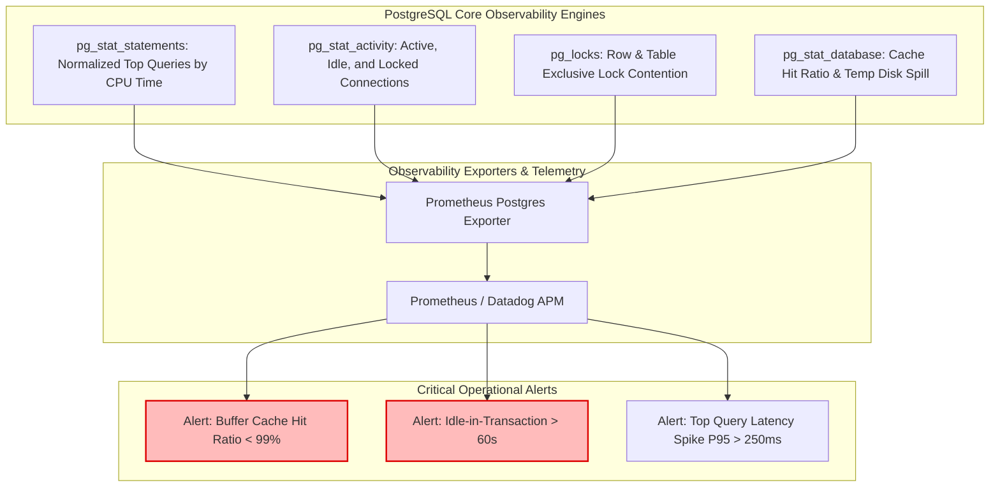

## Fast Revision (10-Second Recall)
- **Top 5 Database Metrics:**
  1. *Query Execution Latency:* P95 / P99 query duration via `pg_stat_statements`.
  2. *Connection Pool Saturation:* Active vs idle vs waiting client connections.
  3. *Buffer Cache Hit Ratio:* Percentage of reads served from RAM vs Disk (Target: over 99%).
  4. *Lock Waits & Deadlocks:* Transactions blocked waiting on row/table locks.
  5. *Storage & Disk IOPS Saturation:* Disk queue depth and read/write IOPS capacity limits.
- **`pg_stat_statements` is Mandatory:** The primary tool in PostgreSQL to identify normalized queries consuming the highest aggregate CPU time (`total_exec_time`).
- **Disk Spill (Temporary Files):** Watch `temp_bytes`—queries sorting or hashing in temporary disk files instead of RAM (`work_mem`).
- **Transaction Wraparound:** Monitor oldest transaction age (`autovacuum_freeze_max_age`) to prevent catastrophic database shutdown.

## The 30-Second Spoken Script
> "Monitoring database performance requires looking at query efficiency, locking behavior, and hardware storage constraints simultaneously.
>
> In relational engines like PostgreSQL or MySQL, we monitor three distinct tiers:
> First, **Query Execution Profiling**: We enable `pg_stat_statements` to track normalized queries. We alert on queries with high P99 latency and identify the top 5 queries consuming the largest percentage of cumulative database execution time. We also monitor `temp_bytes` to spot queries spilling into disk because `work_mem` is undersized.
> Second, **Concurrency and Contention**: We monitor connection states (`active`, `idle in transaction`, and `waiting`) and track lock wait queues. A single transaction held 'idle in transaction' can block autovacuum and lock out hundreds of concurrent writes.
> Third, **Storage and Disk IOPS**: We track the Buffer Cache Hit Ratio—ensuring greater than 99% of page reads come directly from RAM. When this ratio dips, disk read IOPS spike, causing query latencies to degrade by orders of magnitude as the database waits on physical disk access."

## Scenario / Problem Context
An e-commerce order management system deployed a new reporting feature on a Monday morning. By 2:00 PM, all customer checkout requests started timing out with HTTP 504 Gateway Timeouts.

The operations team checked the database CPU utilization on AWS RDS: CPU was sitting at 100%. 

The DBA was unable to determine which query was the culprit because `pg_stat_statements` was disabled. When they ran `SELECT * FROM pg_stat_activity`, over 400 connections were stuck in `active` state, all trying to execute simple `INSERT INTO orders` queries that normally take 2 milliseconds.

It took 3 hours of downtime to discover that the reporting feature had run an unindexed `UPDATE` on a shared table that locked the entire table. Because row-level locks escalated to an exclusive lock, hundreds of incoming customer checkout queries queued up behind it, exhausting the connection pool and saturating all available CPU and IOPS.

The team requires a comprehensive database observability architecture to catch query stalls and locking contention immediately.

## Architectural Workflow / Sequence


## Deep-Dive Analysis & Root Causes

### 1. The Power of `pg_stat_statements`
Standard application logs only record the queries that completed. `pg_stat_statements` normalizes queries (replacing literals with `$1`, `$2`), recording:
- `calls`: Total executions.
- `total_exec_time`: Cumulative time spent in the engine.
- `mean_exec_time` & `stddev_exec_time`: Average and variance.
- `rows`: Total rows processed vs returned.
A query that takes 5ms but runs 10,000 times per second consumes 50 seconds of CPU time every wall-clock second—far more destructive than a 500ms query executed once an hour.

### 2. Lock Contention and "Idle in Transaction"
When an application executes:
```sql
BEGIN;
SELECT * FROM users WHERE id = 1 FOR UPDATE;
-- Developer forgot to commit or app is making an external HTTP call!
```
The connection state becomes `idle in transaction`. The row lock is held indefinitely. Any other query attempting to modify that row will hang in a lock wait queue. If 50 queries queue up behind it, your connection pool is exhausted in seconds.

### 3. Buffer Cache Hit Ratio
PostgreSQL caches data pages in RAM (`shared_buffers` + OS page cache).
- **Formula:** `Hit Ratio = heap_blks_hit / (heap_blks_hit + heap_blks_read)`
- If ratio is 99.5%: Almost all reads come from fast memory (nanoseconds).
- If ratio drops to 85%: The database must read data blocks from SSD/EBS storage (milliseconds), causing disk IOPS throttling and massive query latency spikes.

## Practical Debugging Commands & Code

### Step 1: Enabling and Querying `pg_stat_statements`
Enable in `postgresql.conf`:
```ini
shared_preload_libraries = 'pg_stat_statements'
pg_stat_statements.track = all
pg_stat_statements.max = 10000
```

Query the top 5 queries consuming the most cumulative CPU time:
```sql
SELECT 
    round((total_exec_time / 1000 / 60)::numeric, 2) AS total_minutes,
    calls,
    round(mean_exec_time::numeric, 2) AS avg_ms,
    round((100 * total_exec_time / sum(total_exec_time) OVER ())::numeric, 2) AS percentage_of_total_cpu,
    substring(query, 1, 100) AS clean_query
FROM pg_stat_statements
ORDER BY total_exec_time DESC
LIMIT 5;
```

### Step 2: Detecting Blocked Queries and Lock Contention in Real Time
```sql
-- Find blocked queries and the exact transaction holding the lock
SELECT 
    blocked_locks.pid     AS blocked_pid,
    blocked_activity.usename  AS blocked_user,
    blocking_locks.pid    AS blocking_pid,
    blocking_activity.usename AS blocking_user,
    blocked_activity.query    AS blocked_statement,
    blocking_activity.query   AS blocking_statement
FROM  pg_catalog.pg_locks         blocked_locks
JOIN pg_catalog.pg_stat_activity blocked_activity ON blocked_activity.pid = blocked_locks.pid
JOIN pg_catalog.pg_locks         blocking_locks 
    ON blocking_locks.locktype = blocked_locks.locktype
    AND blocking_locks.database IS NOT DISTINCT FROM blocked_locks.database
    AND blocking_locks.relation IS NOT DISTINCT FROM blocked_locks.relation
    AND blocking_locks.page IS NOT DISTINCT FROM blocked_locks.page
    AND blocking_locks.tuple IS NOT DISTINCT FROM blocked_locks.tuple
    AND blocking_locks.virtualxid IS NOT DISTINCT FROM blocked_locks.virtualxid
    AND blocking_locks.transactionid IS NOT DISTINCT FROM blocked_locks.transactionid
    AND blocking_locks.classid IS NOT DISTINCT FROM blocked_locks.classid
    AND blocking_locks.objid IS NOT DISTINCT FROM blocked_locks.objid
    AND blocking_locks.objsubid IS NOT DISTINCT FROM blocked_locks.objsubid
    AND blocking_locks.pid != blocked_locks.pid
JOIN pg_catalog.pg_stat_activity blocking_activity ON blocking_activity.pid = blocking_locks.pid
WHERE NOT blocked_locks.granted;
```

### Step 3: Checking Buffer Cache Hit Ratio
```sql
SELECT 
    sum(heap_blks_hit) / (sum(heap_blks_hit) + sum(heap_blks_read)) * 100 AS cache_hit_ratio
FROM pg_statio_user_tables;
-- Target: Greater than 99.0%
```

### Step 4: Terminating Stale `idle in transaction` Connections
```sql
-- View all connections stuck in idle in transaction for longer than 60 seconds
SELECT pid, usename, client_addr, state, now() - state_change as duration, query
FROM pg_stat_activity
WHERE state = 'idle in transaction' AND (now() - state_change) > interval '60 seconds';

-- Terminate rogue blocking connection immediately
SELECT pg_terminate_backend(12345);
```

## Prevention & Senior Best Practices
1. **Set `idle_in_transaction_session_timeout`:** Configure PostgreSQL with `idle_in_transaction_session_timeout = '30s'` to automatically terminate transactions left open by application crashes or network drops.
2. **Mandate Statement Timeouts:** Set `statement_timeout = '15s'` at the database level so runaway or unindexed analytical queries are killed before they exhaust system resources.
3. **Monitor Cache Hit Ratio Daily:** Alert when the Buffer Cache Hit Ratio drops below 98.5%, indicating that table or index sizes have outgrown assigned RAM (`shared_buffers`).
4. **Log Long Queries Automatically:** Set `log_min_duration_statement = 250` so any query taking longer than 250ms is logged with its parameters and execution duration.
5. **Never Perform External I/O Inside DB Transactions:** Ban HTTP requests, email sending, or file writing while holding a database transaction lock to eliminate lock wait queuing.

