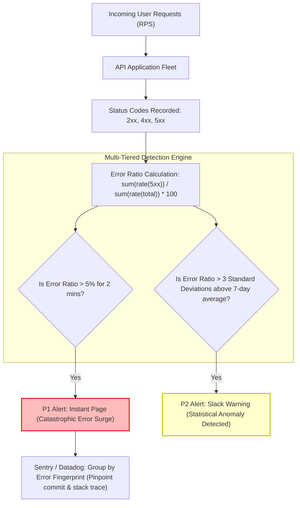

## Fast Revision (10-Second Recall)
- **Error Percentage vs Absolute Count:** Never alert purely on absolute error counts. 100 errors out of 100,000 requests (0.1%) is normal; 100 errors out of 120 requests (83%) is a catastrophic outage.
- **The Zero-Traffic Blind Spot:** If an edge proxy is dropping traffic, absolute 500 errors drop to zero! Always monitor the **error ratio** and total throughput concurrently.
- **Dynamic Anomaly Baselines:** Compare error rates against the standard deviation of trailing historical traffic (`avg_over_time[1w] + 3 * stddev_over_time[1w]`) to avoid false positives during daily traffic crests.
- **Fast Diagnostic Triaging:** Top 500 error causes in production: (1) Uncaught exceptions, (2) Database connection timeouts, (3) Downstream 3rd-party API 502/504 propagation, (4) Out-of-memory crashes.
- **Error Tracking APM (Sentry / Bugsnag):** Group unique stack traces by fingerprint to immediately isolate which specific line of code or release commit caused the surge.

## The 30-Second Spoken Script
> "Detecting an abnormal increase in HTTP 500 errors requires balancing immediate responsiveness to sudden deployment crashes with resilience against normal background noise.
>
> In production environments, we monitor error rates using three complementary strategies:
> First, **Percentage Error Ratios**: We evaluate the ratio of HTTP 5xx responses to total incoming requests: `sum(rate(5xx)) / sum(rate(total))`. Alerting on absolute error counts is flawed because 50 errors during a 10,000 RPS peak is normal, while 50 errors at 2:00 AM on 55 total requests represents a severe outage.
> Second, **Time-Shifted Anomaly Baselines**: For non-critical background services, we use PromQL standard deviation queries to detect when error rates exceed 3 standard deviations above the 7-day historical mean for that specific hour of the week.
> Third, **Automated Fingerprint Grouping**: When an error surge is detected, our APM (Sentry/Datadog) aggregates stack traces into unique issue fingerprints. During a surge, our alert immediately links to the top failing fingerprint, showing the exact commit, author, and stack trace that introduced the error."

## Scenario / Problem Context
A fintech banking application deployed version 3.8.0 at 11:00 AM. 

The DevOps team had configured an old Nagios alert:
`Alert if total HTTP 500 errors > 200 in 5 minutes`

During the lunch rush, traffic surged from 1,000 RPS to 25,000 RPS. A minor bug in a deprecated profile avatar endpoint was throwing 220 errors over 5 minutes (a negligible 0.002% error rate). The Nagios alert fired, paging the on-call engineer during lunch.

Annoyed by the false alarm, the team raised the threshold to 2,000 errors. 

Three weeks later, on a quiet Sunday morning at 3:00 AM (traffic: 50 RPS), a database migration failure caused the login service to fail completely (100% of logins returning HTTP 500). Over 5 minutes, 1,200 errors occurred. Because 1,200 was below the static 2,000 threshold, no alert fired. Customers were unable to log in for 6 hours until Monday morning business hours.

The team needs an intelligent error detection architecture based on error ratios and dynamic anomaly baselines.

## Architectural Workflow / Sequence


## Deep-Dive Analysis & Root Causes

### 1. Static Thresholds vs Error Ratios
- **Static Count (`count > 100`):** Extremely fragile. Fails to scale with traffic spikes (flash sales) and completely misses catastrophic 100% failure rates during off-peak hours.
- **Percentage Ratio (`5xx / total > 1%`):** Robust across traffic swings. It automatically scales whether the system is handling 10 RPS or 50,000 RPS.
- **Low-Traffic Floor:** During near-zero traffic hours (e.g. 1 request per minute), a single 500 error causes a 100% error rate! Always include a minimum request volume floor (e.g., `and total_rate > 5`).

### 2. Difference Between HTTP 4xx and 5xx
- **4xx Errors (Client Errors):** 401 Unauthorized, 404 Not Found, 422 Bad Input. Normal in healthy systems as users typo passwords or bots scan endpoints.
- **5xx Errors (Server Errors):** 500 Internal Error, 502 Bad Gateway, 503 Unavailable, 504 Gateway Timeout. Direct indicators of server crashes, unhandled exceptions, database deadlocks, or infrastructure failure.

### 3. Immediate Triage Playbook for 500 Surges
1. **Did a deployment just happen?** Check Kubernetes deployment timeline. If error surge correlates with release timestamp, execute `kubectl rollout undo` immediately.
2. **Is it concentrated on one route or fleet-wide?** Group errors by `route`. If only `/checkout` is failing, isolate the payment gateway.
3. **Is it database connection exhaustion?** Correlate with database connection pool metrics.

## Practical Debugging Commands & Code

### Step 1: Prometheus Metrics Middleware Tracking HTTP Status Codes
```typescript
// src/middleware/statusMetrics.ts
import { Request, Response, NextFunction } from 'express';
import client from 'prom-client';

export const httpRequestsByStatus = new client.Counter({
  name: 'http_requests_total',
  help: 'Total HTTP requests partitioned by status code',
  labelNames: ['method', 'route', 'status_code', 'status_family'],
});

export function errorTrackingMiddleware(req: Request, res: Response, next: NextFunction) {
  res.on('finish', () => {
    const route = req.route ? req.route.path : 'unmatched_route';
    const statusCode = res.statusCode;
    const statusFamily = `${Math.floor(statusCode / 100)}xx`;

    httpRequestsByStatus.inc({
      method: req.method,
      route,
      status_code: statusCode.toString(),
      status_family: statusFamily,
    });
  });

  next();
}
```

### Step 2: Essential PromQL Queries for HTTP 500 Surges

#### 1. Instant 5xx Error Percentage Rate Across Fleet:
```promql
(
  sum(rate(http_requests_total{status_family="5xx"}[2m])) 
  / 
  sum(rate(http_requests_total[2m]))
) * 100
```

#### 2. Prometheus Alert Rule: Critical Error Rate Exceeds 2% with Minimum Traffic Floor:
```yaml
# prometheus-rules/http-500-alerts.yaml
groups:
  - name: http_error_alerts
    rules:
      - alert: HighHttp5xxErrorRatio
        expr: |
          (
            sum(rate(http_requests_total{status_family="5xx"}[3m])) 
            / 
            sum(rate(http_requests_total[3m]))
          ) > 0.02
          and
          sum(rate(http_requests_total[3m])) > 10 # Traffic floor: ignore low-traffic blips
        for: 2m
        labels:
          severity: critical
          priority: P1
        annotations:
          summary: "Abnormal HTTP 500 Surge: Over 2% of requests failing"
          description: "Current 5xx error rate is {{ $value | humanizePercentage }} over the last 3 minutes across production fleet."
```

#### 3. Statistical Anomaly Detection (Z-Score > 3 over 7-Day Baseline):
```promql
(
  rate(http_requests_total{status_family="5xx"}[15m]) 
  - 
  avg_over_time(rate(http_requests_total{status_family="5xx"}[15m])[1w:1h])
)
/
stddev_over_time(rate(http_requests_total{status_family="5xx"}[15m])[1w:1h]) > 3
```

### Step 3: Fast Production CLI Diagnostics for 500 Errors
```bash
# Filter Kubernetes container logs for HTTP 500 and unhandled stack traces
kubectl logs -l app=api-service -n production --tail=1000 | grep -E '"status":5[0-9]{2}|TypeError|UnhandledPromiseRejection' | jq .

# Group recent 500 errors by route using GoAccess or awk on Nginx ingress logs
kubectl logs -l app.kubernetes.io/name=ingress-nginx -n ingress-nginx --tail=5000 | \
  awk '($9 ~ /5[0-9]{2}/) {print $7, $9}' | sort | uniq -c | sort -nr | head -n 10
```

## Prevention & Senior Best Practices
1. **Never Alert on Raw Error Counts:** Always alert on the ratio of 5xx errors to total requests, enforcing a minimum traffic volume floor to prevent low-traffic false positives.
2. **Integrate APM Error Fingerprinting:** Route error alerts directly to Sentry, Datadog, or Rollbar so engineers see grouped stack traces rather than raw log dumps.
3. **Automate Rollback on Error Surges:** Configure Argo Rollouts or deployment CD pipelines to automatically abort and roll back canaries if 5xx error rates exceed 0.5% during deployment.
4. **Distinguish Infrastructure 502/504 from Application 500:** Separate upstream proxy errors (502 Bad Gateway, 504 Gateway Timeout) from internal uncaught application exceptions (500 Internal Server Error) to accelerate diagnosis.
5. **Always Catch Unhandled Promise Rejections:** Register process-level listeners (`process.on('unhandledRejection')`) to log full stack traces and correlation IDs before terminating or reporting.

