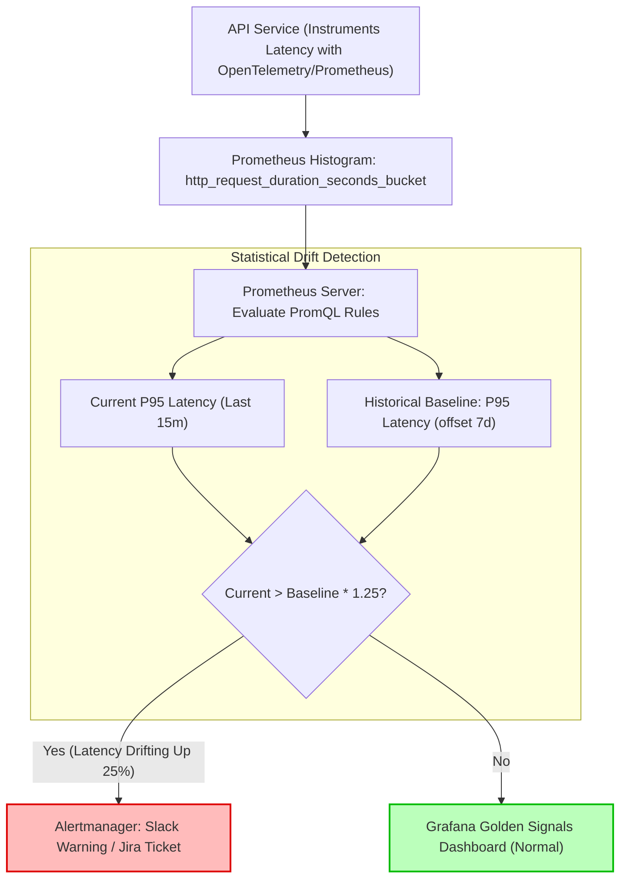

## Fast Revision (10-Second Recall)
- **The Boiling Frog Trap:** APIs rarely break instantaneously; they degrade gradually over weeks as database tables grow and N+1 query counts compound.
- **Why Averages Lie:** Average latency masks tail-end slowdowns. If 95% of requests take 20ms and 5% take 5,000ms, the average is 269ms—hiding that 1 in 20 users experiences an outage.
- **Track Latency Distributions:** Focus strictly on P50 (median user), P95 (slow threshold), and P99 (tail worst-case experience).
- **Rate-of-Change / Day-over-Day Comparison:** Alert on statistical drift (e.g., current P95 latency is 30% higher than the 7-day trailing average at the same hour).
- **Core Signal Sources:** Ingress load balancer access logs (Envoy/ALB), application APM traces (OpenTelemetry), and Prometheus histograms (`histogram_quantile`).

## The 30-Second Spoken Script
> "To identify whether an API is becoming progressively slower before customers report it, we never rely on average response times. Averages conceal tail latency and are easily skewed by cached responses.
>
> Instead, we implement three progressive monitoring layers:
> First, **Percentile Histogram Tracking**: We export request duration metrics into Prometheus using histograms with fine-grained buckets around our SLA boundaries, computing `histogram_quantile(0.95, ...)` and `histogram_quantile(0.99, ...)` in real time.
> Second, **Time-Shifted Baseline Comparisons**: We use PromQL queries that compare today's P95 latency against the same hour last week (`offset 1w`). If latency has grown by more than 20% week-over-week under comparable traffic volume, an automated ticket is filed.
> Third, **Correlated Resource Telemetry**: When latency drifts upward, our APM dashboards correlate the shift against database query execution times, garbage collection pauses, and connection pool wait queues to isolate whether the root cause is code regression or data volume growth."

## Scenario / Problem Context
An e-commerce order search endpoint—`GET /api/v1/orders/search`—had an SLA of P95 under 150ms. Over three months, as the database grew from 500,000 to 8,000,000 records, the API's P95 latency crept from 120ms to 420ms, and finally to 1,800ms.

Because the engineering team only monitored uptime (`curl /healthz` returning 200) and CPU utilization (which remained at a modest 35%), no alerts ever fired. Customers began complaining that searches were freezing. 

The post-mortem revealed that an index on `created_at` was missing, forcing a sequential table scan whose execution time scaled linearly with table growth. The team requires automated observability to detect slow, creeping latency regressions weeks before they breach customer SLAs.

## Architectural Workflow / Sequence


## Deep-Dive Analysis & Root Causes

### 1. Why Creeping Latency Happens
- **Unbounded Database Growth:** Queries that run in 5ms on a 10,000-row staging table degrade to 3 seconds when production hits millions of rows without appropriate composite indexes.
- **N+1 Query Compounding:** An ORM query fetches a user, then fetches their orders in a loop. As users accumulate more orders, query counts explode.
- **Memory Pressure & GC Pauses:** Gradual memory bloat causes the Node.js V8 or JVM garbage collector to run more frequently, introducing periodic 200ms "stop-the-world" pauses.
- **Downstream Dependency Degradation:** Third-party payment or KYC microservices slowly increasing their response times.

### 2. The Fallacy of Averages vs Percentiles
- **P50 (Median):** Represents what the typical user experiences.
- **P90 / P95:** Catches standard edge cases (e.g., users with larger account histories).
- **P99:** Catches tail degradation (e.g., cold cache hits, full table scans, or lock contention). An e-commerce user who experiences a 3-second delay on checkout is likely to abandon their cart.

## Practical Debugging Commands & Code

### Step 1: Instrumenting Request Latency with Prometheus in Express / Node.js
```typescript
// src/middleware/metrics.ts
import { Request, Response, NextFunction } from 'express';
import client from 'prom-client';

// Define fine-grained duration histogram buckets around SLA boundaries
const httpRequestDurationSeconds = new client.Histogram({
  name: 'http_request_duration_seconds',
  help: 'Duration of HTTP requests in seconds',
  labelNames: ['method', 'route', 'status_code'],
  buckets: [0.025, 0.05, 0.1, 0.15, 0.25, 0.5, 1, 2.5, 5, 10],
});

export function prometheusMetricsMiddleware(req: Request, res: Response, next: NextFunction) {
  const start = process.hrtime();

  res.on('finish', () => {
    const diff = process.hrtime(start);
    const durationSeconds = diff[0] + diff[1] / 1e9;
    
    // Normalize route to avoid high-cardinality explosion (e.g. /orders/123 -> /orders/:id)
    const route = req.route ? req.route.path : req.path;

    httpRequestDurationSeconds
      .labels(req.method, route, res.statusCode.toString())
      .observe(durationSeconds);
  });

  next();
}
```

### Step 2: PromQL Queries for Trend and Drift Analysis

Calculate real-time P95 latency for a specific route:
```promql
histogram_quantile(0.95, sum(rate(http_request_duration_seconds_bucket{route="/api/v1/orders/search"}[5m])) by (le))
```

Detect when current P95 latency is 25% higher than the same time last week:
```promql
(
  histogram_quantile(0.95, sum(rate(http_request_duration_seconds_bucket{route="/api/v1/orders/search"}[15m])) by (le))
  -
  histogram_quantile(0.95, sum(rate(http_request_duration_seconds_bucket{route="/api/v1/orders/search"}[15m] offset 7d)) by (le))
)
/
histogram_quantile(0.95, sum(rate(http_request_duration_seconds_bucket{route="/api/v1/orders/search"}[15m] offset 7d)) by (le))
> 0.25
```

### Step 3: Prometheus Alert Rule for Creeping Latency
```yaml
# prometheus-rules/latency-alerts.yaml
groups:
  - name: api_latency_degradation
    rules:
      - alert: ApiLatencyCreepingSlower
        expr: |
          histogram_quantile(0.95, sum(rate(http_request_duration_seconds_bucket{route!~"/healthz.*"}[15m])) by (le, route))
          > 0.300
        for: 30m
        labels:
          severity: warning
        annotations:
          summary: "API route {{ $labels.route }} P95 latency exceeds 300ms SLA"
          description: "Route {{ $labels.route }} has had a P95 latency of {{ $value }}s for more than 30 minutes."
```

## Prevention & Senior Best Practices
1. **Never Monitor Averages:** Eliminate average latency graphs from executive and operational dashboards; replace them with P50, P95, and P99 percentile bands.
2. **Normalize Metric Route Labels:** Never use raw URLs (`/orders/usr_99214`) as Prometheus metric labels. Always use parameterized route patterns (`/orders/:id`) to prevent high-cardinality metric server memory exhaustion.
3. **Automate Week-over-Week Regression Alerts:** Set up automated non-paging warnings in Slack or Jira when an endpoint's P95 latency grows by 20% compared to the trailing 7-day baseline.
4. **Enforce Database Query Logging Limits:** Configure PostgreSQL `log_min_duration_statement = 250` (or `pg_stat_statements`) to log any query taking over 250ms directly to your log aggregator.
5. **Establish Performance Budgets in CI:** Run synthetic load benchmarks on every pull request that touches database entities to ensure new code does not introduce N+1 query regressions.

