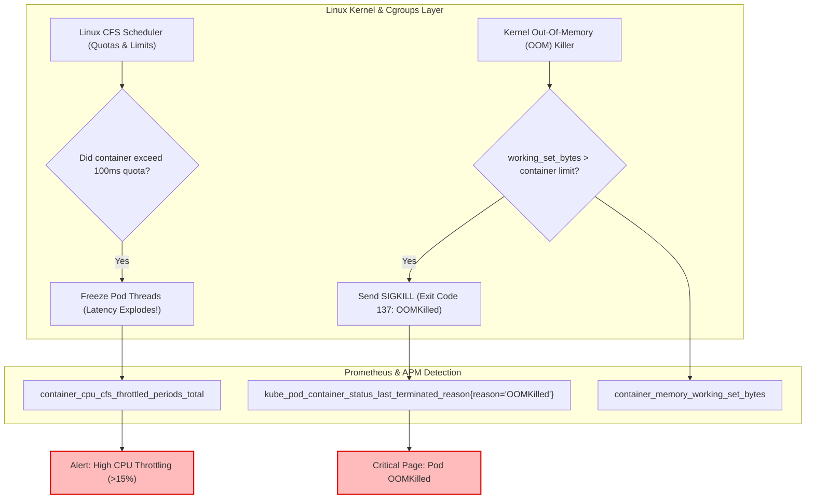

## Fast Revision (10-Second Recall)
- **Container vs Host Metrics:** Running `top` or `free -m` inside a Docker container displays host node metrics, NOT container limits! Always monitor `cgroup` metrics (`container_cpu_usage_seconds_total`, `container_memory_working_set_bytes`).
- **CPU Throttling:** When a container exceeds its CPU `limits`, the Linux Completely Fair Scheduler (CFS) throttles execution by freezing thread scheduling for milliseconds, causing massive latency spikes even while CPU utilization looks "low."
- **Memory: RSS vs Working Set:** The Linux kernel kills containers via OOM Killer (`exit code 137`) based on `container_memory_working_set_bytes` reaching the cgroup limit, not raw allocated heap.
- **Node.js Heap Monitoring:** Monitor `process.memoryUsage().heapUsed` vs `heapTotal`. A steadily increasing baseline slope after garbage collection cycles indicates an application memory leak.
- **Alert on CFS Throttling Ratio:** Alert when throttled CPU periods exceed 15% of total runtime periods.

## The 30-Second Spoken Script
> "Monitoring CPU and memory in modern cloud-native environments requires understanding how Linux container cgroups enforce resource boundaries.
>
> For **CPU monitoring**, the most dangerous hidden trap is **CFS CPU Throttling**. When a Kubernetes pod exceeds its CPU limit, the Linux kernel does not crash the pod—it aggressively throttles the process, freezing thread execution for hundreds of milliseconds. Monitoring average CPU utilization alone will look completely safe, but application latency spikes dramatically. We track `container_cpu_cfs_throttled_periods_total` divided by `container_cpu_cfs_periods_total` to detect when containers are being throttled.
>
> For **Memory monitoring**, we distinguish between runtime heap usage and OS working set memory. Kubernetes triggers an **OOMKill (Exit 137)** when `container_memory_working_set_bytes` hits the container memory limit. We monitor memory usage trends alongside garbage collection frequencies. If the heap baseline climbs steadily upward across hours without dropping after major GC cycles, we trigger automated heap snapshots to isolate memory leaks before the container is terminated."

## Scenario / Problem Context
A high-throughput API gateway deployed in Kubernetes was configured with:
```yaml
resources:
  requests:
    cpu: "500m"
    memory: "512Mi"
  limits:
    cpu: "1000m"
    memory: "1Gi"
```

During a marketing event, users complained that P99 API latency jumped from 45ms to 2,400ms. The operations team checked Grafana: CPU utilization was reported at only 65%. 

Suddenly, several pods restarted with `OOMKilled (Exit Code 137)`.

The investigation revealed two critical monitoring blind spots:
1. The CPU limit of `1000m` (1 core) caused the Linux kernel to throttle the container's multi-threaded Node.js libuv worker pool for 40% of all time slices, creating artificial 2-second processing delays.
2. The team was monitoring Node.js V8 `heapUsed` (which stayed at 300MB), unaware that native C++ image processing buffers allocated unmanaged memory outside the V8 heap, pushing `cgroup working_set_bytes` beyond 1GiB and triggering an instant kernel OOM kill.

The team needs actionable monitoring rules to detect CPU throttling and container memory exhaustion.

## Architectural Workflow / Sequence


## Deep-Dive Analysis & Root Causes

### 1. CPU Quotas vs CPU Shares
- **CPU Requests:** Mapped to Linux `cpu.shares`. Guarantees baseline CPU scheduling weight relative to other containers on the same node.
- **CPU Limits:** Mapped to Linux `cpu.cfs_quota_us` over a `cpu.cfs_period_us` window (usually 100ms). If a limit is `1000m`, the container gets 100ms of CPU time per 100ms period. If a multi-threaded app uses 4 threads for 25ms, its quota is exhausted! For the remaining 75ms of the period, the entire process is frozen.
- **Senior Recommendation:** Many production teams omit CPU `limits` entirely (or set them very high) to avoid CFS throttling latency spikes, relying on CPU `requests` with HPA for auto-scaling.

### 2. Understanding Memory Metrics
- **RSS (Resident Set Size):** RAM currently allocated to the process.
- **Cache / Buffer Memory:** File system page caches cached in RAM. The OS can reclaim this under memory pressure.
- **Working Set Memory (`container_memory_working_set_bytes`):** RSS + un-reclaimable page cache memory. **This is the exact number Kubernetes uses to decide whether to OOMKill a container.**

### 3. V8 / JVM Heap vs Native Buffer Leaks
- V8 Heap: JavaScript objects, closures, strings, numbers.
- External / Native Buffers: Node.js `Buffer.alloc()`, SSL buffers, native C++ extensions, and WebAssembly instances. A memory leak in native buffers will never show up in `v8.getHeapStatistics()`, yet will trigger an OOMKill.

## Practical Debugging Commands & Code

### Step 1: Exporting Detailed Node.js Runtime Memory & GC Metrics
```typescript
// src/monitoring/v8Metrics.ts
import v8 from 'node:v8';
import client from 'prom-client';

const heapUsedGauge = new client.Gauge({
  name: 'nodejs_v8_heap_used_bytes',
  help: 'V8 heap memory currently used in bytes',
});

const heapTotalGauge = new client.Gauge({
  name: 'nodejs_v8_heap_total_bytes',
  help: 'Total V8 heap memory allocated in bytes',
});

const externalMemoryGauge = new client.Gauge({
  name: 'nodejs_external_memory_bytes',
  help: 'Node.js memory bound to C++ objects (Buffers, etc.)',
});

export function startMemoryMonitoring(intervalMs = 10000) {
  setInterval(() => {
    const mem = process.memoryUsage();
    heapUsedGauge.set(mem.heapUsed);
    heapTotalGauge.set(mem.heapTotal);
    externalMemoryGauge.set(mem.external);
  }, intervalMs);
}
```

### Step 2: Critical PromQL Queries for Containers

#### CPU CFS Throttling Percentage (Alert if over 15%):
```promql
sum(rate(container_cpu_cfs_throttled_periods_total{namespace="production", pod=~"api-.*"}[5m]))
/
sum(rate(container_cpu_cfs_periods_total{namespace="production", pod=~"api-.*"}[5m])) * 100
```

#### Memory Utilization Percentage vs Container Limit:
```promql
sum(container_memory_working_set_bytes{namespace="production", container="app"}) by (pod)
/
sum(container_spec_memory_limit_bytes{namespace="production", container="app"}) by (pod) * 100
```

#### Detecting Pods Terminated by OOMKiller:
```promql
kube_pod_container_status_last_terminated_reason{reason="OOMKilled", namespace="production"} > 0
```

### Step 3: Kubernetes CLI Forensics for Pod OOMKills
```bash
# Check if pod was OOMKilled and inspect exit code
kubectl get pod api-service-75bb9c-x4z -n production -o jsonpath='{.status.containerStatuses[*].lastState.terminated}'
# Output shows: {"exitCode":137,"reason":"OOMKilled","finishedAt":"..."}

# Inspect node-level kernel dmesg for OOM invocations
kubectl node-shell node-worker-01 -- dmesg -T | grep -i -E "oom-killer|killed process"
```

## Prevention & Senior Best Practices
1. **Monitor Working Set, Not RSS:** Always configure memory alerts against `container_memory_working_set_bytes` to anticipate OOMKills before the kernel terminates containers.
2. **Alert on CPU Throttling Over Usage:** A container at 50% CPU utilization that is 30% throttled is in critical distress. Alert on `container_cpu_cfs_throttled_periods_total`.
3. **Set Memory Limits Carefully:** Always set memory `requests` equal to memory `limits` (Guaranteed QoS class) for stateful or critical database services to prevent the node from evicting them during node memory pressure.
4. **Automate Heap Dumps on Memory High-Water Marks:** Configure your runtime to take a V8 heap snapshot or JVM heap dump automatically when memory reaches 85% of limit, providing forensic proof of what objects are leaking.
5. **Consider Removing CPU Limits for Latency-Sensitive Apps:** Many tech organizations omit CPU limits in Kubernetes pods, relying on CPU requests and Horizontal Pod Autoscalers (HPA) to eliminate CFS throttling latency spikes.

