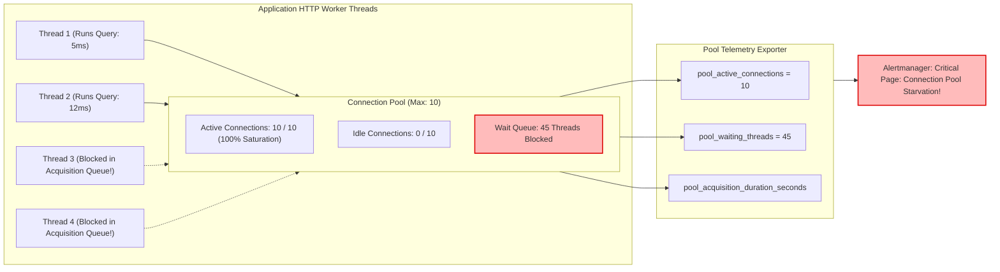

## Fast Revision (10-Second Recall)
- **The Golden Pool Rule:** A smaller, well-tuned database connection pool (e.g. 10 to 20 connections per pod) outperforms a large pool (100+ connections) because it prevents database CPU context switching and disk thrashing.
- **Top 4 Pool Metrics to Monitor:**
  1. *Active Connections:* Connections currently running queries.
  2. *Idle Connections:* Sockets open and waiting for work.
  3. *Waiting Threads / Acquisition Queue Depth:* Application threads blocked waiting for a free connection. (Most dangerous metric!).
  4. *Connection Acquisition Latency:* Time spent waiting to acquire a connection from the pool before running SQL.
- **Connection Leak Signature:** Active connection count climbs to `pool_max` and never drops, while idle connections hit 0, causing all subsequent queries to timeout with `TimeoutError: Connection acquisition timeout`.
- **PgBouncer Metrics:** Monitor `cl_active`, `cl_waiting`, `sv_active`, `sv_idle` in `SHOW POOLS`.

## The 30-Second Spoken Script
> "Monitoring database connection pools is critical because connection starvation is one of the most common causes of catastrophic API latency spikes. When the pool is exhausted, incoming HTTP requests don't fail immediately—they hang in an acquisition wait queue until they hit the pool timeout.
>
> We instrument connection pools using metrics from HikariCP, PgPool, or Node.js ORM pool managers across three key vectors:
> First, **Saturation and Utilization**: We track the ratio of `active_connections` to `total_pool_size`. If utilization consistently sits above 80%, the pool is undersized for current traffic or queries are running too slowly.
> Second, **Acquisition Queue Latency**: This is our primary leading indicator. We measure the time an application thread spends waiting to borrow a connection from the pool. In a healthy system, acquisition time is sub-millisecond (under 1ms). If acquisition time climbs to 500ms or 2 seconds, incoming queries are queueing behind long-running transactions.
> Third, **Connection Leak Detection**: We alert on connection holding times. If connections remain checked out of the pool for more than 10 seconds without returning, we trigger automated leak detection logs with thread stack traces to identify code that acquired a connection without releasing it in a `finally` block."

## Scenario / Problem Context
A fintech payments service deployed a new microservice handling user refunds. Within 30 minutes of deployment, the entire payments cluster began timing out. 

Customer requests failed with:
`QueryFailedError: Connection pool timeout after 10000ms: no available connection`

The DevOps team saw that database CPU utilization was only 12%. The database engine was completely idle! 

When they inspected the application metrics:
- `pool_size_max` was configured to 20 connections per pod across 10 pods.
- All 20 connections in each pod were marked as `active` (200 total active connections).
- 450 incoming HTTP threads were blocked in `waiting_threads` state.

A developer had added an external fraud-check HTTP call inside a database transaction:
```typescript
const runner = dataSource.createQueryRunner();
await runner.connect();
await runner.startTransaction();
await checkFraudApi(user); // Third-party HTTP call that hung for 30 seconds!
await runner.commitTransaction();
await runner.release();
```
The connections were held open while waiting for third-party HTTP responses, starving the entire application of database connections while the database server sat idle.

The team requires automated metrics and alerts to detect connection pool saturation and connection leaks instantly.

## Architectural Workflow / Sequence


## Deep-Dive Analysis & Root Causes

### 1. The Anatomy of Pool Saturation
A connection pool manages a finite number of physical database connections.
- **Healthy State:** Requests borrow a connection in under 1ms, execute SQL in 5-20ms, and return the connection immediately. Active connections fluctuate rapidly; wait queue is 0.
- **Starved State:** Queries take too long (due to missing indexes, table locks, or external HTTP calls inside transactions). All connections remain active. New requests enter the acquisition wait queue.
- **Timeout Collapse:** Once the wait queue exceeds `acquireTimeoutMillis` (e.g. 10s), incoming requests throw errors and fail.

### 2. Sizing the Pool: The HikariCP Formula
Many engineers incorrectly assume that more connections equal better performance:
`Connections = ((Core Count * 2) + Effective Spindle / Disk Count)`
For a 4-core database server with SSD storage:
$((4 \times 2) + 1) = 9 \text{ connections!}$
Exceeding 50 to 100 simultaneous connections on a single database master introduces extreme CPU context-switching overhead, making every query run slower. Use PgBouncer to multiplex client connections.

### 3. Connection Leaks
A leak occurs when an error is thrown and the code bypasses `connection.release()`.
- Modern pool managers (like HikariCP) include `leakDetectionThreshold`: if a connection is not returned within $N$ milliseconds, a stack trace is logged identifying the exact line of code that checked out the connection.

## Practical Debugging Commands & Code

### Step 1: Instrumenting Pool Metrics in Node.js (Generic-Pool / Knex / TypeORM)
```typescript
// src/monitoring/poolMetrics.ts
import client from 'prom-client';
import { Pool } from 'pg';

export function instrumentPgPool(pool: Pool, poolName = 'primary_db') {
  // 1. Total connections currently allocated
  new client.Gauge({
    name: 'db_pool_total_connections',
    help: 'Total physical connections in pool',
    labelNames: ['pool'],
    collect() {
      this.set({ pool: poolName }, pool.totalCount);
    },
  });

  // 2. Connections currently running a query
  new client.Gauge({
    name: 'db_pool_active_connections',
    help: 'Number of connections actively executing queries',
    labelNames: ['pool'],
    collect() {
      this.set({ pool: poolName }, pool.totalCount - pool.idleCount);
    },
  });

  // 3. Idle connections waiting in pool
  new client.Gauge({
    name: 'db_pool_idle_connections',
    help: 'Number of idle connections available in pool',
    labelNames: ['pool'],
    collect() {
      this.set({ pool: poolName }, pool.idleCount);
    },
  });

  // 4. Threads waiting in queue to acquire connection (Critical Saturation Metric!)
  new client.Gauge({
    name: 'db_pool_waiting_requests',
    help: 'Number of callers waiting in queue to acquire a connection',
    labelNames: ['pool'],
    collect() {
      this.set({ pool: poolName }, pool.waitingCount);
    },
  });
}
```

### Step 2: Essential PromQL Alerts for Connection Pools

#### Alert on Connection Pool Saturation (Over 85% for 3 minutes):
```promql
sum(db_pool_active_connections{pool="primary_db"}) 
/ 
sum(db_pool_total_connections{pool="primary_db"}) > 0.85
```

#### Alert on Acquisition Queue Depth (Callers Blocked in Queue):
```promql
sum(db_pool_waiting_requests{pool="primary_db"}) > 5
```

### Step 3: Inspecting PgBouncer Pool States in Production
Connect to PgBouncer admin console:
```bash
psql -p 6432 -U pgbouncer -d pgbouncer -c "SHOW POOLS;"
```

Output:
```text
 database |   user   | cl_active | cl_waiting | sv_active | sv_idle | sv_used | maxwait
----------+----------+-----------+------------+-----------+---------+---------+---------
 commerce | app_user |        18 |         42 |        10 |       0 |       0 |       8
```
- `cl_active`: Active client connections.
- `cl_waiting`: Client queries queued waiting for a server connection (If `cl_waiting > 0`, pool is saturated!).
- `maxwait`: Longest wait time in seconds for a client in the queue.

## Prevention & Senior Best Practices
1. **Never Hold Connections During External I/O:** Never call HTTP APIs, send emails, generate PDF reports, or read from object storage while holding a database connection.
2. **Configure Strict Acquisition Timeouts:** Set `connectionTimeoutMillis = 3000` (3 seconds). It is far better to fail fast and return HTTP 503 than to let hundreds of HTTP threads hang for 30 seconds.
3. **Enable Leak Detection in Development and Staging:** Configure HikariCP `leakDetectionThreshold = 5000` (or TypeORM connection tracking) to print full stack traces whenever a connection is held longer than 5 seconds.
4. **Deploy PgBouncer for Connection Multiplexing:** Decouple thousands of ephemeral pod connections from PostgreSQL by placing PgBouncer in transaction pooling mode.
5. **Always Release Connections in `finally` Blocks:** Guarantee that database connections and query runners are closed in `finally` blocks to prevent leaks on unhandled exceptions.

