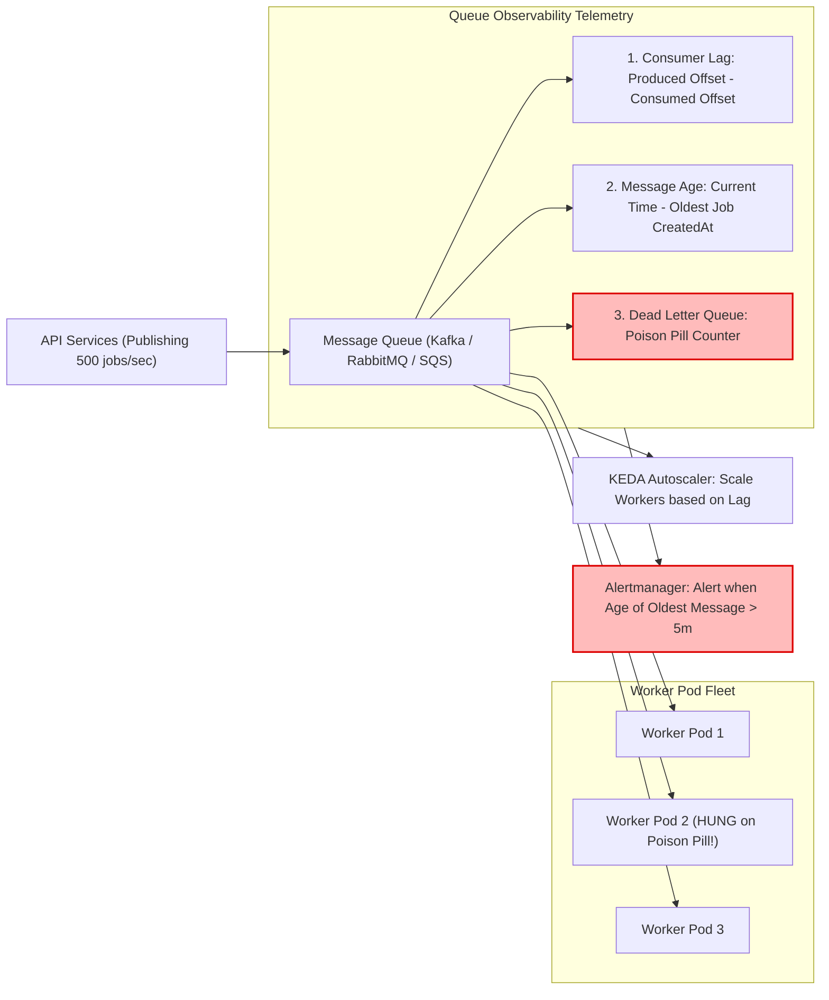

## Fast Revision (10-Second Recall)
- **Message Count vs Consumer Lag:** Queue size (total messages) can be misleading during high-throughput bursts. **Consumer Lag** (the offset delta between newest produced message and current consumer offset) is the true indicator of delay.
- **Queue Age (Time in Queue):** The most critical user-facing metric: the elapsed time between when the oldest unconsumed message was published and the current wall-clock time.
- **Top 4 Queue Metrics:**
  1. *Consumer Lag / Backlog Depth:* Number of pending unprocessed messages.
  2. *Message Age of Oldest Message:* Wall-clock delay in seconds.
  3. *Processing Duration per Message:* How long worker processes take to complete individual jobs.
  4. *Dead Letter Queue (DLQ) Arrival Rate:* Rate of permanently failed messages moved to quarantine.
- **Kubernetes Auto-scaling (KEDA):** Auto-scale worker pods based on queue length or consumer lag rather than CPU/memory utilization.

## The 30-Second Spoken Script
> "Monitoring queue processing delays requires focusing on **time delay** rather than raw message counts. A queue with 100,000 messages being processed at 20,000 messages per second is completely healthy, whereas a queue with only 50 messages where the oldest message has sat for 4 hours indicates that consumer workers are completely stalled.
>
> We monitor asynchronous queues across three core metrics:
> First, **Consumer Lag and Offset Tracking**: In systems like Kafka or SQS, we monitor consumer lag—the gap between the producer's latest offset and the consumer group's committed offset. A growing lag indicates that the production rate exceeds our consumption capacity.
> Second, **Age of Oldest Unprocessed Message**: We track the wall-clock age of the oldest message in the queue (e.g. `ApproximateAgeOfOldestMessage` in SQS or BullMQ job timestamps). If any message waits in queue for longer than our processing SLA (e.g. 60 seconds), an alert triggers.
> Third, **Dead Letter Queue (DLQ) Surges and Poison Pills**: We alarm immediately if any messages land in the Dead Letter Queue, which usually indicates bad payload schemas or poison-pill crashes that cause worker pods to crash in a loop.
>
> To maintain stability, we feed these queue metrics into **KEDA (Kubernetes Event-driven Autoscaling)** to scale worker pods dynamically as backlog swells."

## Scenario / Problem Context
A video processing platform allowed users to upload videos, which were transcoded asynchronously by background worker pods listening to a RabbitMQ queue. The platform promised customers: *"Your video will be ready within 10 minutes."*

On a Tuesday afternoon, users complained that uploaded videos had been stuck in "Processing..." for over 5 hours.

The DevOps team checked the worker fleet:
- Kubernetes worker pods were running normally with CPU usage at 15%.
- Pod crash counts were zero.
- However, the RabbitMQ queue had accumulated 14,000 unprocessed video jobs!

A third-party video codec library introduced in that morning's deployment had a bug: when processing HEVC-encoded videos, it hung indefinitely waiting on a native C++ thread lock without timing out. Because the 10 worker threads were all permanently hung, zero new jobs were picked up.

Because the team only monitored worker CPU and pod status (which appeared healthy), nobody noticed that consumer throughput had dropped to zero while queue processing delay exploded to 5 hours.

The team needs an automated queue observability system that tracks consumer lag, message age, and poison-pill stalls.

## Architectural Workflow / Sequence


## Deep-Dive Analysis & Root Causes

### 1. Consumer Lag vs Message Count
- **Message Count:** Number of messages currently in the broker. High message count during a batch import is normal.
- **Consumer Lag:** Measures whether consumers are keeping pace. If lag is flat or shrinking, consumers are healthy. If lag is growing monotonically over 15 minutes, processing capacity is insufficient.

### 2. The Poison Pill Trap
A poison pill is a malformed message that causes worker processes to crash or hang indefinitely whenever consumed:
1. Worker picks up Message A.
2. Worker crashes with unhandled exception or hangs.
3. Message broker requeues Message A at the head of the queue.
4. Next worker picks up Message A and crashes.
5. In minutes, the entire worker fleet is paralyzed, and all legitimate messages behind it are blocked.
- **Solution:** Configure `maxReceiveCount` (usually 3 retries) with automatic routing to a Dead Letter Queue (DLQ).

### 3. Starvation by Slow Jobs (Head-of-Line Blocking)
If a queue mixes 5-millisecond email jobs with 10-minute PDF generation jobs, a burst of PDF jobs will starve all email notifications.
- **Solution:** Segregate workloads into priority queues: `queue_notifications_fast` and `queue_reports_slow`.

## Practical Debugging Commands & Code

### Step 1: Instrumenting Queue Metrics in BullMQ / Redis / Node.js
```typescript
// src/monitoring/queueMetrics.ts
import { Queue } from 'bullmq';
import client from 'prom-client';

export function instrumentBullQueue(queue: Queue, queueName = 'video_transcoding') {
  // 1. Pending waiting jobs (Backlog)
  new client.Gauge({
    name: 'queue_waiting_jobs',
    help: 'Number of jobs waiting to be processed',
    labelNames: ['queue'],
    async collect() {
      const count = await queue.getWaitingCount();
      this.set({ queue: queueName }, count);
    },
  });

  // 2. Active jobs currently in execution
  new client.Gauge({
    name: 'queue_active_jobs',
    help: 'Number of jobs currently being processed by workers',
    labelNames: ['queue'],
    async collect() {
      const count = await queue.getActiveCount();
      this.set({ queue: queueName }, count);
    },
  });

  // 3. Failed jobs (Dead Letter Queue indicator)
  new client.Gauge({
    name: 'queue_failed_jobs',
    help: 'Number of failed jobs in dead letter state',
    labelNames: ['queue'],
    async collect() {
      const count = await queue.getFailedCount();
      this.set({ queue: queueName }, count);
    },
  });

  // 4. Age of oldest unprocessed job in seconds (Most Critical SLA Metric!)
  new client.Gauge({
    name: 'queue_oldest_job_age_seconds',
    help: 'Age of the oldest waiting job in seconds',
    labelNames: ['queue'],
    async collect() {
      const [oldestJob] = await queue.getJobs(['waiting'], 0, 0, true);
      if (oldestJob && oldestJob.timestamp) {
        const ageSeconds = Math.floor((Date.now() - oldestJob.timestamp) / 1000);
        this.set({ queue: queueName }, ageSeconds);
      } else {
        this.set({ queue: queueName }, 0);
      }
    },
  });
}
```

### Step 2: Essential PromQL Queries for Queue Delays

#### Alert when Oldest Message has Waited Over 300 Seconds (5 mins):
```promql
queue_oldest_job_age_seconds{queue="video_transcoding"} > 300
```

#### Alert on Growing Consumer Lag (Kafka Exporter):
```promql
sum(kafka_consumergroup_lag{consumergroup="transcoder-workers"}) by (topic) > 1000
```

#### Alert on Poison Pills Landing in Dead Letter Queue:
```promql
rate(queue_failed_jobs{queue="video_transcoding"}[5m]) > 0
```

### Step 3: Inspecting Kafka Consumer Lag via CLI
```bash
# Check lag across all partitions for consumer group
kafka-consumer-groups.sh --bootstrap-server kafka:9092 \
  --describe --group transcoder-workers

# Output shows:
# TOPIC           PARTITION  CURRENT-OFFSET  LOG-END-OFFSET  LAG
# video-uploads   0          45020           52100           7080  <-- Heavy Lag!
# video-uploads   1          44800           52150           7350
```

## Prevention & Senior Best Practices
1. **Alert on Message Age, Not Message Count:** Set primary operational alarms on `queue_oldest_job_age_seconds` to guarantee business SLA compliance regardless of traffic volume.
2. **Always Configure Dead Letter Queues (DLQ):** Set a maximum retry limit (e.g., 3-5 attempts). Move repeatedly failing messages to a quarantine DLQ to prevent poison pills from blocking the entire pipeline.
3. **Set Worker Job Processing Timeouts:** Ensure every background job has an explicit execution timeout (e.g. 5 minutes). If a worker hangs, the orchestrator terminates the job and re-queues it.
4. **Auto-scale with KEDA:** Use Kubernetes Event-driven Autoscaling (KEDA) to scale worker pods automatically based on queue consumer lag rather than CPU utilization.
5. **Segregate Workloads by Latency Class:** Never route 100ms transactional notifications and 10-minute heavy analytics jobs through the same queue. Maintain independent fast and slow queues.

