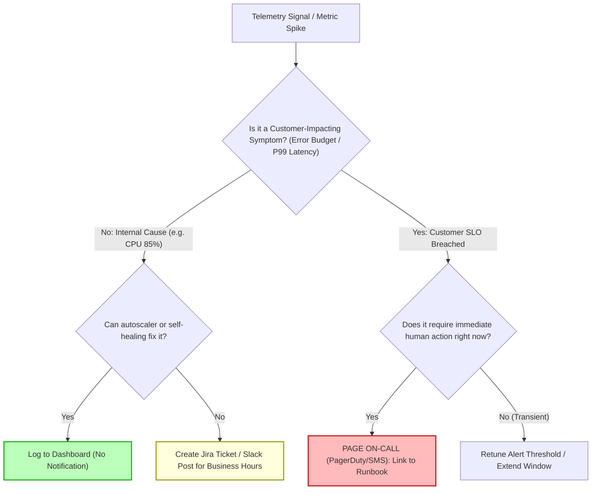

## Fast Revision (10-Second Recall)
- **The Core Problem:** When engineers receive dozens of non-actionable or transient alerts daily, they start ignoring pages, leading to catastrophic outages when real incidents occur.
- **The Golden Alert Rule:** **Every page must be actionable.** If an alert does not require an immediate, human-driven action in the middle of the night, it must NEVER wake someone up.
- **Symptom-Based vs Cause-Based Alerting:** Alert on symptoms that affect users (high latency, high error rate, data loss), not internal causes (CPU at 85%, disk at 75%).
- **The 3-Tier Alerting Hierarchy:**
  1. *P1 / Page (PagerDuty):* Immediate customer impact or imminent data loss. Requires waking up an engineer.
  2. *P2 / Ticket (Slack / Jira):* Degraded redundancy or capacity warning. To be resolved during normal working hours.
  3. *P3 / Dashboard Only:* Background telemetry for trend analysis and quarterly planning. Zero notifications.
- **Weekly Alert Hygiene Review:** Review all alerts triggered during the previous week. Any alert that resulted in "no action taken" must be deleted, retuned, or downgraded.

## The 30-Second Spoken Script
> "Alert fatigue is one of the most dangerous operational risks in engineering. When an on-call rotation receives 50 pages a week that turn out to be transient blips, engineers develop cognitive numbness. When a genuine catastrophic outage strikes, the page is silenced or ignored.
>
> To eliminate alert fatigue permanently, we apply four Google SRE principles:
> First, **Symptom-Based Alerting**: We never alert on internal causes like high CPU or temporary memory spikes. If CPU is at 90% but user latency is 35ms and error rates are zero, the system is simply utilizing its hardware efficiently. We alert exclusively on customer-facing symptoms—availability breaches and latency SLA violations.
> Second, **Strict Actionability**: Every alert must have a link to an explicit, up-to-date runbook detailing the exact diagnostic steps and remediation commands. If an alert's remediation is 'watch it and see if it goes away,' that alert is deleted immediately.
> Third, **Multi-Tier Routing**: Only P1 user-facing outages page mobile phones via PagerDuty. Non-urgent issues (like a disk reaching 80% with 2 weeks of runway) post to a team Slack channel or automatically generate a Jira ticket.
> Finally, **Weekly On-Call Handoff Audits**: During weekly handoff meetings, the team reviews every fired alert. Any alert that didn't require human action is retuned or deleted."

## Scenario / Problem Context
A SaaS company's engineering team managed 40 microservices. Over three years, developers had accumulated 280 Prometheus and CloudWatch alert rules:
- "Pod CPU > 80% for 2 minutes"
- "Node Memory > 75%"
- "Kafka Message Count > 500"
- "Redis Connection Count > 50"

The on-call engineer was paged an average of 42 times per week—often at 2:00 AM, 4:00 AM, and on weekends. Ninety-five percent of the pages were transient spikes that resolved themselves within 5 minutes without any engineer intervention. Engineers created a Slack filter to automatically mute the alerts channel and habitually swiped away PagerDuty notifications.

One Friday evening, the primary PostgreSQL database connection pool crashed, completely breaking the billing checkout API. The on-call engineer assumed the PagerDuty ping was another CPU false alarm and went back to sleep. The company lost $450,000 in unrecoverable sales before an executive noticed the outage the following morning.

The VP of Engineering declared an operational emergency: overhaul the alerting system to achieve zero false alarms and restore trust in the on-call rotation.

## Architectural Workflow / Sequence


## Deep-Dive Analysis & Root Causes

### 1. The Trap of Cause-Based Alerting
Engineers instinctively alert on what they understand:
- *Cause:* "Disk space is at 80%." (Bad alert: It might take 6 months to fill the remaining 20%).
- *Cause:* "CPU is at 90%." (Bad alert: Modern engines like Go, Node.js, and Java are designed to use available CPU).
- *Symptom:* "P95 API latency is over 500ms for 5 minutes." (Great alert: Real users are currently suffering).
- *Symptom:* "Disk will be completely full in 4 hours based on linear prediction." (Great alert: Gives actionable runway).

### 2. The Anatomy of an Actionable Alert
Every alert configuration must pass the **3-Question Actionability Test**:
1. *What specific user impact is occurring right now?*
2. *What specific action must the on-call engineer take immediately?*
3. *What happens if the engineer ignores this for 4 hours?*
If the answer to Question 3 is "nothing bad happens," it is NOT a paging alert.

### 3. Deduplication and Alert Grouping
When a core dependency (e.g., PostgreSQL or Redis) goes down:
- 50 microservices all experience connection errors simultaneously.
- If each service fires an alert, the on-call engineer receives 50 simultaneous pages!
- Use Alertmanager's `group_by: ['alertname', 'cluster', 'service']` and `inhibit_rules` so a parent "DatabaseDown" alert mutes all downstream "ServiceCannotConnectToDatabase" alerts.

## Practical Debugging Commands & Code

### Step 1: Alertmanager Configuration with Inhibition and Grouping
Configure Alertmanager to group related alerts and inhibit downstream noise:

```yaml
# alertmanager.yaml
global:
  resolve_timeout: 5m

route:
  group_by: ['alertname', 'cluster']
  group_wait: 30s       # Wait 30s to buffer and group multiple alerts into 1 notification
  group_interval: 5m    # Send update at most once every 5m
  repeat_interval: 4h   # Do not re-page for the same alert for 4 hours
  receiver: 'pagerduty-critical'
  routes:
    # Route non-urgent capacity warnings to Slack, NOT PagerDuty!
    - match:
        severity: warning
      receiver: 'slack-team-channel'
      continue: false

# Inhibit downstream alerts when root cause is already firing
inhibit_rules:
  - source_match:
      alertname: 'PostgresPrimaryDown'
    target_match_re:
      alertname: '.*DatabaseConnectionTimeout|.*Http5xxSurge'
    equal: ['cluster', 'environment']
```

### Step 2: Predictive Linear Disk Alerting Instead of Static Percentage
Instead of alerting when disk is at 80% (which might not fill for months), alert when linear regression predicts the disk will fill within 4 hours:

```yaml
# prometheus-rules/predictive-alerts.yaml
groups:
  - name: storage_alerts
    rules:
      - alert: DiskWillFillIn4Hours
        expr: |
          predict_linear(node_filesystem_free_bytes{mountpoint="/"}[1h], 4 * 3600) < 0
          and
          node_filesystem_free_bytes{mountpoint="/"} / node_filesystem_size_bytes{mountpoint="/"} < 0.20
        for: 15m
        labels:
          severity: critical
        annotations:
          summary: "Disk volume {{ $labels.mountpoint }} will fill in under 4 hours"
          description: "Based on current 1-hour write rate, disk space will be completely exhausted within 4 hours."
          runbook_url: "https://wiki.company.internal/runbooks/disk-cleanup"
```

### Step 3: Mandating Runbooks in Prometheus Rule Definitions
Ensure every alert rule includes an unambiguous `runbook_url`:

```yaml
# prometheus-rules/actionable-slo-alert.yaml
- alert: CheckoutErrorRateHigh
  expr: sum(rate(http_requests_total{route="/checkout",status_code=~"5.."}[5m])) / sum(rate(http_requests_total{route="/checkout"}[5m])) > 0.01
  for: 3m
  labels:
    severity: page
    priority: P1
  annotations:
    summary: "Checkout API error rate exceeds 1%"
    runbook_url: "https://runbooks.internal/checkout/500-errors"
    action: "1. Check database connection pool metrics. 2. Verify payment gateway status. 3. Roll back latest deployment if error correlates with release."
```

## Prevention & Senior Best Practices
1. **Delete Any Alert That Isn't Actionable:** If an alert fires and the on-call engineer says "there was nothing for me to do," immediately delete the alert or downgrade it to a dashboard.
2. **Mandate Runbook URLs on All Alerts:** Configure CI linters to reject any Prometheus alert YAML PR that lacks an explicit, functional `runbook_url` annotation.
3. **Weekly On-Call Handoff Audit:** Dedicate 30 minutes every Monday to review all fired alerts. If an alert fired more than twice without an incident being declared, it must be retuned.
4. **Use Inhibit Rules for Core Dependencies:** Inhibit microservice error alerts when the underlying database, network switch, or cloud provider is already known to be down.
5. **Separate Daytime Warnings from Midnight Pages:** Route warnings and non-urgent capacity alerts to team Slack channels during business hours; reserve midnight mobile phone pages strictly for active customer-facing outages.

