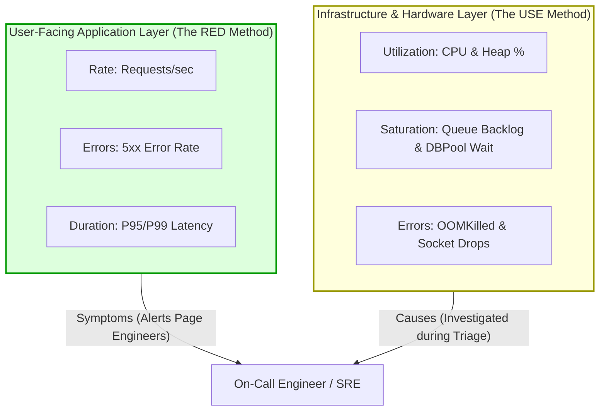

## Fast Revision (10-Second Recall)
- **Google's 4 Golden Signals:** **Latency** (time to service request), **Traffic** (demand/requests per second), **Errors** (rate of requests that fail), and **Saturation** (how "full" the service is).
- **The RED Method (For Services / APIs):** **Rate** (requests per second), **Errors** (failed requests per second), **Duration** (latency distribution). Focuses on user-facing experience.
- **The USE Method (For Infrastructure / Hardware):** **Utilization** (average time resource was busy), **Saturation** (queue depth / pending work), **Errors** (hardware/kernel errors). Focuses on machines and hardware.
- **Metric Cardinality:** Avoid attaching unbounded high-cardinality values (e.g. `user_id`, `email`, `timestamp`) as metric tags to prevent Prometheus/Datadog metric server crashes.
- **Actionability Rule:** Only alert on symptoms affecting users (high error rate, latency breach), not internal mechanical causes (temporary CPU spike).

## The 30-Second Spoken Script
> "When designing production monitoring, we avoid collecting random metrics that clutter dashboards. Instead, we structure our telemetry around established operational frameworks: the **RED method** for microservices and the **USE method** for underlying infrastructure.
>
> For customer-facing APIs, we implement the **RED method**:
> 1. **Rate**: Throughput in requests per second, which identifies unexpected traffic drops or surges.
> 2. **Errors**: HTTP 5xx rates and unhandled application exceptions, tracking our SLA error budget.
> 3. **Duration**: Percentile latency distributions—specifically P50, P95, and P99.
>
> For our host machines, Kubernetes nodes, and databases, we apply Brendan Gregg's **USE method**:
> 1. **Utilization**: Percentage of CPU cores busy, memory heap occupied, or disk I/O bandwidth consumed.
> 2. **Saturation**: Extra work that cannot be serviced immediately—such as OS thread run-queue lengths, database connection pool wait queues, or network socket backlogs.
> 3. **Errors**: Socket drop counts, disk read errors, and OOM kill events.
>
> By strictly dividing monitoring into user-facing symptoms (RED) and infrastructure causes (USE), our engineers can diagnose outages in seconds rather than digging through unrelated charts."

## Scenario / Problem Context
A SaaS company was alerted by angry customer tweets that their invoicing platform was down. The on-call engineer opened the company's Datadog monitoring portal and was confronted by 45 different dashboards containing over 600 unorganized graphs: JVM thread state counters, raw memory page allocations, Linux kernel context switches, and network interface byte rates.

None of the graphs clearly indicated whether users could log in or process invoices. It took the team 50 minutes simply to figure out that the authentication service was rejecting requests because Redis had run out of memory.

The CTO mandated a complete overhaul of production metrics, replacing the chaotic dashboard sprawl with a standardized framework based on Google's Four Golden Signals and the RED/USE methodologies.

## Architectural Workflow / Sequence


## Deep-Dive Analysis & Root Causes

### 1. Google's Four Golden Signals (SRE Handbook)
1. **Latency:** The time it takes to service a request. Differentiate between successful request latency and failed request latency (failing fast with 500 can artificially make your average latency look low!).
2. **Traffic:** A measure of how much demand is placed on your system (e.g. HTTP RPS, network I/O per second, or Kafka messages ingested).
3. **Errors:** The rate of requests that fail, either explicitly (e.g., HTTP 500), implicitly (e.g., HTTP 200 with error payload), or by policy (e.g., response taking longer than 2 seconds).
4. **Saturation:** A measure of how full your service is. Emphasizes the resource that will become constrained first (e.g. CPU, memory, database connection pool, disk space).

### 2. RED vs USE Frameworks

| Dimension | RED Method (Tom Wilkie) | USE Method (Brendan Gregg) |
| :--- | :--- | :--- |
| **Target Scope** | Microservices, APIs, Request-Driven Software | Hardware, OS, Kernels, Databases, Disks |
| **Primary Consumer** | Product Engineers, API Developers | Systems Engineers, SREs, DBAs |
| **Core Metrics** | Rate, Errors, Duration | Utilization, Saturation, Errors |
| **Typical Alerts** | "P95 latency is over 500ms for 5 mins" | "Disk storage is at 92% capacity" |
| **Role in Outages** | **Symptom:** Identifies *what* is broken for users | **Cause:** Identifies *why* the service is choking |

### 3. Metric Cardinality Pitfall
A metric label represents an independent time-series in Prometheus.
- `http_requests_total{method="POST", status="200"}` = ~10 time series (Safe).
- `http_requests_total{user_id="usr_88219"}` = 5,000,000 time series (Kills Prometheus memory and crashes monitoring).
- **Rule:** Never put UUIDs, email addresses, order IDs, or raw timestamps into metric labels.

## Practical Debugging Commands & Code

### Step 1: Exporting RED Metrics via Prometheus Client
```typescript
// src/monitoring/redMetrics.ts
import client from 'prom-client';

// 1. RATE & ERRORS: Counter tracking request throughput and status
export const httpRequestsTotal = new client.Counter({
  name: 'http_requests_total',
  help: 'Total number of HTTP requests processed',
  labelNames: ['service', 'method', 'route', 'status_class'], // e.g. status_class="2xx", "5xx"
});

// 2. DURATION: Histogram tracking request duration percentiles
export const httpRequestDurationSeconds = new client.Histogram({
  name: 'http_request_duration_seconds',
  help: 'Duration of HTTP requests in seconds',
  labelNames: ['service', 'method', 'route'],
  buckets: [0.05, 0.1, 0.25, 0.5, 1, 2.5, 5],
});

// Helper to record RED metrics on request completion
export function recordRedMetrics(service: string, method: string, route: string, statusCode: number, durationSeconds: number) {
  const statusClass = `${Math.floor(statusCode / 100)}xx`;

  httpRequestsTotal.inc({
    service,
    method,
    route,
    status_class: statusClass,
  });

  httpRequestDurationSeconds.observe(
    { service, method, route },
    durationSeconds
  );
}
```

### Step 2: Essential PromQL Queries for RED Metrics

#### Request Rate (RPS):
```promql
sum(rate(http_requests_total{service="payment-svc"}[2m])) by (route)
```

#### Error Rate Percentage (5xx Ratio):
```promql
sum(rate(http_requests_total{service="payment-svc", status_class="5xx"}[2m]))
/
sum(rate(http_requests_total{service="payment-svc"}[2m])) * 100
```

#### P99 Latency (Duration):
```promql
histogram_quantile(0.99, sum(rate(http_request_duration_seconds_bucket{service="payment-svc"}[5m])) by (le))
```

### Step 3: USE Method Queries for Node / Infrastructure

#### CPU Utilization:
```promql
100 - (avg by (instance) (rate(node_cpu_seconds_total{mode="idle"}[2m])) * 100)
```

#### System Saturation (Linux 1-Minute Load Average per CPU Core):
```promql
node_load1 / count by (instance) (node_cpu_seconds_total{mode="idle"})
```

## Prevention & Senior Best Practices
1. **Organize Dashboards by RED on Top, USE on Bottom:** Top panels should display user-facing RED metrics (Rate, Error, Duration). Lower panels display infrastructure USE metrics (CPU, Memory, DB pools).
2. **Alert on Symptoms, Not Causes:** Page the on-call engineer when user error rate or latency breaches SLOs. Do not page an engineer solely because CPU hit 80% if latency and error rates are completely normal.
3. **Prevent Label Cardinality Explosions:** Use static route masks (`/api/v1/users/:id`) rather than raw request URLs in Prometheus tags.
4. **Standardize Naming Across Services:** Enforce identical metric names across all microservices (`http_requests_total`, `http_request_duration_seconds`) so a single Grafana template dashboard works for every service.
5. **Monitor Saturation Before Capacity Exhaustion:** Alert on queue depths and connection wait times early, giving engineers time to scale pods before requests start dropping.

