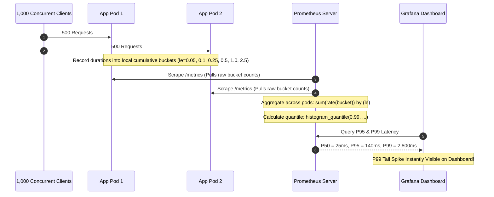

## Fast Revision (10-Second Recall)
- **Why Percentiles Matter:** Averages hide tail outliers. P95 latency is the threshold under which 95% of requests complete; P99 is the threshold under which 99% complete.
- **Histogram vs Summary:** Prometheus Summaries calculate quantiles on the client instance (cannot be aggregated across multiple pods). Prometheus **Histograms** store counts in cumulative buckets, allowing accurate global quantile calculation across hundreds of pods via `histogram_quantile()`.
- **Bucket Boundary Selection:** Quantile accuracy depends entirely on bucket granularity around your target SLA. If your SLA is 200ms, buckets of `[0.1, 0.2, 0.3]` are accurate; buckets of `[0.1, 1.0, 10.0]` produce massive linear interpolation estimation errors.
- **Tail Latency Compounding in Microservices:** If a user request triggers 10 downstream microservice calls in parallel, each with a 1% tail chance (P99), the probability of the user experiencing P99 latency is $1 - (0.99)^{10} \approx 9.56\%$!
- **PromQL Aggregation Invariant:** Always sum the bucket rates *before* computing the quantile: `histogram_quantile(0.95, sum(rate(...)) by (le))`.

## The 30-Second Spoken Script
> "Tracking API P95 and P99 latency requires careful statistical design because naive averages and client-side summaries cannot be safely aggregated across distributed fleets.
>
> In production architectures, we use **Prometheus cumulative Histograms**. Each application pod increments count buckets (such as under 50ms, under 100ms, under 250ms, under 500ms). When calculating our fleet-wide P95 or P99 latency in Grafana or Alertmanager, we execute:
> `histogram_quantile(0.95, sum(rate(http_request_duration_seconds_bucket[5m])) by (le))`
>
> Crucially, we must design our bucket boundaries strategically around our Service Level Objectives (SLOs). Because Prometheus uses linear interpolation inside buckets, having wide bucket gaps will distort tail-latency reporting.
>
> Furthermore, we monitor P99 latency specifically because of **microservice tail compounding**: when an API gateway fans out to 10 microservices, 1 in 10 user requests will suffer the worst-case P99 latency. Tracking and alarming on P99 ensures we catch cold cache misses, lock contention, and garbage collection pauses before they impact aggregate business conversion."

## Scenario / Problem Context
A ride-hailing company was tracking API performance using average latency graphs. Their Grafana dashboard proudly displayed an average response time of 65ms for the dispatch endpoint: `POST /api/v1/rides/request`. Management believed the system was operating well within its 200ms SLA.

However, customer support was flooded with complaints from drivers and riders in dense metro areas reporting that booking requests were hanging for 8 to 12 seconds before failing with timeouts.

When the SRE team inspected the raw distribution:
- 95% of requests were cached or trivial geographic queries taking 20ms.
- 5% of requests (specifically high-density areas with thousands of active drivers) were executing unindexed geospatial spatial queries taking 9,500ms.
The average of 65ms was mathematically accurate, but completely concealed a catastrophic outage for 1 out of every 20 paying customers.

The company urgently needs a robust P95 and P99 latency tracking architecture using Prometheus histograms.

## Architectural Workflow / Sequence


## Deep-Dive Analysis & Root Causes

### 1. The Math of Linear Interpolation in Prometheus
`histogram_quantile(0.95, ...)` does not store every individual latency number (which would require infinite storage). Instead:
1. It identifies which bucket contains the 95th percentile rank.
2. It assumes a uniform distribution of values *inside* that specific bucket and uses linear interpolation to estimate the quantile.
- **Example:** If bucket `le="1.0"` has 90 requests and bucket `le="5.0"` has 100 requests, the 95th percentile request is estimated at 3.0 seconds ($1.0 + (5.0 - 1.0) \times 0.5$).
- **Rule:** Define tighter bucket boundaries around your SLA targets (e.g. `[0.05, 0.1, 0.15, 0.2, 0.25, 0.3, 0.5, 1.0, 2.0, 5.0]`) to ensure high estimation precision.

### 2. Summary vs Histogram in Prometheus

| Feature | Summary (`client.Summary`) | Histogram (`client.Histogram`) |
| :--- | :--- | :--- |
| **Quantile Calculation** | Done directly inside the client process | Calculated on Prometheus server via PromQL |
| **Aggregatable Across Pods?** | **NO.** You cannot average percentiles mathematically! | **YES.** Bucket counts are additive across 100 pods. |
| **Resource Cost** | Higher client CPU/memory; low server load | Low client cost; higher server PromQL computation |
| **Recommendation** | Only for single-instance standalone apps | **Standard choice for cloud-native microservices** |

### 3. The Fallacy of "Averaging Averages or Percentiles"
A common junior mistake in Grafana:
`avg(histogram_quantile(0.95, ...))`
You can never average percentiles together! Mathematically, the 95th percentile of two separate groups is NOT the average of their individual percentiles. You must sum the underlying bucket counters first, then compute the quantile across the aggregated sum:
`histogram_quantile(0.95, sum(rate(...)) by (le))`

## Practical Debugging Commands & Code

### Step 1: Configuring Optimal Histogram Buckets in Node.js
```typescript
// src/metrics/latencyHistogram.ts
import client from 'prom-client';

// Tailored buckets targeting web API SLAs:
// Fine-grained between 25ms and 500ms; coarse-grained up to 10 seconds
const SLA_BUCKETS = [
  0.025, // 25ms
  0.05,  // 50ms
  0.1,   // 100ms
  0.15,  // 150ms
  0.2,   // 200ms (SLA target)
  0.3,   // 300ms
  0.5,   // 500ms
  1.0,   // 1s
  2.5,   // 2.5s
  5.0,   // 5s
  10.0,  // 10s
];

export const apiLatencyHistogram = new client.Histogram({
  name: 'http_request_duration_seconds',
  help: 'HTTP request duration in seconds',
  labelNames: ['route', 'method', 'status_code'],
  buckets: SLA_BUCKETS,
});

// Middleware to record request latency
export function trackLatency(req: any, res: any, next: any) {
  const end = apiLatencyHistogram.startTimer();
  res.on('finish', () => {
    const route = req.route ? req.route.path : 'unmatched';
    end({ route, method: req.method, status_code: res.statusCode });
  });
  next();
}
```

### Step 2: Accurate PromQL Queries for P95 and P99

#### Accurate Global P95 Across All Pods:
```promql
histogram_quantile(0.95, 
  sum(rate(http_request_duration_seconds_bucket{route!~"/healthz.*"}[5m])) by (le)
)
```

#### Accurate P99 Latency Grouped by Route:
```promql
histogram_quantile(0.99, 
  sum(rate(http_request_duration_seconds_bucket[5m])) by (le, route)
)
```

#### Comparing P50 (Median) vs P99 (Tail) on the Same Grafana Chart:
```promql
# Series A: P50 (What normal users experience)
histogram_quantile(0.50, sum(rate(http_request_duration_seconds_bucket[5m])) by (le))

# Series B: P99 (What frustrated tail users experience)
histogram_quantile(0.99, sum(rate(http_request_duration_seconds_bucket[5m])) by (le))
```

### Step 3: Alertmanager Rule for P99 Tail Latency Breach
```yaml
# prometheus-rules/p99-alerts.yaml
groups:
  - name: api_p99_alerts
    rules:
      - alert: ApiTailLatencyP99Breach
        expr: |
          histogram_quantile(0.99, sum(rate(http_request_duration_seconds_bucket{route="/api/v1/checkout"}[5m])) by (le))
          > 1.500
        for: 5m
        labels:
          severity: critical
          team: checkout-core
        annotations:
          summary: "Checkout P99 tail latency exceeded 1.5 seconds"
          description: "1% of checkout users are experiencing latency over {{ $value }}s for the past 5 minutes."
```

## Prevention & Senior Best Practices
1. **Never Calculate Averages:** Ban `avg()` or `mean()` for latency measurements in engineering dashboards and SLAs; mandate P50, P95, and P99 percentiles.
2. **Tune Histogram Buckets Carefully:** Ensure at least 3-4 bucket boundaries exist within your primary SLA target range (e.g. 50ms, 100ms, 150ms, 200ms) to ensure high linear interpolation accuracy.
3. **Always Sum Before Quantile:** In PromQL, always execute `sum(rate(...)) by (le)` before passing to `histogram_quantile()`. Never aggregate after calculating the quantile.
4. **Isolate Health Checks and Static Assets:** Filter out `/healthz`, `/metrics`, and static asset routes (`.png`, `.js`) from latency calculations to prevent skewing user API percentiles.
5. **Account for Compounding Tail Latency:** If an orchestration service calls 8 backend services, budget each microservice at P99.9 rather than P99 to maintain an acceptable overall user experience.

