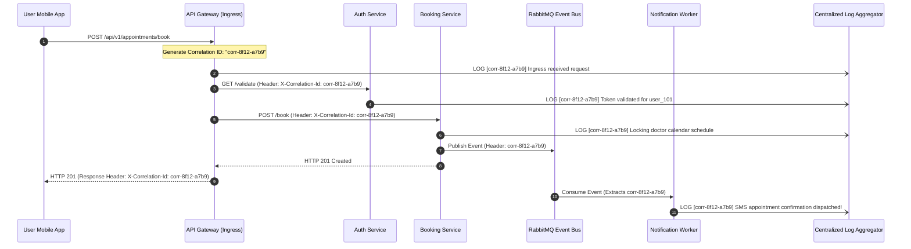

## Fast Revision (10-Second Recall)
- **Correlation ID Definition:** A globally unique identifier (UUIDv4 or ULID) generated at the edge gateway and attached to an incoming request, carried across every microservice, log entry, and async message in that transaction.
- **Correlation ID vs Request ID:**
  - *Request ID (`X-Request-Id`):* Unique to a single HTTP request between client and server.
  - *Correlation ID (`X-Correlation-Id`):* Persists across all downstream calls, database operations, and background jobs spawned by that original request.
- **Context Storage in Node.js:** Stored using `AsyncLocalStorage` so any function or repository can access the active correlation ID without passing it as an explicit function parameter.
- **Log Enrichment:** Every log statement automatically prepends `[correlation_id: <uuid>]` so querying your log aggregator (Loki, Elasticsearch) returns the complete chronological execution narrative across 20 pods.
- **Client Transparency:** Return the correlation ID in response headers (`X-Correlation-Id: <uuid>`) so users and API clients can quote it during support escalations.

## The 30-Second Spoken Script
> "A **Correlation ID** is a unique identifier assigned to a transaction at the system boundary that is passed through every downstream microservice, background queue, and database query involved in fulfilling that request.
>
> In distributed microservice architectures, when a single user action touches 10 different containers across multiple servers, traditional localized logs become useless. Searching for an error by timestamp returns thousands of interleaved, unrelated log lines from other users.
>
> By generating a Correlation ID at the API gateway and passing it via the `X-Correlation-Id` HTTP header and message queue metadata, every microservice injects this ID into its structured JSON logs using runtime context mechanisms like Node's `AsyncLocalStorage` or Java's `MDC` (Mapped Diagnostic Context).
>
> When an incident occurs or an end-user reports a failure, an engineer simply enters that single Correlation ID into Elasticsearch or Grafana Loki. The log viewer immediately displays the complete, chronological story of that transaction from frontend gateway to database, reducing debugging time from hours to seconds."

## Scenario / Problem Context
An online healthcare booking application allowed patients to schedule doctor appointments. A patient clicked "Confirm Appointment." The browser spinner spun for 20 seconds, and then displayed:
`"An unexpected error occurred. Please contact support with reference code: ERR-8821"`

The patient called customer support, who forwarded the ticket to the engineering on-call engineer.

The engineer opened the log aggregator. In that 20-second window, the system had processed 15,000 requests from 4,000 different patients. Searching for "ERR-8821" returned zero results because that was a generic error code generated by the frontend. Searching for "Error" returned 350 unrelated errors.

The engineer had no way of knowing:
- Which specific API container handled the patient's request.
- What database query failed.
- Why the appointment was lost.

The engineering department requires a universal Correlation ID framework across all microservices so any customer request can be traced through logs instantly.

## Architectural Workflow / Sequence


## Deep-Dive Analysis & Root Causes

### 1. Request ID vs Correlation ID
- **Request ID:** Generated per point-to-point HTTP call. Useful for debugging load balancer to server proxy handshakes.
- **Correlation ID:** Identifies the overall user transaction lifecycle across all synchronous and asynchronous boundaries. If Service A makes 3 HTTP calls to Service B, all 3 share the **same Correlation ID**, but each may have a distinct **Request ID**.

### 2. The Context Passing Problem
Passing `correlationId` as a function argument through every layer of code:
`bookingService.create(data, correlationId)`
`appointmentRepo.save(entity, correlationId)`
`smsClient.send(msg, correlationId)`
This pollutes business logic interfaces.
- **Solution:** Use **AsyncLocalStorage** in Node.js, **ThreadLocal / MDC** in Java, or `context.Context` in Go to store the Correlation ID implicitly in the execution thread.

### 3. Edge Gateway Ingestion Rules
When an incoming request arrives at the API gateway:
- If the client already provides an `X-Correlation-Id` (e.g., from a mobile app SDK), sanitize and reuse it.
- If missing, generate a new UUIDv4/ULID.
- Always return the `X-Correlation-Id` in the response header so clients have a reference token for customer support.

## Practical Debugging Commands & Code

### Step 1: Implementing Universal Correlation ID with `AsyncLocalStorage` in Node.js
```typescript
// src/middleware/correlationId.ts
import { AsyncLocalStorage } from 'node:async_hooks';
import { randomUUID } from 'node:crypto';
import { Request, Response, NextFunction } from 'express';

// Global storage for correlation context
export const asyncLocalStorage = new AsyncLocalStorage<Map<string, string>>();

export const CORRELATION_HEADER = 'x-correlation-id';

export function correlationIdMiddleware(req: Request, res: Response, next: NextFunction) {
  // Extract from client header or generate new unique ID
  const correlationId = (req.headers[CORRELATION_HEADER] as string) || `corr-${randomUUID()}`;

  // Mirror correlation ID in outgoing response headers
  res.setHeader(CORRELATION_HEADER, correlationId);

  // Store in AsyncLocalStorage for the lifetime of this request thread
  const store = new Map<string, string>();
  store.set('correlationId', correlationId);

  asyncLocalStorage.run(store, () => {
    next();
  });
}

// Helper to retrieve correlation ID anywhere in the application
export function getCorrelationId(): string {
  const store = asyncLocalStorage.getStore();
  return store?.get('correlationId') || 'no-correlation-id';
}
```

### Step 2: Enriched Structured Logger Automatically Attaching Correlation ID
```typescript
// src/logger.ts
import winston from 'winston';
import { getCorrelationId } from './middleware/correlationId';

export const logger = winston.createLogger({
  level: 'info',
  format: winston.format.combine(
    winston.format.timestamp(),
    winston.format.printf(({ timestamp, level, message, ...meta }) => {
      // Automatically grabs current correlation ID from execution context!
      const correlationId = getCorrelationId();

      return JSON.stringify({
        timestamp,
        level,
        correlation_id: correlationId,
        message,
        ...meta,
      });
    })
  ),
  transports: [new winston.transports.Console()],
});
```

### Step 3: Outgoing HTTP Client Propagating Correlation ID
```typescript
// src/clients/httpClient.ts
import axios from 'axios';
import { getCorrelationId, CORRELATION_HEADER } from '../middleware/correlationId';

export const internalHttpClient = axios.create();

// Interceptor: injects current correlation ID into every outgoing microservice call
internalHttpClient.interceptors.request.use((config) => {
  const correlationId = getCorrelationId();
  if (correlationId !== 'no-correlation-id') {
    config.headers[CORRELATION_HEADER] = correlationId;
  }
  return config;
});
```

### Step 4: Querying Logs by Correlation ID in Grafana Loki
In Grafana Explore (Loki LogQL):
```logql
{cluster="production"} |= "corr-8f12-a7b9" | json
```
Output displays the complete chronological log stream across all containers:
```text
11:02:15.102 [Gateway] Ingress POST /appointments received
11:02:15.140 [AuthService] User token validated: usr_994
11:02:15.220 [BookingService] Acquired lock on doctor schedule
11:02:15.890 [BookingService] Database transaction committed
11:02:15.910 [NotificationWorker] SMS confirmation sent
```

## Prevention & Senior Best Practices
1. **Always Return Correlation ID to the Client:** Include `X-Correlation-Id` in all HTTP response headers so end-users and client SDKs can quote it when reporting defects.
2. **Never Pass Correlation ID as Function Arguments:** Use `AsyncLocalStorage` (Node.js) or `MDC` (Java) to prevent polluting domain service and repository method signatures.
3. **Carry Across Message Queues:** In Kafka, RabbitMQ, and SQS, always copy the Correlation ID into message headers and extract it on consumption.
4. **Sanitize Incoming Headers:** If accepting client-supplied correlation IDs, validate format using regex (`/^[a-zA-Z0-9_-]{1,64}$/`) to prevent header injection attacks.
5. **Enforce JSON Logging in CI:** Reject pull requests that use raw `console.log()` without the structured correlation ID wrapper.

