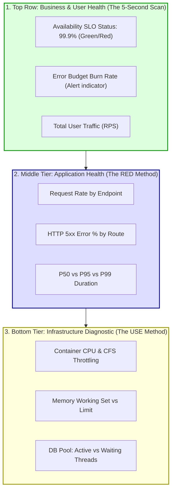

## Fast Revision (10-Second Recall)
- **The 30-Second Rule:** An on-call engineer waking up at 3:00 AM must be able to glance at the dashboard and answer three questions within 30 seconds:
  1. *Is the system broken?*
  2. *What specific user feature is impacted?*
  3. *What component or deployment caused it?*
- **The Inverted Pyramid Layout:** Top: Overall Business & User Health (Status, SLOs, Error Rate). Middle: Application RED Metrics (Rate, Error, Duration). Bottom: Infrastructure USE Metrics (CPU, Memory, DB Pools, Network).
- **Avoid "Dashboard Junk":** A dashboard with 80 tiny charts is unusable during an outage. Stick to 10-15 well-curated, high-impact panels.
- **Consistent Visual Semantics:** Red always means critical failure; Yellow means degraded warning; Green means healthy. Never use red for random metric series like "Memory Available"!
- **Deploy Dashboards as Code:** Version-control all Grafana dashboards as JSON or Jsonnet/Terraform in Git to prevent accidental drift.

## The 30-Second Spoken Script
> "Designing an effective production dashboard is an exercise in cognitive ergonomics and information hierarchy. During a high-stress production outage, engineers suffer from tunnel vision. A dashboard crammed with 60 unorganized charts causes analysis paralysis.
>
> We organize production dashboards using the **Inverted Pyramid** layout:
> At the **very top row**, we display the high-level **Business & User Health**: customer-facing availability SLO status, active error budget burn rate, and a single traffic throughput indicator. If this row is green, the system is operating normally.
> In the **middle tier**, we display the **Application RED Metrics**: Request Rate, HTTP 5xx Error Ratios, and P95/P99 Duration broken down by API route. This section tells the engineer *what* user feature is degraded.
> In the **bottom tier**, we provide drill-down **Infrastructure USE Metrics**: container CPU throttling, memory working set, and database connection pool saturation. This section helps isolate *why* the service is struggling.
>
> We also implement Grafana template variables (allowing on-call engineers to filter by environment, region, or pod) and link every panel directly to corresponding runbooks and trace views."

## Scenario / Problem Context
During a critical platform outage, the on-call engineer opened the company's primary Grafana dashboard: `"Core-Services-Master"`. 

The dashboard contained 94 separate panels arranged randomly by whichever developer happened to add a metric:
- Chart 1: "Disk I/O operations per second on Node 3"
- Chart 14: "Number of garbage collections in Payment Pod"
- Chart 32: "Memory Allocated in MB (Graphed in bright red, even though it was completely normal!)"
- Chart 68: "Total HTTP 200 responses over 30 days"

The engineer scrolled frantically up and down for 25 minutes, overwhelmed by the visual noise. Meanwhile, the checkout API had been failing completely because a single critical panel—"Postgres Active Connection Pool Saturation"—was hidden at the bottom of the page under row 8.

The incident review concluded that the dashboard design itself significantly increased the Mean Time to Detect (MTTD) and Mean Time to Mitigate (MTTM). The SRE lead mandated a complete redesign of all operational dashboards.

## Architectural Workflow / Sequence


## Deep-Dive Analysis & Root Causes

### 1. The Cognitive Load Problem During Incidents
When an engineer is paged at 3:00 AM, cognitive processing capacity drops by up to 50%. 
- Too many charts cause cognitive overload.
- Inconsistent color scales cause confusion.
- Static time ranges (e.g. showing 7 days of data by default) hide acute 5-minute outages.

### 2. The 3 Tiers of Dashboards in an Organization
1. **Executive / Business Dashboard:** Revenue per minute, active daily users, monthly SLA compliance. (Audience: Executives, Product Managers).
2. **Operational Triage Dashboard:** RED metrics, golden signals, error ratios, SLO burn rates. (Audience: On-call SREs, developers on rotation).
3. **Deep Component Diagnostic Dashboard:** JVM GC heap generations, Linux TCP socket buffer sizes, Redis slab allocators. (Audience: Specialist engineers during deep forensic analysis).
- **Rule:** Never mix Deep Component diagnostics into the Operational Triage dashboard!

### 3. Visual Ergonomics & Color Semantics
- **Reserve Red Exclusively for Critical Danger:** If a chart uses red just because it's a pretty color, engineers will misinterpret it as an alert.
- **Overlaid Baselines:** Always show the current metric as a solid line, and the historical 7-day baseline as a faint dashed line (`offset 1w`) so anomalous shifts are instantly obvious.
- **Log Scales for Latency:** Use logarithmic or percentile bucket heatmaps to display latency distributions so both 10ms fast requests and 5,000ms tail spikes are legible on the same screen.

## Practical Debugging Commands & Code

### Step 1: Declarative Grafana Dashboard as Code (Terraform / JSON)
Manage production dashboards via Git rather than clicking through the web UI:

```json
{
  "annotations": { "list": [] },
  "editable": false,
  "fiscalYearStartMonth": 0,
  "graphTooltip": 1,
  "id": null,
  "title": "API Service - SRE Golden Signals",
  "timezone": "utc",
  "panels": [
    {
      "id": 1,
      "title": "Availability SLO Status (Last 30 Days)",
      "type": "stat",
      "gridPos": { "h": 4, "w": 6, "x": 0, "y": 0 },
      "targets": [
        {
          "expr": "100 - (sum(rate(http_requests_total{status=~\"5..\"}[30d])) / sum(rate(http_requests_total[30d])) * 100)",
          "legendFormat": "30-Day Availability %"
        }
      ],
      "thresholds": {
        "mode": "absolute",
        "steps": [
          { "color": "red", "value": null },
          { "color": "yellow", "value": 99.5 },
          { "color": "green", "value": 99.9 }
        ]
      }
    },
    {
      "id": 2,
      "title": "HTTP 5xx Error Ratio",
      "type": "timeseries",
      "gridPos": { "h": 8, "w": 12, "x": 0, "y": 4 },
      "targets": [
        {
          "expr": "sum(rate(http_requests_total{status=~\"5..\"}[2m])) / sum(rate(http_requests_total[2m])) * 100",
          "legendFormat": "5xx Ratio %"
        }
      ]
    },
    {
      "id": 3,
      "title": "P95 & P99 Latency Distribution",
      "type": "timeseries",
      "gridPos": { "h": 8, "w": 12, "x": 12, "y": 4 },
      "targets": [
        {
          "expr": "histogram_quantile(0.95, sum(rate(http_request_duration_seconds_bucket[5m])) by (le))",
          "legendFormat": "P95 Latency"
        },
        {
          "expr": "histogram_quantile(0.99, sum(rate(http_request_duration_seconds_bucket[5m])) by (le))",
          "legendFormat": "P99 Latency (Tail)"
        }
      ]
    }
  ]
}
```

### Step 2: Adding Shared Cursor Sync in Grafana
Enable synchronized time-scrubbing across all charts:
- In Dashboard Settings $\rightarrow$ General $\rightarrow$ Graph Tooltip: Set to **Shared Crosshair** or **Shared Tooltip**.
- When an engineer hovers over a spike on the Error chart, the cursor automatically highlights the exact same millisecond on the CPU and Database charts!

### Step 3: Fast Grafana Dashboard Export & Backup CLI
```bash
# Export production dashboard JSON via Grafana API for Git versioning
curl -s -H "Authorization: Bearer $GRAFANA_API_KEY" \
  https://grafana.internal/api/dashboards/uid/api-golden-signals | \
  jq .dashboard > dashboards/api-golden-signals.json
```

## Prevention & Senior Best Practices
1. **Apply the 30-Second Rule:** Test your dashboard with an engineer who didn't build it. If they cannot identify the simulated bug within 30 seconds, simplify the dashboard.
2. **Follow the Inverted Pyramid:** Place high-level business SLOs at the top, application RED metrics in the middle, and infrastructure USE metrics at the bottom.
3. **Limit Panels to 15 per Dashboard:** Reschedule deep component diagnostics (JVM memory pools, disk sector IOPS) to secondary drill-down dashboards linked via Grafana Data Links.
4. **Use Shared Tooltip Cursors:** Always enable shared crosshairs so hovering over an anomaly aligns timestamps across all graphs simultaneously.
5. **Treat Dashboards as Code:** Never allow ad-hoc manual edits in production Grafana; store dashboards in Git (JSON/Terraform) and enforce pull request reviews for modifications.

