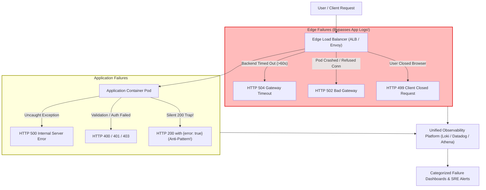

## Fast Revision (10-Second Recall)
- **The Definition of a Failed Request:** An HTTP request that fails to deliver the expected business outcome. Includes explicit HTTP 5xx errors, HTTP 4xx business rejections, silent failures (HTTP 200 with error payload), and dropped requests (TCP timeouts).
- **The Edge Ingress Blind Spot:** If an API gateway or Nginx proxy crashes or times out (HTTP 502/504), the request **never reaches application logs**. You must monitor edge ingress logs (ALB, Cloudflare, Envoy), not just application pods.
- **Silent 200 OK Anti-Pattern:** Legacy systems returning `{ "success": false, "error": "Database error" }` with an HTTP 200 status code completely bypass standard HTTP metrics.
- **Top 4 Failure Categorizations:**
  1. *4xx Client Errors:* Bad payload, authentication missing, unroutable resource.
  2. *5xx Application Errors:* Uncaught exceptions, null pointer bugs.
  3. *5xx Infrastructure Errors:* Gateway timeouts (504), Bad Gateway upstream crash (502).
  4. *Dropped / Aborted:* Client disconnected before response byte sent (`499 Client Closed Request`).
- **Telemetry Sources:** Ingress access logs, Prometheus error metrics, APM exception trackers (Sentry), and distributed trace error flags (`status.code == ERROR`).

## The 30-Second Spoken Script
> "To comprehensively identify failed requests in production, we cannot rely solely on application-level error logs. In reality, a significant portion of failed requests never reach the application at all because they are rejected or dropped at the edge ingress layer.
>
> We identify and categorize failed requests across three distinct observability planes:
> First, **Edge and Ingress Access Logs**: We analyze load balancer logs (such as AWS ALB or Envoy). This captures HTTP 502 Bad Gateway and 504 Gateway Timeout errors where the application hung or died before returning a response, as well as HTTP 499 errors where the user gave up and aborted the request.
> Second, **Standardized HTTP Status and Error Envelopes**: We enforce RFC 7807 (Problem Details for HTTP APIs), eliminating the dangerous anti-pattern of returning HTTP 200 with an internal error object. This allows Prometheus to calculate real-time error rates directly from response status codes.
> Third, **Automated APM Exception Aggregation**: Using OpenTelemetry and Sentry, every failed request records a detailed span error status, capturing the exact exception stack trace, user parameters, and Correlation ID, allowing engineers to reproduce and resolve failures instantly."

## Scenario / Problem Context
A SaaS e-learning platform noticed a 30% drop in course completion rates. Customer complaints started rolling in: *"I clicked Submit Quiz, the screen went blank, and none of my answers were saved."*

The engineering team looked at their application logs:
- Application error logs were completely clean (0 errors recorded).
- Kubernetes pod health checks were returning 200 OK.
- Developers reported: *"The backend is not throwing any errors."*

When an SRE investigated the AWS Application Load Balancer (ALB) access logs, they discovered that the `/api/v1/quizzes/submit` endpoint had received 4,500 requests over the last 2 hours. Over 1,800 of those requests returned **HTTP 504 Gateway Timeout** from the load balancer!

The Node.js backend had a synchronous grading calculation that blocked the single-threaded event loop for 65 seconds. Because the ALB had a 60-second idle timeout, the ALB closed the connection and returned HTTP 504 to the user. The Node.js application eventually finished the calculation 5 seconds later and logged a normal 200 OK, completely oblivious that the user had received an error 5 seconds prior!

The organization needs a unified strategy to capture and identify all failed requests across edge, proxy, and application layers.

## Architectural Workflow / Sequence


## Deep-Dive Analysis & Root Causes

### 1. The Anatomy of Edge Drops
- **HTTP 502 Bad Gateway:** The proxy attempted to connect to the backend pod, but the connection was refused (`ECONNREFUSED`), the container crashed midway, or TLS handshake failed.
- **HTTP 504 Gateway Timeout:** The proxy connected to the backend pod, but the backend did not return response headers within the proxy's `idle_timeout` limit.
- **HTTP 499 Client Closed Request:** Nginx/Envoy status code indicating the client closed the HTTP connection before the server finished sending the response (often caused by user rage-clicking or hitting refresh).

### 2. The Silent HTTP 200 Error Anti-Pattern
Returning:
```json
HTTP/1.1 200 OK
{ "status": "error", "message": "Failed to charge card" }
```
This is a critical architectural anti-pattern:
- Edge proxies and CDN caches treat the response as successful and may cache the error!
- Prometheus RED metrics register the request as successful.
- Upstream circuit breakers fail to trip because they only evaluate HTTP 5xx codes.
- **Rule:** Always return semantic HTTP status codes (e.g. 400 Bad Request, 422 Unprocessable, 500 Internal Error).

### 3. Standardizing Error Envelopes (RFC 7807)
Enforce standard JSON Problem Details across all error responses:
```json
{
  "type": "https://api.example.com/errors/payment-declined",
  "title": "Payment Declined",
  "status": 402,
  "detail": "Card has insufficient funds.",
  "instance": "/orders/ord_123/pay",
  "correlation_id": "corr_9921_abc"
}
```

## Practical Debugging Commands & Code

### Step 1: Querying AWS ALB Access Logs in Amazon Athena
Identify failed requests that never made it to the application:

```sql
-- Query ALB logs in Athena for all 5xx edge errors in the last 2 hours
SELECT 
    request_verb,
    request_url,
    target_status_code,
    elb_status_code,
    target_processing_time,
    client_ip
FROM alb_access_logs
WHERE elb_status_code LIKE '5%' 
  AND parse_datetime(time,'yyyy-MM-dd''T''HH:mm:ss.SSSSSS''Z''') >= now() - interval '2' hour
ORDER BY time DESC
LIMIT 50;
```

### Step 2: Global Express Error Handling Middleware (RFC 7807)
Ensure every application failure returns a proper HTTP status code and structured JSON envelope:

```typescript
// src/middleware/errorHandler.ts
import { Request, Response, NextFunction } from 'express';
import { getCorrelationId } from './correlationId';
import { logger } from '../logger';

export interface AppError extends Error {
  statusCode?: number;
  errorCode?: string;
  details?: any;
}

export function globalErrorHandler(err: AppError, req: Request, res: Response, next: NextFunction) {
  const correlationId = getCorrelationId();
  const statusCode = err.statusCode || 500;
  const errorCode = err.errorCode || 'INTERNAL_SERVER_ERROR';

  // Log error with complete context and stack trace
  logger.error({
    message: err.message,
    status_code: statusCode,
    error_code: errorCode,
    stack: err.stack,
    route: req.path,
    method: req.method,
    correlation_id: correlationId,
  });

  // Return RFC 7807 compliant problem details
  res.status(statusCode).json({
    type: `https://api.company.com/errors/${errorCode.toLowerCase()}`,
    title: err.name || 'Internal Server Error',
    status: statusCode,
    detail: err.message,
    instance: req.originalUrl,
    correlation_id: correlationId,
    timestamp: new Date().toISOString(),
  });
}
```

### Step 3: Fast Production CLI Search for Ingress 5xx Errors
```bash
# Search Nginx Ingress Controller logs for all 502 and 504 errors in real time
kubectl logs -l app.kubernetes.io/name=ingress-nginx -n ingress-nginx --tail=2000 | \
  awk '($9 ~ /50[24]/) {print $4, $7, $9, $10, $11}' | head -n 20

# Search application logs for uncaught exceptions grouped by error message
kubectl logs -l app=order-service -n production --tail=5000 | \
  jq -r 'select(.level=="error") | .message' | sort | uniq -c | sort -nr
```

## Prevention & Senior Best Practices
1. **Monitor Load Balancer Logs Continuously:** Never rely exclusively on container logs. Ingest ALB or Envoy access logs into your centralized log aggregator to detect 502/504 gateway drops.
2. **Eliminate Silent 200 Errors:** Never return HTTP 200 for failed operations. Use semantic 4xx codes for client mistakes and 5xx codes for server failures.
3. **Configure Load Balancer Timeouts to Exceed Application Timeouts:** Set edge proxy idle timeouts (e.g. 30s) higher than internal application timeouts (e.g. 10s) so the application terminates requests cleanly before the proxy cuts the TCP socket.
4. **Log Request Body Metadata on 500 Errors:** When an uncaught exception occurs, log the incoming query parameters, headers, and sanitized body (masking credit cards/passwords) alongside the stack trace.
5. **Track HTTP 499 Disconnections:** Monitor client closed requests (`499`). A surge in 499s indicates that users are actively aborting pages because backend latency has become unacceptable.

