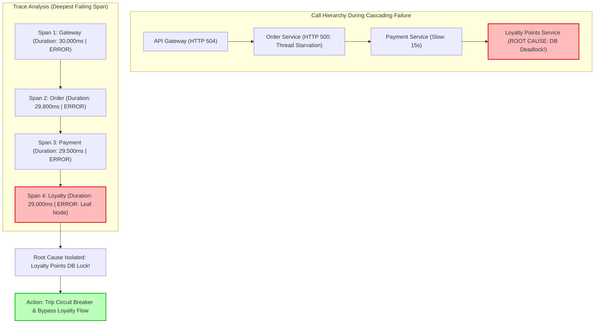

## Fast Revision (10-Second Recall)
- **The Cascading Failure Trap:** When an upstream microservice fails or slows down, every downstream service calling it queues requests, runs out of threads/connections, and crashes in a domino effect.
- **Root Cause vs Symptom Services:** The service generating the most alarms is usually a **victim**, not the perpetrator! The service at the bottom of the call tree whose latency exploded first is the true root cause.
- **The Trace Depth Rule:** Follow the distributed trace tree to the **deepest failing span** (`status.code == ERROR`) that has no failed children. That span marks the exact point of origin.
- **Service Dependency Maps:** Use APM dependency graphs (Datadog Service Map, Jaeger System Architecture) to visualize real-time error flow vectors.
- **Circuit Breakers as Firewalls:** Prevent cascading failures by wrapping inter-service calls in circuit breakers (fail-fast within 50ms instead of hanging for 30s).

## The 30-Second Spoken Script
> "When a cascading failure strikes a microservice cluster, dozens of services turn red on Grafana dashboards simultaneously. Identifying the exact microservice that initiated the failure requires looking at latency precedence and trace hierarchy rather than raw error volume.
>
> In high-reliability engineering, we apply three steps:
> First, **Isolating the Deepest Failing Span**: In our distributed tracing system (such as Jaeger or Grafana Tempo), we filter for traces with error status. We inspect the span tree: the root cause is almost always the **leaf-node span** that failed first—the deepest service in the call chain that threw an error without having any downstream dependencies fail.
> Second, **Time-Series Latency Precedence**: A cascading failure propagates backwards. By inspecting the latency graphs of all services involved, we identify which service's latency slope ticked upward first. If Service C slowed down at 14:02:00, Service B choked at 14:02:30, and Gateway A died at 14:03:00, Service C is the originator.
> Third, **Blast Radius Containment**: Once identified, we verify whether circuit breakers tripped to isolate the offending service, or whether we must apply an emergency traffic shed, rate limit, or fallback flag to restore the rest of the cluster."

## Scenario / Problem Context
An e-commerce platform experienced a catastrophic outage during a Black Friday event. Within 90 seconds, all 8 customer-facing services crashed:
- Web Frontend: 100% HTTP 504 Gateway Timeouts.
- API Gateway: Connection pool saturated; memory at 98%.
- Checkout Service: 8,000 HTTP 500 errors per second.
- Recommendation Service: Unresponsive; Kubernetes restarted pods in a crash loop.
- Order Service: Database connection pool exhausted.

The on-call channel was chaos: four different teams were yelling that their service was being flooded and accusing each other of causing the crash. The executive incident bridge had 25 engineers frantically restarting random pods, which immediately crashed again upon boot.

It took 2 hours to discover the true culprit: a tiny, non-critical **Loyalty Points Microservice** had suffered a database deadlock. Because the Checkout Service called the Loyalty Service synchronously without a timeout or circuit breaker, checkout worker threads were blocked waiting 60 seconds for points balance responses, exhausting connection pools up the chain and taking down the entire multi-million dollar business.

The organization needs a deterministic playbook to pinpoint the root cause microservice within 2 minutes during cascading incidents.

## Architectural Workflow / Sequence


## Deep-Dive Analysis & Root Causes

### 1. The Anatomy of Cascading Failures
Cascading failures occur due to **resource exhaustion propagation**:
1. Service D slows down from 20ms to 10,000ms.
2. Service C calls Service D. Service C's worker threads or HTTP sockets remain open for 10 seconds instead of 20ms.
3. Service C exhausts its internal thread pool or connection limit.
4. Service B calls Service C and now experiences timeouts.
5. Ingress Gateway A exhausts all sockets and begins dropping incoming customer connections with HTTP 504.

### 2. Identifying the Deepest Failing Span
In a distributed trace:
- If Service A fails because Service B failed, both spans are marked `ERROR`.
- If Service B failed because Service C failed, all three spans are marked `ERROR`.
- **The Golden Rule:** The root cause is the span that satisfies:
  1. `span.status == ERROR`
  2. None of its children spans have `span.status == ERROR` (or it has no children at all).
  This eliminates all intermediate victim services instantly.

### 3. Chronological Time-Precedence Analysis
During an incident, look at the Prometheus latency graphs across all services:
- The service whose P99 latency slope climbed first is the instigator.
- Services whose latency climbed later are collateral victims of queue buildup.

## Practical Debugging Commands & Code

### Step 1: OpenTelemetry Trace Query to Pinpoint the Root Failing Span
Using the Jaeger or Tempo API, filter traces and find the root error span:

```bash
# Query Tempo / Jaeger for recent traces with status=error in the checkout pipeline
curl -s "http://jaeger-query:16686/api/traces?service=api-gateway&tags=%7B%22error%22%3A%22true%22%7D&limit=5" | \
  jq '.data[0].spans[] | select(.tags[] | select(.key=="error" and .value==true)) | {service: .processID, operation: .operationName, duration_ms: (.duration / 1000)}'
```

Output clearly exposes the leaf service that failed:
```json
{
  "service": "loyalty-service",
  "operation": "getLoyaltyBalance",
  "duration_ms": 28450,
  "error": "QueryFailedError: deadlock detected on relation loyalty_ledger"
}
```

### Step 2: Correlating Error Timestamps with Prometheus Metrics
Identify which service started throwing errors first:

```promql
# Plot the 5xx error rate across all services on a single chart
sum(rate(http_requests_total{status=~"5.."}[1m])) by (service)
```
Observing the time axis reveals that `loyalty-service` started erroring at 14:02:15, whereas `checkout-service` did not start erroring until 14:03:00.

### Step 3: Implementing Circuit Breakers to Prevent Cascading Failure
Protect upstream services by short-circuiting calls to struggling downstream services:

```typescript
// src/clients/LoyaltyServiceClient.ts
import CircuitBreaker from 'opossum';
import axios from 'axios';

async function fetchLoyaltyBalanceRaw(userId: string) {
  const res = await axios.get(`http://loyalty-svc.internal/users/${userId}/points`, {
    timeout: 1000, // Strict 1-second timeout! Never allow indefinite hanging
  });
  return res.data;
}

// Wrap call in circuit breaker
export const loyaltyBreaker = new CircuitBreaker(fetchLoyaltyBalanceRaw, {
  timeout: 1000,
  errorThresholdPercentage: 50, // Trip if 50% of calls fail or time out
  resetTimeout: 30000,          // Try again after 30 seconds
  volumeThreshold: 10,
});

// Non-critical fallback: If loyalty service fails, return 0 points and allow checkout to proceed!
loyaltyBreaker.fallback(() => ({
  pointsBalance: 0,
  isDegradedFallback: true,
}));

export async function getLoyaltyPoints(userId: string) {
  // Never crashes checkout! Fails fast in 1ms if breaker is OPEN
  return loyaltyBreaker.fire(userId);
}
```

## Prevention & Senior Best Practices
1. **Never Make Synchronous Calls to Non-Critical Services:** Non-essential features (recommendations, loyalty points, marketing banners) must have fail-open fallbacks and strict circuit breakers.
2. **Enforce Mandatory HTTP Timeouts Everywhere:** Ban any HTTP or RPC client configured with infinite default timeouts. Set connect timeouts to 1s and socket timeouts to 2-3s.
3. **Use the Deepest Span Rule in Tracing:** Train all on-call engineers to look for the leaf-node error span in distributed trace graphs to find the root cause within seconds.
4. **Implement Bulkheads:** Isolate resource pools (thread pools, connection pools) so that an outage in one downstream dependency cannot exhaust threads needed for other features.
5. **Decouple with Asynchronous Queues:** For write operations that do not require immediate synchronous customer feedback (e.g. sending emails, recording audit logs), publish to Kafka or SQS instead of blocking HTTP calls.

